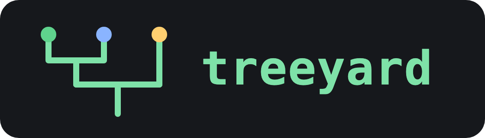
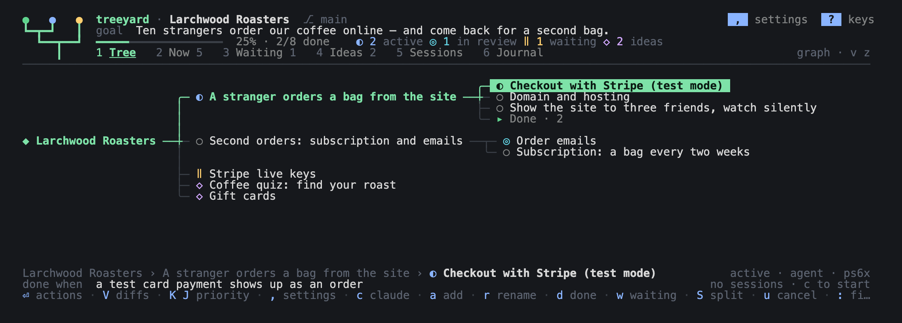
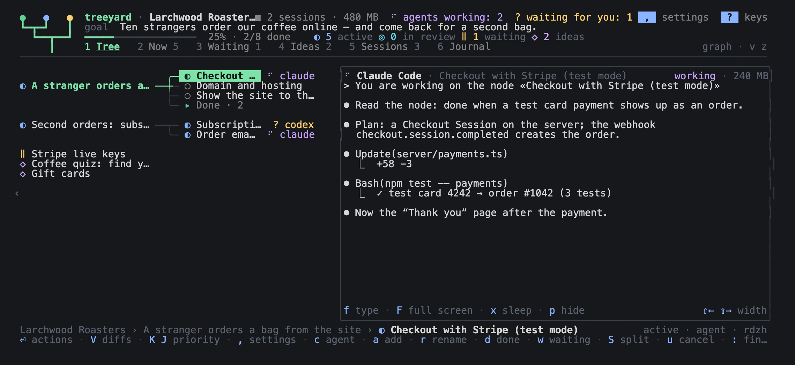
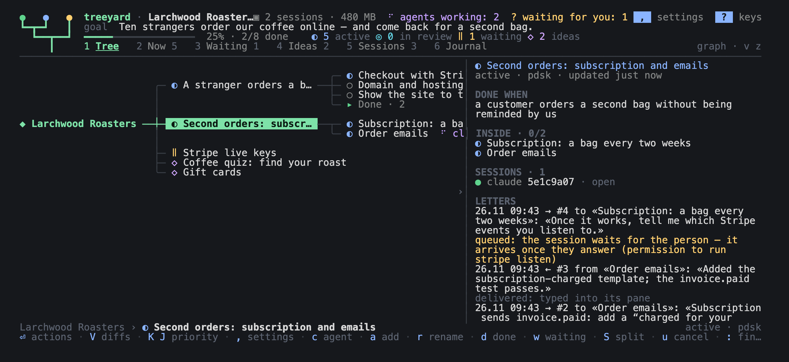
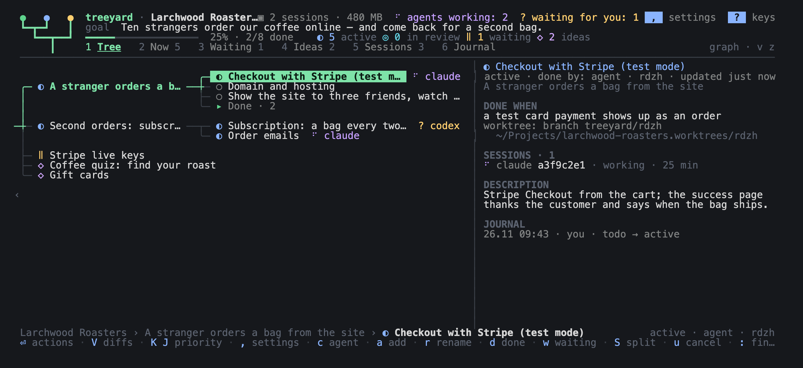
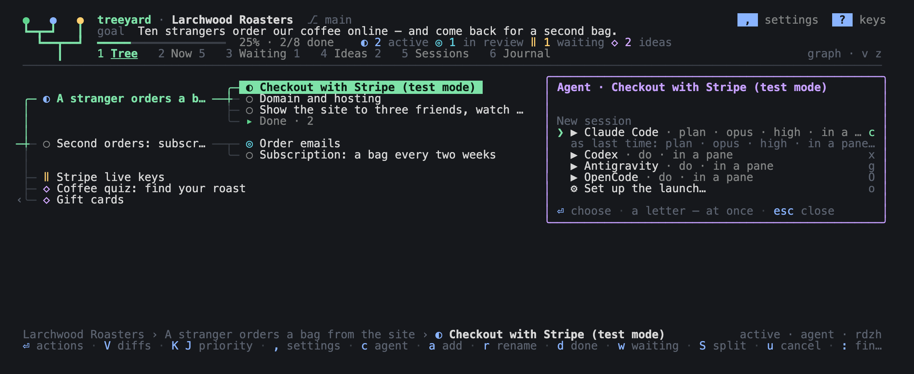
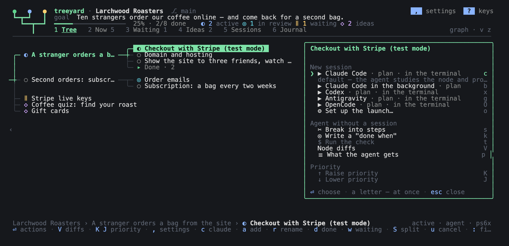

<div align="center">



**Treeyard is a system for Agent-Driven Development (ADD): agents write the code, and you
plan, hand out the tasks and accept the work.**

Planning, building and managing a project in one terminal — on top of Claude Code, Codex,
Antigravity and OpenCode.

A goal graph with dependencies · several agents at once · mail between agents · a git
worktree per node

[](https://github.com/antondanv/treeyard/actions/workflows/ci.yml)
[](https://www.npmjs.com/package/@antondanv/treeyard)

[](LICENSE)

**English** · [Русский](README.ru.md) · [treeyard.ru](https://treeyard.ru)

https://github.com/user-attachments/assets/e2f796e4-2617-4ba7-97e9-ef8ba56e2ed3

</div>

## Quick start

You need Node.js 22+ and at least one agent CLI: Claude Code, Codex, Antigravity or
OpenCode. To have agents work in a pane next to the tree, also install
[tmux](https://github.com/tmux/tmux/wiki/Installing) (the link has the commands for every
system); without it, sessions open in this terminal.

```sh
npm install -g @antondanv/treeyard
cd my-project && treeyard                  # no tree yet: the planting wizard
```

On the first run there is no tree yet, and the wizard asks how to plant it. With an agent:
in an empty folder it asks you to tell everything you think about the project, in a
folder with code it reads the code, the documents and the history first; then it asks
questions and writes the tree only after your “yes”. Or on your own, from a template: a
couple of questions, and the tree is ready.

Once the tree is open, `c` opens the agent menu: the one you launched last on top, with the
same settings, the other CLIs below; `c` `⏎` repeats the last launch. `?` shows all the
keys, `,` opens the settings (the language, the theme and the rest). Other ways in:

```sh
treeyard init                              # a new tree: with an agent or from a template
treeyard init --agent --brain codex        # straight to the agent, no wizard
treeyard import                            # the agent quietly reads the project's plan and builds the tree
```

**Contents**

- [What it is and why you'd want it](#what-it-is-and-why-youd-want-it)
- [What it looks like](#what-it-looks-like)
- [How you work with it](#how-you-work-with-it)
- [Several agents at once](#several-agents-at-once)
- [What agents are allowed to do](#what-agents-are-allowed-to-do)
- [The vibe-coding practices built in](#the-vibe-coding-practices-built-in)
- [When to use it and when not](#when-to-use-it-and-when-not)
- [In numbers](#in-numbers)
- [Why I built it](#why-i-built-it)
- [Documentation](#documentation)
- [Contributing](#contributing)

## What it is and why you'd want it

You already work with Claude Code or Codex, and the project's rules are in `AGENTS.md` or
`CLAUDE.md`. And still you know how it goes. The code is written in an evening, and the
project has been “almost ready” for a month. The plan has grown into a file thousands of
lines long, and the agent rereads it in every session. You ask for one thing and get
three more “while I was at it”. The agent says “done”, and it doesn't work. A week later
you can't tell where you stopped.

Treeyard puts the whole project into one tree on your screen: the goal at the top,
milestones under it, tasks under them. All of them are nodes of the tree. You plan in the
tree, start agents from its nodes, and see in it what is done, what is in progress and
where things are stuck.



### “I already have AGENTS.md and CLAUDE.md”

Keep them: they hold the rules — the stack, the commands, the style. But the rules are
the same for every task, and they say nothing about where the project stands. So a
`PLAN.md` or a `ROADMAP.md` appears next to them, and the trouble starts:

- it grows to thousands of lines, and the agent reads all of it in every session: tokens
  spent, instructions blurred;
- the agent ticks its own boxes, and “done” there doesn't mean “works”;
- two agents edit the same file and know nothing about each other;
- your own steps, and everything that waits for a server or a payment provider, get lost
  among the items.

Treeyard leaves only the rules in `AGENTS.md` and moves the plan and the state of the
project into the tree. Each task is a file of its own, with a status and a journal, and
an agent gets the context of its one task, not the whole plan. And it is still Markdown
in your repository: it lives in `.tree/` and is committed along with the code.

### You have an idea and don't know where to start

Open an empty folder and run `treeyard`. Say it the way it comes: plain text, in any
order. The agent asks questions and offers its own answer to each one; you correct it and
tell it more. The idea in your head becomes a plan on the screen: the goal, the first
result you can check in real life, and the tasks on the way to it — including the ones no
agent will do for you: a server, a domain, payments.

### You already have a project, and it is big

Run `treeyard` in the project's folder. The agent reads the code, the documents and the
history on its own and tells you what it found: what really works, what was promised and
never done, where the loose ends are. Then it asks a few questions and builds a tree of
the project. On it you see what is done, what is in progress and where you have hit a
wall — with the reason and with what has to happen before you can move on. At any moment
an agent can review the whole tree and show what has stalled, what has grown too big and
what it is time to pick up.

### From there, you see your project

Pick a task and open Claude Code or Codex on it, right next to the tree. The agent starts
with the context of this very task: why it exists, what is next to it, what the project's
rules are. It doesn't need to read the whole plan. It doesn't close its own work either:
it shows proof, and you accept. With several agents running, the tree shows who is
working and who is waiting for your answer. Back after a week? Every task keeps its own
journal, and one list shows everything you can do right now.

That is Agent-Driven Development: you plan, the agents build, and you manage the project
and accept the work.

## What it looks like

Scroll sideways.

<!-- The non-breaking spaces under each caption keep the columns wide: GitHub squeezes images in a table to the page's width, and this way the row scrolls sideways instead. -->
<table>
<tr>
<td></td>
<td></td>
<td></td>
<td></td>
<td></td>
</tr>
<tr>
<td>Three agents at once: one in a pane, one waiting for you, one in the background<br>&nbsp;&nbsp;&nbsp;&nbsp;&nbsp;&nbsp;&nbsp;&nbsp;&nbsp;&nbsp;&nbsp;&nbsp;&nbsp;&nbsp;&nbsp;&nbsp;&nbsp;&nbsp;&nbsp;&nbsp;&nbsp;&nbsp;&nbsp;&nbsp;&nbsp;&nbsp;&nbsp;&nbsp;&nbsp;&nbsp;&nbsp;&nbsp;&nbsp;&nbsp;&nbsp;&nbsp;&nbsp;&nbsp;&nbsp;&nbsp;&nbsp;&nbsp;&nbsp;&nbsp;&nbsp;&nbsp;&nbsp;&nbsp;&nbsp;&nbsp;&nbsp;&nbsp;&nbsp;&nbsp;&nbsp;&nbsp;&nbsp;&nbsp;&nbsp;&nbsp;&nbsp;&nbsp;&nbsp;&nbsp;&nbsp;&nbsp;&nbsp;&nbsp;&nbsp;&nbsp;&nbsp;&nbsp;&nbsp;&nbsp;&nbsp;&nbsp;&nbsp;&nbsp;&nbsp;&nbsp;&nbsp;&nbsp;&nbsp;&nbsp;&nbsp;&nbsp;&nbsp;&nbsp;&nbsp;&nbsp;&nbsp;&nbsp;&nbsp;&nbsp;&nbsp;&nbsp;&nbsp;&nbsp;&nbsp;&nbsp;&nbsp;&nbsp;&nbsp;&nbsp;&nbsp;&nbsp;&nbsp;&nbsp;&nbsp;&nbsp;&nbsp;&nbsp;&nbsp;&nbsp;&nbsp;&nbsp;&nbsp;&nbsp;&nbsp;&nbsp;&nbsp;&nbsp;&nbsp;&nbsp;&nbsp;&nbsp;&nbsp;&nbsp;&nbsp;&nbsp;&nbsp;&nbsp;&nbsp;&nbsp;&nbsp;&nbsp;&nbsp;&nbsp;&nbsp;&nbsp;&nbsp;&nbsp;&nbsp;&nbsp;&nbsp;&nbsp;&nbsp;&nbsp;&nbsp;&nbsp;&nbsp;&nbsp;&nbsp;&nbsp;&nbsp;&nbsp;&nbsp;&nbsp;&nbsp;&nbsp;&nbsp;&nbsp;&nbsp;&nbsp;&nbsp;&nbsp;&nbsp;&nbsp;&nbsp;&nbsp;</td>
<td>Messages between sessions: which one arrived and which one waits<br>&nbsp;&nbsp;&nbsp;&nbsp;&nbsp;&nbsp;&nbsp;&nbsp;&nbsp;&nbsp;&nbsp;&nbsp;&nbsp;&nbsp;&nbsp;&nbsp;&nbsp;&nbsp;&nbsp;&nbsp;&nbsp;&nbsp;&nbsp;&nbsp;&nbsp;&nbsp;&nbsp;&nbsp;&nbsp;&nbsp;&nbsp;&nbsp;&nbsp;&nbsp;&nbsp;&nbsp;&nbsp;&nbsp;&nbsp;&nbsp;&nbsp;&nbsp;&nbsp;&nbsp;&nbsp;&nbsp;&nbsp;&nbsp;&nbsp;&nbsp;&nbsp;&nbsp;&nbsp;&nbsp;&nbsp;&nbsp;&nbsp;&nbsp;&nbsp;&nbsp;&nbsp;&nbsp;&nbsp;&nbsp;&nbsp;&nbsp;&nbsp;&nbsp;&nbsp;&nbsp;&nbsp;&nbsp;&nbsp;&nbsp;&nbsp;&nbsp;&nbsp;&nbsp;&nbsp;&nbsp;&nbsp;&nbsp;&nbsp;&nbsp;&nbsp;&nbsp;&nbsp;&nbsp;&nbsp;&nbsp;&nbsp;&nbsp;&nbsp;&nbsp;&nbsp;&nbsp;&nbsp;&nbsp;&nbsp;&nbsp;&nbsp;&nbsp;&nbsp;&nbsp;&nbsp;&nbsp;&nbsp;&nbsp;&nbsp;&nbsp;&nbsp;&nbsp;&nbsp;&nbsp;&nbsp;&nbsp;&nbsp;&nbsp;&nbsp;&nbsp;&nbsp;&nbsp;&nbsp;&nbsp;&nbsp;&nbsp;&nbsp;&nbsp;&nbsp;&nbsp;&nbsp;&nbsp;&nbsp;&nbsp;&nbsp;&nbsp;&nbsp;&nbsp;&nbsp;&nbsp;&nbsp;&nbsp;&nbsp;&nbsp;&nbsp;&nbsp;&nbsp;&nbsp;&nbsp;&nbsp;&nbsp;&nbsp;&nbsp;&nbsp;&nbsp;&nbsp;&nbsp;&nbsp;&nbsp;&nbsp;&nbsp;&nbsp;&nbsp;&nbsp;&nbsp;&nbsp;&nbsp;&nbsp;&nbsp;&nbsp;</td>
<td>A node gets its own git worktree and branch; the tree stays one<br>&nbsp;&nbsp;&nbsp;&nbsp;&nbsp;&nbsp;&nbsp;&nbsp;&nbsp;&nbsp;&nbsp;&nbsp;&nbsp;&nbsp;&nbsp;&nbsp;&nbsp;&nbsp;&nbsp;&nbsp;&nbsp;&nbsp;&nbsp;&nbsp;&nbsp;&nbsp;&nbsp;&nbsp;&nbsp;&nbsp;&nbsp;&nbsp;&nbsp;&nbsp;&nbsp;&nbsp;&nbsp;&nbsp;&nbsp;&nbsp;&nbsp;&nbsp;&nbsp;&nbsp;&nbsp;&nbsp;&nbsp;&nbsp;&nbsp;&nbsp;&nbsp;&nbsp;&nbsp;&nbsp;&nbsp;&nbsp;&nbsp;&nbsp;&nbsp;&nbsp;&nbsp;&nbsp;&nbsp;&nbsp;&nbsp;&nbsp;&nbsp;&nbsp;&nbsp;&nbsp;&nbsp;&nbsp;&nbsp;&nbsp;&nbsp;&nbsp;&nbsp;&nbsp;&nbsp;&nbsp;&nbsp;&nbsp;&nbsp;&nbsp;&nbsp;&nbsp;&nbsp;&nbsp;&nbsp;&nbsp;&nbsp;&nbsp;&nbsp;&nbsp;&nbsp;&nbsp;&nbsp;&nbsp;&nbsp;&nbsp;&nbsp;&nbsp;&nbsp;&nbsp;&nbsp;&nbsp;&nbsp;&nbsp;&nbsp;&nbsp;&nbsp;&nbsp;&nbsp;&nbsp;&nbsp;&nbsp;&nbsp;&nbsp;&nbsp;&nbsp;&nbsp;&nbsp;&nbsp;&nbsp;&nbsp;&nbsp;&nbsp;&nbsp;&nbsp;&nbsp;&nbsp;&nbsp;&nbsp;&nbsp;&nbsp;&nbsp;&nbsp;&nbsp;&nbsp;&nbsp;&nbsp;&nbsp;&nbsp;&nbsp;&nbsp;&nbsp;&nbsp;&nbsp;&nbsp;&nbsp;&nbsp;&nbsp;&nbsp;&nbsp;&nbsp;&nbsp;&nbsp;&nbsp;&nbsp;&nbsp;&nbsp;&nbsp;&nbsp;&nbsp;&nbsp;&nbsp;&nbsp;&nbsp;&nbsp;&nbsp;</td>
<td><code>c</code> — the agent menu, the last launch on top with all its settings<br>&nbsp;&nbsp;&nbsp;&nbsp;&nbsp;&nbsp;&nbsp;&nbsp;&nbsp;&nbsp;&nbsp;&nbsp;&nbsp;&nbsp;&nbsp;&nbsp;&nbsp;&nbsp;&nbsp;&nbsp;&nbsp;&nbsp;&nbsp;&nbsp;&nbsp;&nbsp;&nbsp;&nbsp;&nbsp;&nbsp;&nbsp;&nbsp;&nbsp;&nbsp;&nbsp;&nbsp;&nbsp;&nbsp;&nbsp;&nbsp;&nbsp;&nbsp;&nbsp;&nbsp;&nbsp;&nbsp;&nbsp;&nbsp;&nbsp;&nbsp;&nbsp;&nbsp;&nbsp;&nbsp;&nbsp;&nbsp;&nbsp;&nbsp;&nbsp;&nbsp;&nbsp;&nbsp;&nbsp;&nbsp;&nbsp;&nbsp;&nbsp;&nbsp;&nbsp;&nbsp;&nbsp;&nbsp;&nbsp;&nbsp;&nbsp;&nbsp;&nbsp;&nbsp;&nbsp;&nbsp;&nbsp;&nbsp;&nbsp;&nbsp;&nbsp;&nbsp;&nbsp;&nbsp;&nbsp;&nbsp;&nbsp;&nbsp;&nbsp;&nbsp;&nbsp;&nbsp;&nbsp;&nbsp;&nbsp;&nbsp;&nbsp;&nbsp;&nbsp;&nbsp;&nbsp;&nbsp;&nbsp;&nbsp;&nbsp;&nbsp;&nbsp;&nbsp;&nbsp;&nbsp;&nbsp;&nbsp;&nbsp;&nbsp;&nbsp;&nbsp;&nbsp;&nbsp;&nbsp;&nbsp;&nbsp;&nbsp;&nbsp;&nbsp;&nbsp;&nbsp;&nbsp;&nbsp;&nbsp;&nbsp;&nbsp;&nbsp;&nbsp;&nbsp;&nbsp;&nbsp;&nbsp;&nbsp;&nbsp;&nbsp;&nbsp;&nbsp;&nbsp;&nbsp;&nbsp;&nbsp;&nbsp;&nbsp;&nbsp;&nbsp;&nbsp;&nbsp;&nbsp;&nbsp;&nbsp;&nbsp;&nbsp;&nbsp;&nbsp;&nbsp;&nbsp;&nbsp;&nbsp;&nbsp;&nbsp;&nbsp;</td>
<td><code>⏎</code> — everything about the node: sessions, agent tasks, the check, diffs<br>&nbsp;&nbsp;&nbsp;&nbsp;&nbsp;&nbsp;&nbsp;&nbsp;&nbsp;&nbsp;&nbsp;&nbsp;&nbsp;&nbsp;&nbsp;&nbsp;&nbsp;&nbsp;&nbsp;&nbsp;&nbsp;&nbsp;&nbsp;&nbsp;&nbsp;&nbsp;&nbsp;&nbsp;&nbsp;&nbsp;&nbsp;&nbsp;&nbsp;&nbsp;&nbsp;&nbsp;&nbsp;&nbsp;&nbsp;&nbsp;&nbsp;&nbsp;&nbsp;&nbsp;&nbsp;&nbsp;&nbsp;&nbsp;&nbsp;&nbsp;&nbsp;&nbsp;&nbsp;&nbsp;&nbsp;&nbsp;&nbsp;&nbsp;&nbsp;&nbsp;&nbsp;&nbsp;&nbsp;&nbsp;&nbsp;&nbsp;&nbsp;&nbsp;&nbsp;&nbsp;&nbsp;&nbsp;&nbsp;&nbsp;&nbsp;&nbsp;&nbsp;&nbsp;&nbsp;&nbsp;&nbsp;&nbsp;&nbsp;&nbsp;&nbsp;&nbsp;&nbsp;&nbsp;&nbsp;&nbsp;&nbsp;&nbsp;&nbsp;&nbsp;&nbsp;&nbsp;&nbsp;&nbsp;&nbsp;&nbsp;&nbsp;&nbsp;&nbsp;&nbsp;&nbsp;&nbsp;&nbsp;&nbsp;&nbsp;&nbsp;&nbsp;&nbsp;&nbsp;&nbsp;&nbsp;&nbsp;&nbsp;&nbsp;&nbsp;&nbsp;&nbsp;&nbsp;&nbsp;&nbsp;&nbsp;&nbsp;&nbsp;&nbsp;&nbsp;&nbsp;&nbsp;&nbsp;&nbsp;&nbsp;&nbsp;&nbsp;&nbsp;&nbsp;&nbsp;&nbsp;&nbsp;&nbsp;&nbsp;&nbsp;&nbsp;&nbsp;&nbsp;&nbsp;&nbsp;&nbsp;&nbsp;&nbsp;&nbsp;&nbsp;&nbsp;&nbsp;&nbsp;&nbsp;&nbsp;&nbsp;&nbsp;&nbsp;&nbsp;&nbsp;&nbsp;&nbsp;&nbsp;&nbsp;&nbsp;&nbsp;</td>
</tr>
</table>

## How you work with it

1. **Now** (`2`) lists everything you can do right now, across all branches. Pick a node.
2. `c` opens the agent menu: the one you launched last on top, with its settings, the other
   CLIs below. Pick one, and its session for the node opens in a pane next to the tree;
   `c` `⏎` repeats the last launch.
3. The agent gets the node's context, studies the code and proposes a plan. You agree; it
   works.
4. When the task is finished, the agent sets **in review** and shows proof: a command and
   its output, a screenshot, its commits (`V`). You look and press `d` — **done**.
5. Hit something outside — `w`: **waiting**, with a reason and when to come back. Go to
   another branch.
6. A new idea on the way — `a`, as an idea. Once a week, look through **Waiting** (`3`):
   has the condition come?

## Several agents at once

When there is a lot to do, one session can become the coordinator. Tell it “do the
subscription branch”, and it hands the nodes to other sessions, watches them, answers their
questions and accepts the work. You see all of it in the tree: who is working, who is
waiting for you, who is done.

### The coordinator

- The `treeyard-coordinate` skill teaches an agent this job. It picks nodes that touch
  different files, opens them in panes or in the background
  (`treeyard open a b c --pane --task "…"`), waits (`treeyard wait`), accepts the work by its
  diff and its checks, merges the branches and moves the nodes to review.
- `treeyard queue` starts a branch's nodes in turn, no more than a set number at once. A node
  with `needs` starts only once the nodes it depends on are in review or done. When the
  subscription window is nearly used up, the queue waits for it to reset.
- When two active nodes change the same file, `wait` and `queue` notice and tell both
  sessions.

### Messages between sessions

- `treeyard send <node> "…"` writes to the node's session that is already open instead of
  starting a new one. A free session gets the message at once, a sleeping one wakes up, a
  busy one gets it after its turn. With a hook installed (`treeyard hook claude install`;
  Codex, Antigravity and OpenCode have one too) it arrives even mid-turn, between two tool
  calls.
- `--wait` waits for the answer. Answering an agent's question or permission request
  (`--answer`, `--approve`, `--reject`) is yours alone: another agent's message doesn't pass
  for your word.
- Every message stays a line in both nodes' journals, and the node's card shows whether it
  arrived or still waits. If two agents start bouncing messages with no work in between,
  treeyard holds back the next one after six in a row.

### A git worktree per node

`treeyard open <id> --worktree` (or the same box in the launch form) opens a session of any
CLI in a git worktree of its own, on the branch `treeyard/<id>`. Agents don't get in each
other's way in one folder, the branch's commits count as the node's commits, and there is
still one tree for everyone. `treeyard worktree rm --done` removes the merged worktrees of
closed nodes. Branches that touch different nodes merge without conflicts in the tree's
overview: `.tree/README.md` has a merge driver of its own.

### Agents know about the tree on their own

- The `treeyard`, `treeyard-init` and `treeyard-coordinate` skills are installed into Claude
  Code, Codex and Antigravity and updated along with treeyard. Even a plain `claude` started
  in the project's folder knows how to keep the tree.
- `treeyard status` shows the whole setup on one screen: the tree, the skills, the hooks, live
  sessions. Each problem comes with the command that fixes it.
- The commit hook (`treeyard hook install`) attaches a session's commits to its node by
  itself.

## What agents are allowed to do

- **Claude Code**, **OpenCode** — what their own settings allow; treeyard adds nothing. A
  “plan” start opens Claude Code in plan mode and OpenCode with its plan agent:
  no edits until you agree.
- **Codex**'s default sandbox keeps the tmux socket and the project's `.git` shut, so
  `treeyard send` and `git commit` fail in its session. Before its first launch treeyard asks
  you once: the **sandbox + treeyard and git** (workspace-write with the network and `.git`
  open, the rest from config.toml) or **as in config.toml**. Change it later in `,`;
  `treeyard status` names the config.toml lines if the sandbox stays shut.
- **Antigravity** asks before every command, so before its first launch treeyard asks you
  once: **full access** (commands, files and the network with no confirmations,
  `--dangerously-skip-permissions`) or its **ordinary mode**. Change it later in `,`.
- **Break into steps** and **write a “done when”** — read-only, whichever agent does them.

Before each launch the confirmation shows what access the agent gets. Details —
[What agents may do](docs/reference.md#what-agents-may-do).

## The vibe-coding practices built in

Treeyard doesn't just show tasks. It has rules built in that save tokens and time and
raise the quality of what you ship. You don't have to police them yourself: the tool
works that way.

| What Treeyard does | What you get |
| --- | --- |
| An agent gets the context of its own task only | A session starts with about 3k tokens instead of 65k for the whole plan, and short instructions don't get lost |
| One task — one session | The agent finishes the task while its context is fresh; no endless “just a bit more” |
| A plan first, then code | A mistake is caught in the plan, not in code already written |
| An agent can't mark its own work done; it shows proof | Fewer “done, but it doesn't work”: there is a command with its output, a screenshot, the commits |
| A new idea is a separate task, not “while I'm at it” | Tokens and time go into what you asked for, and ideas aren't lost |
| History lives in the task's journal, decisions in one place with their reasons | A new session doesn't reread a log thousands of lines long; what was decided, and why, is written down once |
| A goal from real life, your own steps in the plan, a “waiting” status | The project doesn't stall on a server, a domain or payments: they are visible from day one, and work goes on in other branches |

The rules come from my own projects and from practices other people have tested for
years: Mikado, Shape Up, GTD, Anthropic's recommendations for Claude Code. All twelve are
on one page — [docs/practice.md](docs/practice.md).

## When to use it and when not

**Use it when**

- the project lives longer than one session — days, weeks, months;
- there are several directions at once, and some of them wait for the outside world;
- part of the work is yours alone: a server, a domain, payments, a contract, showing it to
  people;
- you run several agents or several CLIs in parallel and want to see who is doing what;
- you keep several projects and come back to one after a break: the tree and the journals
  say where you stopped.

**Don't, when**

- it's one small task: write a script, fix a bug, answer a question. Open plain `claude`
  or `codex` — planting a tree, criteria and statuses won't pay off;
- it's a throwaway prototype for one evening;
- a team already lives in its own tracker: Treeyard is made for one person with agents (it
  does sync with a GitHub Project board, though).

Treeyard doesn't write code itself — your agents do. It keeps the plan, gives each agent
its task and shows where the project stands.

## In numbers

- **~95% fewer tokens to get an agent going.** A session opened from a node starts with
  about 3k tokens of context: 2.6k–4.0k, median 3.0k over seven nodes of this repository's
  tree. Handing the agent the whole plan instead — every node with its description and
  journal — is 65k tokens on the same tree of 105 nodes, 84k with `docs/` and the README:
  the node's context is 95–96% smaller. Even the one-page overview (`treeyard show`, 5.5k)
  is almost twice as big.
- **The saving grows with the tree.** On a fresh tree of 12 nodes the whole plan (1.0k) is
  smaller than a node's context (1.7k), so there is nothing to save yet. And most of a
  session's tokens go into the code itself, not into its start.
- **Built with itself.** Treeyard has been run by its own tree since the first commit: in
  five days, 108 commits, 41 nodes done and 18 more in review, 35 agent sessions opened
  from nodes (2026-10-02 → 2026-10-06).

<sub>How the tokens were counted (2026-10-06): `treeyard context <id>` into a file, then
`claude -p "/context" --system-prompt-file <file>` — Claude's own tokenizer, checked
against a real request (3,387 tokens against “3.4k”). Codex and Gemini count with their
own tokenizers.</sub>

## Why I built it

I built Treeyard out of my own vibe coding. With agents, code gets written fast — and then
the project stalls. It stalls on the steps only a person can take: a server, a domain,
payments, showing it to a real person. Meanwhile the agents get side features, the plan
grows into a log thousands of lines long, and every new session starts by rereading it.
Code: done. Project: stuck.

Treeyard is the practices that got my projects past that point, put into one tool. I run
my own projects this way, Treeyard itself included.

## Documentation

- [docs/reference.md](docs/reference.md) — everything in detail: planting a tree, the
  interface, keys and mouse, settings, sessions in panes, the CLI commands for you and
  for agents, node diffs, pictures, shared nodes, GitHub issues and a Project board.
- [docs/practice.md](docs/practice.md) — how to run a project as a tree: twelve rules and
  the templates (Stages, Directions, Mikado, Finding improvements, Client work).
- [docs/architecture.md](docs/architecture.md) — how Treeyard is built.

In the terminal: `?` shows all the keys, `treeyard help` all the commands.

## Contributing

Treeyard is made by one person, and help is welcome. Issues and pull requests are fine in
English or in Russian.

- Found a bug — open an [issue](https://github.com/antondanv/treeyard/issues/new?template=bug_report.yml):
  the form asks for the versions and the setup; you tell what you did, what you expected and
  what happened.
- A typo, an obvious bug or a missing test can come straight as a pull request.
- A new feature or different behaviour — talk it over in an
  [issue](https://github.com/antondanv/treeyard/issues/new?template=feature_request.yml)
  first. The project has a direction ([docs/vision.md](docs/vision.md)), and a short talk
  saves a pull request that won't be merged.
- Leave `.tree/` out of pull requests: it is the maintainer's working plan and gets updated
  separately.

Build and check the project:

```sh
git clone https://github.com/antondanv/treeyard && cd treeyard
npm install                     # with NODE_ENV=production: npm install --include=dev
npm run build && npm link       # the treeyard command from dist/
npm run dev -- <args>           # treeyard from the sources (tsx)
npm run typecheck && npm test && npm run lint && npm run build
npm run screenshots             # the README's pictures again, in English and in Russian (needs Chrome)
FORCE_COLOR=2 npx tsx scripts/screenshot.ts ../my-app shot.png 130x36   # a PNG of the interface
```

Sessions, panes and models go through [Brainyard](https://github.com/antondanv/brainyard)
(`@antondanv/brainyard`), one layer for every agent CLI.

The rest — how to name branches and commits, what to write in a pull request, how to check
what a person sees — is in the [contributing guide](CONTRIBUTING.md).

## License

[Apache 2.0](LICENSE)
