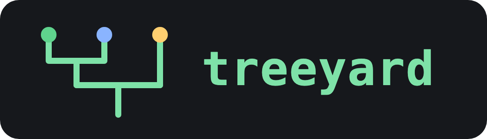
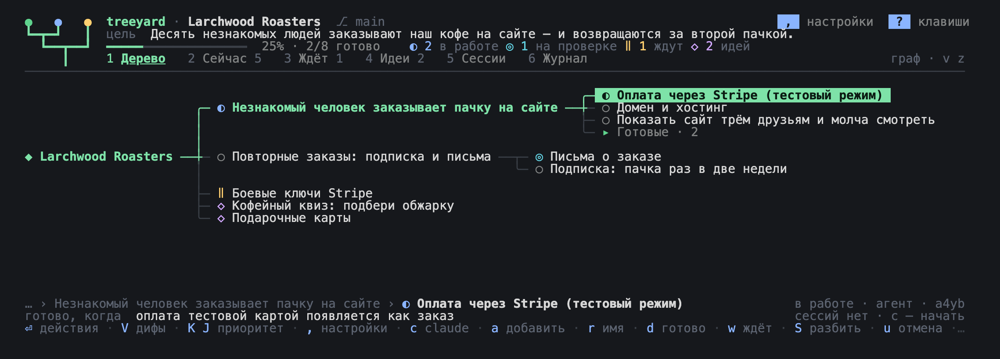
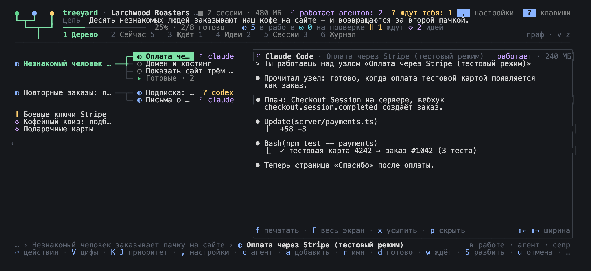
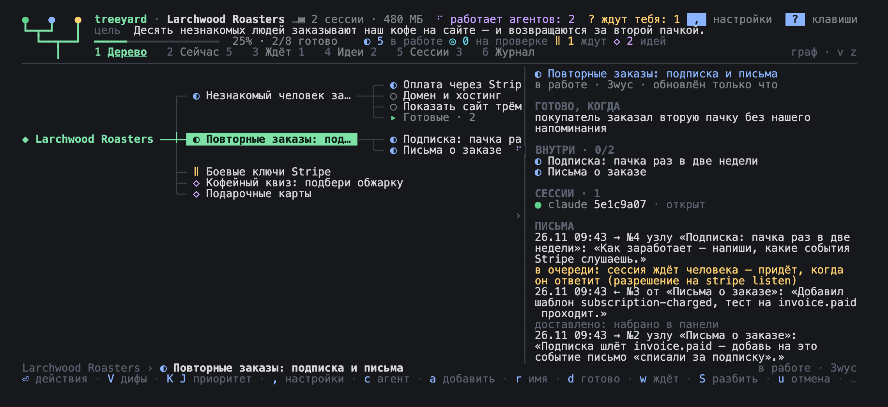
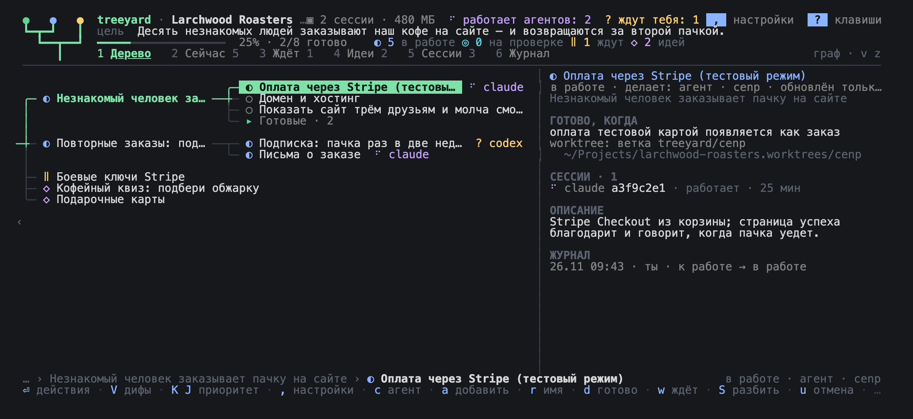
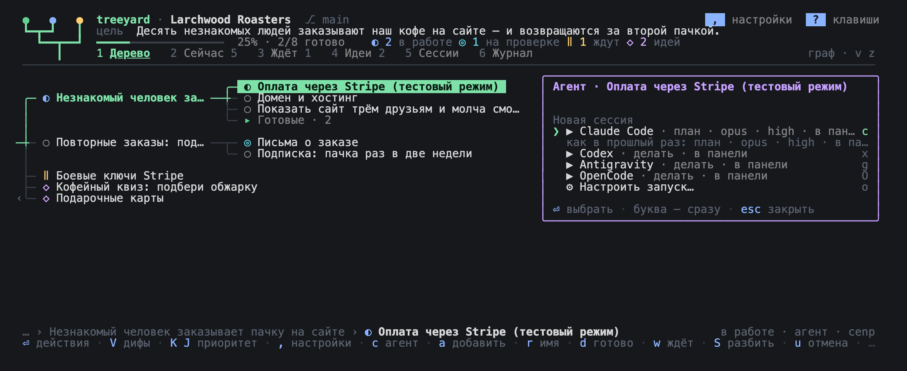
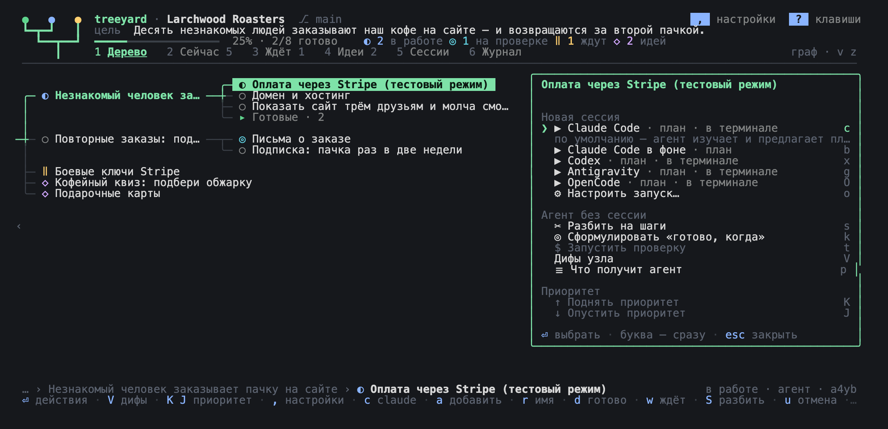

<div align="center">



**Treeyard — система для Agent-Driven Development (ADD): код пишут агенты, а ты
проектируешь, раздаёшь задачи и принимаешь работу.**

Планируешь, разрабатываешь и ведёшь проект в одном терминале — поверх Claude Code, Codex,
Antigravity и OpenCode.

Граф целей с зависимостями · несколько агентов сразу · почта между агентами · свой
worktree у каждого узла

[](https://github.com/antondanv/treeyard/actions/workflows/ci.yml)
[](https://www.npmjs.com/package/@antondanv/treeyard)

[](LICENSE)

[English](README.md) · **Русский** · [treeyard.ru](https://treeyard.ru)

https://github.com/user-attachments/assets/e2f796e4-2617-4ba7-97e9-ef8ba56e2ed3

</div>

## Быстрый старт

Нужны Node.js 22 или новее и хотя бы один агентский CLI: Claude Code, Codex, Antigravity
или OpenCode. Чтобы агенты работали в панели рядом с деревом, поставь ещё
[tmux](https://github.com/tmux/tmux/wiki/Installing) — по ссылке есть команды для любой
системы. Без tmux сессии открываются прямо в этом терминале.

```sh
npm install -g @antondanv/treeyard
cd my-project && treeyard                  # дерева ещё нет — откроется мастер посадки
```

При первом запуске мастер спросит, как сажать дерево. Можно с агентом: в пустой папке он
попросит рассказать о проекте всё, что приходит в голову, а в папке с кодом сначала сам
прочитает код, документы и историю коммитов. Потом задаст вопросы и запишет дерево, только
когда ты скажешь «да». Можно и самому, по шаблону: пара вопросов — и дерево готово.

В открытом дереве `c` открывает меню агентов: сверху тот, кого ты запускал последним, с
теми же настройками, ниже остальные CLI; `c` `⏎` повторяет прошлый запуск. `?` показывает
все клавиши, `,` открывает настройки: язык, тему и прочее. Есть и другие способы начать:

```sh
treeyard init                              # новое дерево: с агентом или по шаблону
treeyard init --agent --brain codex        # сразу к агенту, без мастера
treeyard import                            # агент сам прочитает план проекта и соберёт по нему дерево
```

**Содержание**

- [Что это и зачем](#что-это-и-зачем)
- [Как это выглядит](#как-это-выглядит)
- [Как с ним работать](#как-с-ним-работать)
- [Несколько агентов сразу](#несколько-агентов-сразу)
- [Что разрешено агентам](#что-разрешено-агентам)
- [Практики вайбкодинга из коробки](#практики-вайбкодинга-из-коробки)
- [Когда он нужен, а когда нет](#когда-он-нужен-а-когда-нет)
- [В цифрах](#в-цифрах)
- [Зачем я это сделал](#зачем-я-это-сделал)
- [Документация](#документация)
- [Как поучаствовать](#как-поучаствовать)

## Что это и зачем

Ты уже работаешь с Claude Code или Codex, правила проекта записаны в `AGENTS.md` или
`CLAUDE.md`. И всё равно картина знакомая. Код написан за вечер, а проект уже месяц «почти
готов». План раздулся до файла в тысячи строк, и агент перечитывает его в каждой сессии.
Просишь одно, а агент заодно делает ещё три вещи. Он пишет «готово», а ничего не работает.
Через неделю уже не помнишь, на чём остановился.

Treeyard показывает весь проект одним деревом: наверху цель, под ней вехи, под вехами
задачи — всё это узлы. В дереве ты планируешь, из узлов запускаешь агентов, и по нему же
видно, что готово, что в работе и где всё застряло.



### «У меня уже есть AGENTS.md и CLAUDE.md»

И пусть остаются: там правила — стек, команды, стиль кода. Только правила одни на все
задачи и ничего не говорят о том, в каком состоянии проект. Поэтому рядом обычно заводят
`PLAN.md` или `ROADMAP.md`, и тут начинаются проблемы:

- файл разрастается до тысяч строк, а агент читает его целиком в каждой сессии: токены
  тратятся, инструкции размываются;
- галочки агент ставит себе сам, и «готово» в таком плане не значит «работает»;
- два агента правят один файл и ничего не знают друг о друге;
- твои собственные шаги и всё, что ждёт сервера или оплаты, тонут среди остальных пунктов.

В Treeyard в `AGENTS.md` остаются только правила, а план и состояние проекта живут в
дереве. У каждой задачи свой файл со статусом и журналом, и агент получает контекст только
своей задачи, а не весь план. Причём это обычные Markdown-файлы в твоём репозитории: они
лежат в `.tree/` и коммитятся вместе с кодом.

### Есть идея, но непонятно, с чего начать

Создай пустую папку и запусти в ней `treeyard`. Рассказывай как получается — сплошным
текстом, вразнобой. Агент задаёт вопросы и к каждому сразу предлагает свой ответ; ты
поправляешь и добавляешь подробности. Так идея из головы превращается в план на экране:
цель, первый результат, который можно проверить в реальной жизни, и задачи на пути к нему.
В том числе такие, которые агент за тебя не сделает: сервер, домен, приём оплаты.

### Проект уже есть, и он большой

Запусти `treeyard` в папке проекта. Агент сам прочитает код, документы и историю и
расскажет, что нашёл: что на самом деле работает, что обещано, но не сделано, что брошено
на полпути. Потом задаст несколько вопросов и соберёт дерево проекта. В нём видно, что
готово, что в работе и где ты застрял — с причиной и условием, при котором можно двигаться
дальше. В любой момент можно попросить агента пройтись по всему дереву: он покажет, что
встало, что разрослось и за что пора браться.

### Дальше проект как на ладони

Выбираешь задачу и прямо рядом с деревом открываешь на ней агента — Claude Code, Codex или
другой. Агент сразу знает, о чём задача: зачем она нужна, что с ней связано, какие в
проекте правила. Читать весь план ему не нужно. Свою работу он сам не закрывает:
показывает доказательства, а принимаешь ты. Если агентов несколько, по дереву видно, кто
работает, а кто ждёт твоего ответа. Вернулся через неделю — у каждой задачи есть журнал, а
в отдельном списке собрано всё, за что можно взяться прямо сейчас.

Это и есть Agent-Driven Development: ты проектируешь, агенты пишут код, а ты ведёшь проект
и принимаешь работу.

## Как это выглядит

Листай вбок.

<!-- Неразрывные пробелы под подписями держат ширину колонок: иначе GitHub ужимает картинки таблицы до ширины страницы, а так ряд листается вбок. -->
<table>
<tr>
<td></td>
<td></td>
<td></td>
<td></td>
<td></td>
</tr>
<tr>
<td>Три агента сразу: один в панели, один ждёт твоего ответа, один в фоне<br>&nbsp;&nbsp;&nbsp;&nbsp;&nbsp;&nbsp;&nbsp;&nbsp;&nbsp;&nbsp;&nbsp;&nbsp;&nbsp;&nbsp;&nbsp;&nbsp;&nbsp;&nbsp;&nbsp;&nbsp;&nbsp;&nbsp;&nbsp;&nbsp;&nbsp;&nbsp;&nbsp;&nbsp;&nbsp;&nbsp;&nbsp;&nbsp;&nbsp;&nbsp;&nbsp;&nbsp;&nbsp;&nbsp;&nbsp;&nbsp;&nbsp;&nbsp;&nbsp;&nbsp;&nbsp;&nbsp;&nbsp;&nbsp;&nbsp;&nbsp;&nbsp;&nbsp;&nbsp;&nbsp;&nbsp;&nbsp;&nbsp;&nbsp;&nbsp;&nbsp;&nbsp;&nbsp;&nbsp;&nbsp;&nbsp;&nbsp;&nbsp;&nbsp;&nbsp;&nbsp;&nbsp;&nbsp;&nbsp;&nbsp;&nbsp;&nbsp;&nbsp;&nbsp;&nbsp;&nbsp;&nbsp;&nbsp;&nbsp;&nbsp;&nbsp;&nbsp;&nbsp;&nbsp;&nbsp;&nbsp;&nbsp;&nbsp;&nbsp;&nbsp;&nbsp;&nbsp;&nbsp;&nbsp;&nbsp;&nbsp;&nbsp;&nbsp;&nbsp;&nbsp;&nbsp;&nbsp;&nbsp;&nbsp;&nbsp;&nbsp;&nbsp;&nbsp;&nbsp;&nbsp;&nbsp;&nbsp;&nbsp;&nbsp;&nbsp;&nbsp;&nbsp;&nbsp;&nbsp;&nbsp;&nbsp;&nbsp;&nbsp;&nbsp;&nbsp;&nbsp;&nbsp;&nbsp;&nbsp;&nbsp;&nbsp;&nbsp;&nbsp;&nbsp;&nbsp;&nbsp;&nbsp;&nbsp;&nbsp;&nbsp;&nbsp;&nbsp;&nbsp;&nbsp;&nbsp;&nbsp;&nbsp;&nbsp;&nbsp;&nbsp;&nbsp;&nbsp;&nbsp;&nbsp;&nbsp;&nbsp;&nbsp;&nbsp;&nbsp;&nbsp;&nbsp;&nbsp;&nbsp;&nbsp;&nbsp;&nbsp;</td>
<td>Письма между сессиями: видно, какое доставлено, а какое ждёт<br>&nbsp;&nbsp;&nbsp;&nbsp;&nbsp;&nbsp;&nbsp;&nbsp;&nbsp;&nbsp;&nbsp;&nbsp;&nbsp;&nbsp;&nbsp;&nbsp;&nbsp;&nbsp;&nbsp;&nbsp;&nbsp;&nbsp;&nbsp;&nbsp;&nbsp;&nbsp;&nbsp;&nbsp;&nbsp;&nbsp;&nbsp;&nbsp;&nbsp;&nbsp;&nbsp;&nbsp;&nbsp;&nbsp;&nbsp;&nbsp;&nbsp;&nbsp;&nbsp;&nbsp;&nbsp;&nbsp;&nbsp;&nbsp;&nbsp;&nbsp;&nbsp;&nbsp;&nbsp;&nbsp;&nbsp;&nbsp;&nbsp;&nbsp;&nbsp;&nbsp;&nbsp;&nbsp;&nbsp;&nbsp;&nbsp;&nbsp;&nbsp;&nbsp;&nbsp;&nbsp;&nbsp;&nbsp;&nbsp;&nbsp;&nbsp;&nbsp;&nbsp;&nbsp;&nbsp;&nbsp;&nbsp;&nbsp;&nbsp;&nbsp;&nbsp;&nbsp;&nbsp;&nbsp;&nbsp;&nbsp;&nbsp;&nbsp;&nbsp;&nbsp;&nbsp;&nbsp;&nbsp;&nbsp;&nbsp;&nbsp;&nbsp;&nbsp;&nbsp;&nbsp;&nbsp;&nbsp;&nbsp;&nbsp;&nbsp;&nbsp;&nbsp;&nbsp;&nbsp;&nbsp;&nbsp;&nbsp;&nbsp;&nbsp;&nbsp;&nbsp;&nbsp;&nbsp;&nbsp;&nbsp;&nbsp;&nbsp;&nbsp;&nbsp;&nbsp;&nbsp;&nbsp;&nbsp;&nbsp;&nbsp;&nbsp;&nbsp;&nbsp;&nbsp;&nbsp;&nbsp;&nbsp;&nbsp;&nbsp;&nbsp;&nbsp;&nbsp;&nbsp;&nbsp;&nbsp;&nbsp;&nbsp;&nbsp;&nbsp;&nbsp;&nbsp;&nbsp;&nbsp;&nbsp;&nbsp;&nbsp;&nbsp;&nbsp;&nbsp;&nbsp;&nbsp;&nbsp;&nbsp;&nbsp;&nbsp;&nbsp;</td>
<td>У узла свой git worktree и своя ветка, а дерево общее<br>&nbsp;&nbsp;&nbsp;&nbsp;&nbsp;&nbsp;&nbsp;&nbsp;&nbsp;&nbsp;&nbsp;&nbsp;&nbsp;&nbsp;&nbsp;&nbsp;&nbsp;&nbsp;&nbsp;&nbsp;&nbsp;&nbsp;&nbsp;&nbsp;&nbsp;&nbsp;&nbsp;&nbsp;&nbsp;&nbsp;&nbsp;&nbsp;&nbsp;&nbsp;&nbsp;&nbsp;&nbsp;&nbsp;&nbsp;&nbsp;&nbsp;&nbsp;&nbsp;&nbsp;&nbsp;&nbsp;&nbsp;&nbsp;&nbsp;&nbsp;&nbsp;&nbsp;&nbsp;&nbsp;&nbsp;&nbsp;&nbsp;&nbsp;&nbsp;&nbsp;&nbsp;&nbsp;&nbsp;&nbsp;&nbsp;&nbsp;&nbsp;&nbsp;&nbsp;&nbsp;&nbsp;&nbsp;&nbsp;&nbsp;&nbsp;&nbsp;&nbsp;&nbsp;&nbsp;&nbsp;&nbsp;&nbsp;&nbsp;&nbsp;&nbsp;&nbsp;&nbsp;&nbsp;&nbsp;&nbsp;&nbsp;&nbsp;&nbsp;&nbsp;&nbsp;&nbsp;&nbsp;&nbsp;&nbsp;&nbsp;&nbsp;&nbsp;&nbsp;&nbsp;&nbsp;&nbsp;&nbsp;&nbsp;&nbsp;&nbsp;&nbsp;&nbsp;&nbsp;&nbsp;&nbsp;&nbsp;&nbsp;&nbsp;&nbsp;&nbsp;&nbsp;&nbsp;&nbsp;&nbsp;&nbsp;&nbsp;&nbsp;&nbsp;&nbsp;&nbsp;&nbsp;&nbsp;&nbsp;&nbsp;&nbsp;&nbsp;&nbsp;&nbsp;&nbsp;&nbsp;&nbsp;&nbsp;&nbsp;&nbsp;&nbsp;&nbsp;&nbsp;&nbsp;&nbsp;&nbsp;&nbsp;&nbsp;&nbsp;&nbsp;&nbsp;&nbsp;&nbsp;&nbsp;&nbsp;&nbsp;&nbsp;&nbsp;&nbsp;&nbsp;&nbsp;&nbsp;&nbsp;&nbsp;&nbsp;&nbsp;</td>
<td><code>c</code> — меню агентов, сверху прошлый запуск со всеми настройками<br>&nbsp;&nbsp;&nbsp;&nbsp;&nbsp;&nbsp;&nbsp;&nbsp;&nbsp;&nbsp;&nbsp;&nbsp;&nbsp;&nbsp;&nbsp;&nbsp;&nbsp;&nbsp;&nbsp;&nbsp;&nbsp;&nbsp;&nbsp;&nbsp;&nbsp;&nbsp;&nbsp;&nbsp;&nbsp;&nbsp;&nbsp;&nbsp;&nbsp;&nbsp;&nbsp;&nbsp;&nbsp;&nbsp;&nbsp;&nbsp;&nbsp;&nbsp;&nbsp;&nbsp;&nbsp;&nbsp;&nbsp;&nbsp;&nbsp;&nbsp;&nbsp;&nbsp;&nbsp;&nbsp;&nbsp;&nbsp;&nbsp;&nbsp;&nbsp;&nbsp;&nbsp;&nbsp;&nbsp;&nbsp;&nbsp;&nbsp;&nbsp;&nbsp;&nbsp;&nbsp;&nbsp;&nbsp;&nbsp;&nbsp;&nbsp;&nbsp;&nbsp;&nbsp;&nbsp;&nbsp;&nbsp;&nbsp;&nbsp;&nbsp;&nbsp;&nbsp;&nbsp;&nbsp;&nbsp;&nbsp;&nbsp;&nbsp;&nbsp;&nbsp;&nbsp;&nbsp;&nbsp;&nbsp;&nbsp;&nbsp;&nbsp;&nbsp;&nbsp;&nbsp;&nbsp;&nbsp;&nbsp;&nbsp;&nbsp;&nbsp;&nbsp;&nbsp;&nbsp;&nbsp;&nbsp;&nbsp;&nbsp;&nbsp;&nbsp;&nbsp;&nbsp;&nbsp;&nbsp;&nbsp;&nbsp;&nbsp;&nbsp;&nbsp;&nbsp;&nbsp;&nbsp;&nbsp;&nbsp;&nbsp;&nbsp;&nbsp;&nbsp;&nbsp;&nbsp;&nbsp;&nbsp;&nbsp;&nbsp;&nbsp;&nbsp;&nbsp;&nbsp;&nbsp;&nbsp;&nbsp;&nbsp;&nbsp;&nbsp;&nbsp;&nbsp;&nbsp;&nbsp;&nbsp;&nbsp;&nbsp;&nbsp;&nbsp;&nbsp;&nbsp;&nbsp;&nbsp;&nbsp;&nbsp;&nbsp;&nbsp;</td>
<td><code>⏎</code> — всё про узел: сессии, задачи агенту, проверка, дифы<br>&nbsp;&nbsp;&nbsp;&nbsp;&nbsp;&nbsp;&nbsp;&nbsp;&nbsp;&nbsp;&nbsp;&nbsp;&nbsp;&nbsp;&nbsp;&nbsp;&nbsp;&nbsp;&nbsp;&nbsp;&nbsp;&nbsp;&nbsp;&nbsp;&nbsp;&nbsp;&nbsp;&nbsp;&nbsp;&nbsp;&nbsp;&nbsp;&nbsp;&nbsp;&nbsp;&nbsp;&nbsp;&nbsp;&nbsp;&nbsp;&nbsp;&nbsp;&nbsp;&nbsp;&nbsp;&nbsp;&nbsp;&nbsp;&nbsp;&nbsp;&nbsp;&nbsp;&nbsp;&nbsp;&nbsp;&nbsp;&nbsp;&nbsp;&nbsp;&nbsp;&nbsp;&nbsp;&nbsp;&nbsp;&nbsp;&nbsp;&nbsp;&nbsp;&nbsp;&nbsp;&nbsp;&nbsp;&nbsp;&nbsp;&nbsp;&nbsp;&nbsp;&nbsp;&nbsp;&nbsp;&nbsp;&nbsp;&nbsp;&nbsp;&nbsp;&nbsp;&nbsp;&nbsp;&nbsp;&nbsp;&nbsp;&nbsp;&nbsp;&nbsp;&nbsp;&nbsp;&nbsp;&nbsp;&nbsp;&nbsp;&nbsp;&nbsp;&nbsp;&nbsp;&nbsp;&nbsp;&nbsp;&nbsp;&nbsp;&nbsp;&nbsp;&nbsp;&nbsp;&nbsp;&nbsp;&nbsp;&nbsp;&nbsp;&nbsp;&nbsp;&nbsp;&nbsp;&nbsp;&nbsp;&nbsp;&nbsp;&nbsp;&nbsp;&nbsp;&nbsp;&nbsp;&nbsp;&nbsp;&nbsp;&nbsp;&nbsp;&nbsp;&nbsp;&nbsp;&nbsp;&nbsp;&nbsp;&nbsp;&nbsp;&nbsp;&nbsp;&nbsp;&nbsp;&nbsp;&nbsp;&nbsp;&nbsp;&nbsp;&nbsp;&nbsp;&nbsp;&nbsp;&nbsp;&nbsp;&nbsp;&nbsp;&nbsp;&nbsp;&nbsp;&nbsp;&nbsp;&nbsp;&nbsp;&nbsp;&nbsp;</td>
</tr>
</table>

## Как с ним работать

1. Открой вкладку **«Сейчас»** (`2`): там собрано всё, за что можно взяться прямо сейчас,
   из всех веток. Выбери узел.
2. Нажми `c` — откроется меню агентов: сверху тот, кого ты запускал последним, с теми же
   настройками, ниже остальные CLI. Выбери агента, и его сессия по этому узлу откроется
   рядом с деревом; `c` `⏎` повторяет прошлый запуск.
3. Агент получает контекст узла, изучает код и предлагает план. Ты соглашаешься — он
   берётся за работу.
4. Закончив, агент переводит узел **на проверку** и прикладывает доказательства: команду с
   выводом, скриншот, свои коммиты (их видно по `V`). Ты смотришь и нажимаешь `d` — узел
   **готов**.
5. Если работа упёрлась во что-то внешнее, нажми `w`: узел перейдёт в статус **«ждёт»** с
   причиной и сроком, когда к нему вернуться, а ты займёшься другой веткой.
6. Пришла по ходу идея — добавь её клавишей `a` со статусом «идея». Раз в неделю заглядывай
   во вкладку **«Ждёт»** (`3`): может, к чему-то уже пора вернуться.

## Несколько агентов сразу

Когда задач много, одна сессия может стать координатором. Говоришь ей «сделай ветку с
подпиской», и она сама раздаёт узлы другим сессиям, следит за ними, отвечает на их вопросы
и принимает работу. Ты при этом видишь всё на дереве: кто работает, кто ждёт тебя, кто уже
закончил.

### Координатор

- Скилл `treeyard-coordinate` учит агента этой работе. Он выбирает узлы, которые трогают
  разные файлы, открывает их в панелях или в фоне (`treeyard open a b c --pane --task "…"`),
  ждёт (`treeyard wait`), принимает работу по дифу и проверкам, вливает ветки и переводит
  узлы на проверку.
- `treeyard queue` запускает узлы ветки по очереди, не больше заданного числа сразу. Узел с
  `needs` стартует, только когда узлы, от которых он зависит, на проверке или готовы. Если
  окно подписки почти исчерпано, очередь дождётся его сброса.
- Если два узла в работе правят один и тот же файл, `wait` и `queue` это заметят и
  предупредят обе сессии.

### Письма между сессиями

- `treeyard send <узел> "…"` пишет в уже открытую сессию узла, а не заводит новую. Свободная
  сессия получит письмо сразу, уснувшая проснётся, а занятая — после своего хода. Если
  поставить хук (`treeyard hook claude install`, есть и для Codex, Antigravity, OpenCode),
  письмо дойдёт даже посреди хода, между двумя вызовами инструментов.
- С `--wait` команда дождётся ответа. Ответить на вопрос агента или на запрос разрешения
  (`--answer`, `--approve`, `--reject`) можно только от тебя: письмо другого агента за твоё
  слово не сойдёт.
- Каждое письмо остаётся строкой в журналах обоих узлов, а в карточке узла видно, доставлено
  оно или ещё ждёт. Если два агента начнут перекидываться письмами без дела, после шести
  подряд treeyard следующее не отправит.

### Свой worktree у узла

`treeyard open <id> --worktree` (или та же галочка в форме запуска) открывает сессию любого
CLI в отдельном git worktree на ветке `treeyard/<id>`. Агенты не мешают друг другу в одной
папке, коммиты ветки сами считаются коммитами узла, а дерево при этом остаётся одно на всех.
Влитые и закрытые worktree убирает `treeyard worktree rm --done`. Ветки, которые трогают
разные узлы, сливаются без конфликтов в обзоре дерева: у `.tree/README.md` свой драйвер
слияния.

### Агенты знают про дерево сами

- Скиллы `treeyard`, `treeyard-init` и `treeyard-coordinate` ставятся в Claude Code, Codex и
  Antigravity и обновляются вместе с treeyard. Даже обычный `claude`, запущенный в папке
  проекта, знает, как вести дерево.
- `treeyard status` показывает всю настройку на одном экране: дерево, скиллы, хуки, живые
  сессии. У каждой проблемы — команда, которая её исправит.
- Хук коммитов (`treeyard hook install`) сам привязывает коммиты сессии к её узлу.

## Что разрешено агентам

- **Claude Code** и **OpenCode** — ровно то, что разрешают их собственные настройки;
  treeyard ничего сверху не добавляет. При старте «план» Claude Code открывается в режиме
  plan, а OpenCode — с агентом plan: файлы не меняются, пока ты не согласишься.
- Песочница **Codex** по умолчанию не пускает к сокету tmux и к `.git` проекта, поэтому из
  его сессии не проходят `treeyard send` и `git commit`. Перед первым запуском treeyard
  один раз спросит, как быть: **песочница + treeyard и git** (workspace-write, сеть и `.git`
  открыты, остальное — из config.toml) или **как в config.toml**. Передумаешь — поменяй в
  `,`; если песочница так и осталась закрытой, `treeyard status` подскажет, какие строки
  добавить в config.toml.
- **Antigravity** спрашивает разрешения перед каждой командой, поэтому перед его первым
  запуском treeyard один раз спросит, что выбрать: **полный доступ** (команды, файлы и сеть
  без подтверждений, `--dangerously-skip-permissions`) или **обычный режим** Antigravity.
  Поменять можно потом в `,`.
- **«Разбить на шаги»** и **«Сформулировать «готово, когда»»** работают только на чтение,
  какой бы агент за них ни взялся.

Перед каждым запуском в окне подтверждения видно, какие права получит агент. Подробнее —
[«Что разрешено агентам»](docs/reference.ru.md#что-разрешено-агентам).

## Практики вайбкодинга из коробки

Treeyard — не просто список задач. В нём заложены правила, которые экономят токены и время
и делают результат надёжнее. Следить за ними не нужно: инструмент так устроен.

| Как устроено | Что это даёт |
| --- | --- |
| Агент видит контекст только своей задачи | Сессия начинается примерно с 3 тыс. токенов вместо 65 тыс. на весь план, и короткие инструкции не теряются |
| Одна задача — одна сессия | Агент доделывает задачу, пока контекст свежий, без бесконечного «ещё чуть-чуть» |
| Сначала план, потом код | Ошибку видно ещё в плане, а не в написанном коде |
| Агент не может сам объявить работу готовой — он показывает доказательства | Реже бывает «готово, но не работает»: есть команда с выводом, скриншот, коммиты |
| Новая идея — отдельная задача, а не «заодно» | Токены и время уходят на то, что ты просил, а идеи не пропадают |
| История — в журнале задачи, решения с причинами — в одном месте | Новой сессии не нужно перечитывать лог на тысячи строк, а что и почему решили, записано один раз |
| Цель из реальной жизни, твои шаги в плане, статус «ждёт» | Проект не застревает на сервере, домене и оплате: их видно с первого дня, а работа тем временем идёт в других ветках |

Правила взяты из моих проектов и из чужих практик, проверенных годами: Mikado, Shape Up,
GTD, рекомендации Anthropic по Claude Code. Все двенадцать собраны на одной странице:
[docs/practice.ru.md](docs/practice.ru.md).

## Когда он нужен, а когда нет

**Treeyard пригодится, если**

- проект длится дольше одной сессии — дни, недели, месяцы;
- работа идёт в нескольких направлениях, и часть из них ждёт чего-то извне;
- часть дел можешь сделать только ты: сервер, домен, оплата, договор, показ живым людям;
- одновременно работают несколько агентов или разные CLI, и хочется видеть, кто чем занят;
- проектов несколько, и ты возвращаешься к одному из них после перерыва: дерево и журналы
  напомнят, где ты остановился.

**Обойдёшься без него, если**

- задача одна и небольшая: написать скрипт, поправить баг, что-то выяснить. Тут проще
  открыть обычный `claude` или `codex` — дерево, критерии и статусы отнимут больше времени,
  чем сама задача;
- это прототип на вечер, который потом выбросят;
- команда уже работает в своём трекере. Treeyard рассчитан на одного человека с агентами,
  хотя с доской GitHub Project синхронизироваться умеет.

Код Treeyard сам не пишет — это работа твоих агентов. Он хранит план, выдаёт каждому
агенту его задачу и показывает, где сейчас проект.

## В цифрах

- **Агенту нужно примерно на 95% меньше токенов, чтобы взяться за работу.** Сессия из узла
  начинается с контекстом около трёх тысяч токенов: от 2,6k до 4,0k, медиана 3,0k по семи
  узлам дерева этого репозитория. Если вместо этого дать агенту весь план — все узлы с
  описаниями и журналами, — выйдет 65 тысяч токенов на том же дереве из 105 узлов, а вместе
  с `docs/` и README — 84 тысячи. То есть контекст узла меньше на 95–96%. Даже обзор всего
  дерева на одной странице (`treeyard show`, 5,5k) почти вдвое больше.
- **Чем больше дерево, тем больше экономия.** На свежем дереве из 12 узлов весь план (1,0k)
  ещё меньше контекста одного узла (1,7k) — экономить пока не на чем. Да и большая часть
  токенов в сессии уходит на работу с кодом, а не на старт.
- **Treeyard ведётся в Treeyard.** С первого коммита у него своё дерево: за пять дней — 108
  коммитов, 41 узел готов, ещё 18 на проверке, из узлов открыто 35 сессий агентов (со 2 по
  6 октября 2026 года).

<sub>Как считали токены (6 октября 2026 года): контекст узла выгружали в файл командой
`treeyard context <id>` и считали через `claude -p "/context" --system-prompt-file <файл>`,
то есть токенизатором самого Claude. Сверили с настоящим запросом: 3 387 токенов против
«3.4k». У Codex и Gemini свои токенизаторы, и числа у них получатся другие.</sub>

## Зачем я это сделал

Treeyard вырос из моего собственного вайбкодинга. С агентами код пишется очень быстро, а
потом проект почти всегда встаёт — на том, что может сделать только человек: арендовать
сервер, купить домен, подключить оплату, показать продукт живым людям. Пока до этого не
доходят руки, агенты пилят побочные фичи, план превращается в журнал на тысячи строк, и
каждая новая сессия начинается с того, что перечитывает его целиком. Код готов, а проект
стоит.

В Treeyard я собрал приёмы, которые помогли моим проектам сдвинуться с этой точки. Так я
веду все свои проекты, и сам Treeyard тоже.

## Документация

- [docs/reference.ru.md](docs/reference.ru.md) — подробно обо всём: посадка дерева,
  интерфейс, клавиши и мышь, настройки, сессии в панелях, команды CLI для тебя и для
  агентов, дифы узла, картинки, совместные узлы, issues и доска GitHub Project.
- [docs/practice.ru.md](docs/practice.ru.md) — как вести проект деревом: двенадцать правил
  и шаблоны («Этапы», «Направления», «Микадо», «Поиск улучшений», «Заказ»).
- [docs/architecture.md](docs/architecture.md) — как Treeyard устроен внутри.

Прямо в терминале: `?` — все клавиши, `treeyard help` — все команды.

## Как поучаствовать

Treeyard делает один человек, так что помощь пригодится. Issues и pull requests принимаются
на русском и на английском.

- Нашёл баг — открой [issue](https://github.com/antondanv/treeyard/issues/new?template=bug_report.yml):
  форма спросит версии и окружение, а ты расскажи, что делал, чего ждал и что получилось.
- Опечатку, очевидный баг или недостающий тест можно сразу присылать pull request'ом.
- Новую возможность или другое поведение сначала обсуди в
  [issue](https://github.com/antondanv/treeyard/issues/new?template=feature_request.yml). У
  проекта есть направление ([docs/vision.md](docs/vision.md)), и короткий разговор сбережёт
  pull request, который не вольют.
- Правки `.tree/` в pull request не нужны: это рабочий план мейнтейнера, его обновляют
  отдельно.

Собрать и проверить проект:

```sh
git clone https://github.com/antondanv/treeyard && cd treeyard
npm install                     # при NODE_ENV=production: npm install --include=dev
npm run build && npm link       # команда treeyard из dist/
npm run dev -- <args>           # treeyard прямо из исходников (tsx)
npm run typecheck && npm test && npm run lint && npm run build
npm run screenshots             # переснять картинки README на английском и русском (нужен Chrome)
FORCE_COLOR=2 npx tsx scripts/screenshot.ts ../my-app shot.png 130x36   # PNG интерфейса
```

Сессии, панели и модели работают через [Brainyard](https://github.com/antondanv/brainyard)
(`@antondanv/brainyard`) — общий слой для всех агентских CLI.

Остальное — как называть ветки и коммиты, что писать в pull request, как проверять то, что
видит человек, — в [правилах совместной работы](CONTRIBUTING.ru.md).

## Лицензия

[Apache 2.0](LICENSE)
