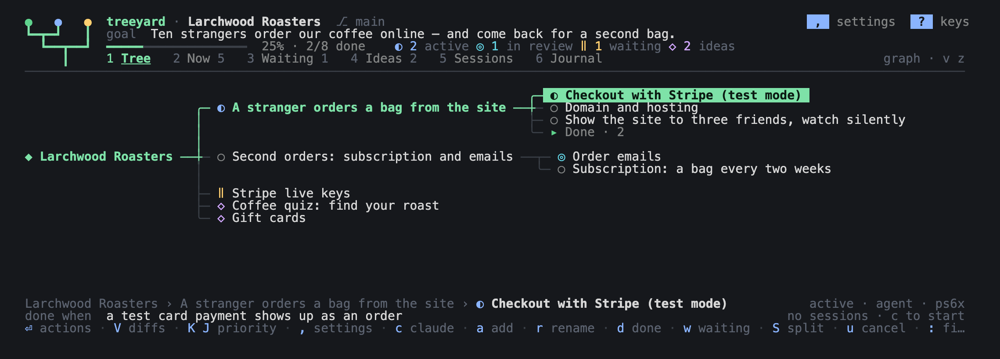
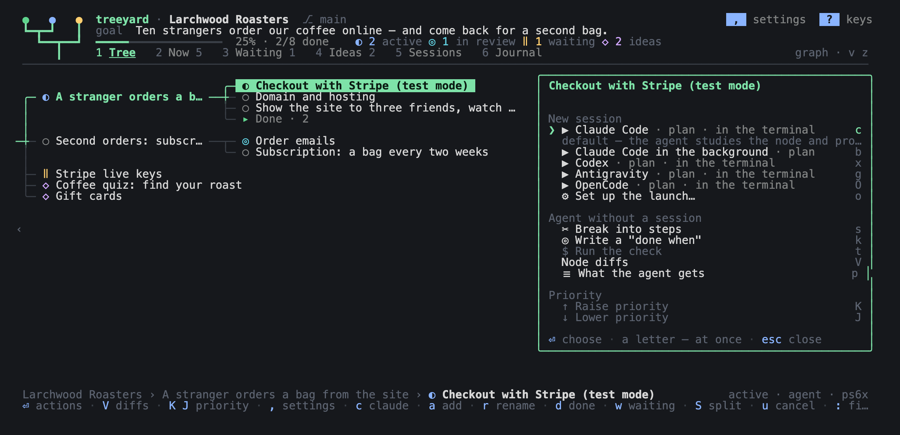

**English** · [Русский](reference.ru.md)

# Treeyard reference

Everything the [README](../README.md) leaves out: how a tree is planted, what the
interface shows, every key, every setting and every command.

- [Planting a tree with an agent](#planting-a-tree-with-an-agent)
- [What it looks like](#what-it-looks-like)
- [Keys](#keys) · [With the mouse](#with-the-mouse)
- [Confirmation and settings](#confirmation-and-settings)
- [Sessions next to the tree](#sessions-next-to-the-tree)
- [Agents and the tree: the CLI commands](#agents-and-the-tree)
  - [Project status](#project-status) · [The root and the project's documents](#the-root-and-the-projects-documents)
  - [Node diffs](#node-diffs) · [Notes](#notes) · [Node pictures](#node-pictures)
  - [Shared nodes](#shared-nodes) · [A GitHub Project board](#a-github-project-board)
- [Tree files and templates](#tree-files-and-templates)
- [Development](#development)

## Planting a tree with an agent

In a folder without a tree, `treeyard` opens a full-screen wizard: **with an agent**
(Claude Code, Codex, Antigravity or OpenCode) or **on your own, from a template**.

The agent gets the [`treeyard-init`](../skills/treeyard-init/SKILL.md) skill and goes like
this:

1. **Looks at where you are.** In an empty folder it asks you to pour out everything you
   think about the project, as plain text. In a project it studies the code, the documents
   and the history and gives a short report: what really works, what was promised and not
   done, where the loose ends are.
2. **Asks questions.** 1–3 at a time, each with its own suggestion, so “yes” is often
   enough. No more than ~12, only what shapes the tree. Nothing it can see in the
   repository. Small things like the README's language go straight into the draft as
   nodes.
3. **Agrees on the goal and the first milestone — in that order.**
   - The root gets the project's big goal: why it exists at all (“ten strangers order our
     coffee online — and come back for a second bag”), not “build an MVP”.
   - The first branch is the first milestone: the nearest check in real life (“a stranger
     orders a bag from the site”).
   - Plus the appetite: how much time you're ready to put in before that milestone.
4. **Asks about steps in the world, not in the code.** A server, a domain, payments, a
   contract, a live user. They go into the tree at once as “done by: you” nodes instead of
   piling up at the end, where projects used to stall.
5. **Shows the draft tree as text.** The walking skeleton first, a “done when” on every
   node, blockers as “waiting”, ideas in a separate branch. It plants it with one command
   (`treeyard import --from-json -`) only after your “yes”.
6. **Writes short documents instead of the old ten.** `docs/vision.md`, `AGENTS.md` as the
   single source of rules, `CLAUDE.md` of one line, `@AGENTS.md`. The plan and the tasks
   live in the tree.

With tmux the conversation opens on the right, and on the left the tree appears and grows
as it is planted. What you type goes straight to the agent; `⌃Q` gives control back to the
tree, `f` to the conversation, `F` shows the conversation full screen. Nothing to run
after planting. Without tmux (or with `open=terminal`) the agent works full screen in this
terminal: leave the session, and the tree opens.

For plain `claude`, `codex` and `agy` to know treeyard's skills in any folder — `treeyard-init`
(planting) and `treeyard` (working with a tree):

```sh
treeyard skills            # where the skills are in each CLI: installed, outdated, not installed
treeyard skills install    # ~/.claude/skills, ~/.codex/skills, ~/.gemini/config/skills; copies in the project — refreshed
```

A skill is installed as a whole folder (SKILL.md and `references/`); a copy that is already
current is left alone. Copies the project keeps for itself (`.claude/skills`, `.agents/skills`)
are refreshed, never created.

## What it looks like



- **Graph** (the default): the goal on the left, branches grow to the right, a parent sits
  in the middle of its children. A node is one line, so the whole working tree fits on the
  screen. Children stand right after their parent's title, and leaves take the room left
  on the right: a short “Done · N” doesn't push its children away, and long titles get cut
  less often. The selected node is a green pill, and the path to it from the root is lit;
  if its title doesn't fit, it slowly scrolls to the end and back, pausing at both ends.
  `z` shows the same nodes as cards, `v` the tree as an indented list. With a session
  open, the cards' width follows the room on the left. In a narrow list, long indents
  shrink to `…`, keeping the node's status and title. With a session open, the graph and
  the cards shift to the working branch; the root stays further left, and `⌥←` or going to
  the top branch gets you there. Agent labels go compact: `⠋ claude` — working, `? claude`
  — waits for you, `▣ codex` — an open agent pane; they show on the selected node too, set
  off from its highlighted title.
- **The bar at the bottom**: where you are, what “done” means for this node (or what it
  waits for), and how its sessions are doing — an agent working, waiting for you, or no
  sessions. The selected node's title and status get the room first; the path in between
  shrinks to `…` when it doesn't fit.
- **Tabs**: `1` Tree · `2` Now — everything you can do right now, across all branches ·
  `3` Waiting — blocked branches with the reason and the condition to come back · `4`
  Ideas · `5` Sessions — this folder's sessions, grouped by Claude Code, Codex,
  Antigravity, OpenCode (`← →` between them) · `6` Journal — what happened in the tree.



From the root, `c` starts a review of the whole tree by the project's agent; `⏎` opens a
menu with the review and a conversation about the project. In “⚙ Another agent, place,
model…” (`o`) you pick Claude Code, Codex, Antigravity or OpenCode, a pane or the
terminal; Claude can also work in the background. The agent gets the goal, an overview of
the nodes, Now, Waiting, the latest journals, the rules and the decisions. A review gives
its findings and `treeyard` commands first, and changes only after you agree. In a
conversation the first message is yours: ask about the status, open or close nodes. The
project's sessions are kept in `.tree/tree.md`, shown in the root's menu and in the
Sessions tab as belonging to the project `◆`; `f` resumes a pane, `x` puts it to sleep.

## Keys

Letter keys also work in the Russian layout, from the same keys: `р о л д` are `h j k l`,
`ф` is `a`, `Ф` is `A` — in the tree, lists, menus and dialogs; Shift keeps the key's
meaning. Russian text in search, forms and agent panes is typed as usual.

| | |
| --- | --- |
| `↑ ↓` `← →` | along the graph's column · to the parent and to the children (`j k` — every node in turn); from the top level `←` goes to the root `◆` |
| `space` `+` `−` | fold a branch · unfold everything · fold everything |
| `:` or `⌃K` | palette: find any node or action by words |
| `/` | filter the tree by title |
| `⏎` | everything about the node: resume a session, start a new one, an agent without a session, the check |
| `c` `b` | Claude Code for the node (in a pane, with tmux) · in the background |
| `f` `F` `x` `p` | the session on the right: type into it · full screen · put to sleep · hide (more below) |
| `a` `A` | a new node inside · beside — on a line at the bottom; long text wraps and stays visible (`tab` — with a criterion) |
| `r` `e` `E` | rename · the node's fields and description · the node in your editor |
| `d` `w` `s` | done (on a done node — back to todo) · waiting, with a reason · any status |
| `D` `y` | delete the node · copy its id |
| `G` | GitHub: the wizard when nothing is connected; sync with the board; with only issues linked — a choice: sync them or connect a board |
| `I` | node pictures: a screenshot from the clipboard (`v`), a caption (`n`), full screen (`o` — full size in Preview), delete (`D`); a picture file can be dragged into the window |
| `V` | node diffs: linked commits → files → a coloured diff; also in the `⏎` menu and the `:` palette |
| `P` | project documents: every `.md`, read with Markdown drawn and edited in the built-in editor; also `⏎` on the root `◆` |
| `S` | an agent breaks the node into 3–7 steps, you tick the ones to add (who breaks it — you choose in the confirmation) |
| `t` | run the node's check (the command in its “check” field) |
| `u` | undo the last change |
| `tab` `⇧tab` | nest · lift a level up |
| `K` `J` or `⇧↑` `⇧↓` | raise · lower the priority among siblings of the same status (also in the `⏎` menu and the `:` palette) |
| `⌥` + arrows | move the graph · `f` — back to the selected node |
| `v` `z` `i` `.` | list ↔ graph · lines ↔ cards · details panel · done nodes |
| `,` `⌃R` | settings · reread the tree from disk |
| `?` `q` | all keys (if they don't fit, `↑↓` `PgUp` `PgDn` scroll) · quit |

The “Edit node” window (`e`) has a multi-line “Description” field: `Enter` is a new line,
`↑↓` move the cursor between lines, `←→` along the text. A paste keeps its line breaks;
long text wraps to the width, and the visible part follows the cursor. `Tab` / `Shift+Tab`
switch fields, `Ctrl+S` saves the whole window; in the other fields `Enter` saves too.
`Esc` drops the edits, `u` in the tree undoes a save. The journal is saved apart from the
description. To edit the whole Markdown file, journal included, there is still `E` from
the tree.

Under each parent, nodes go by status, by default: **active → in review → todo → waiting →
idea → done → dropped**. Within one status you set the order yourself, top to bottom; it
is kept in the nodes' `order`, shows in the CLI, and `u` undoes a move. (The generated
`.tree/README.md` lists siblings by `order` alone, whatever their status and your status
order: it is committed, so it must not depend on whose settings wrote it.) From the CLI:
`treeyard set <id> after=<sibling id>|first|last` (a sibling of another status works too:
the node takes the nearest place in its own group). Changing a status moves the node to
its part. The order of statuses is a setting —
“Status order” in `,` or `treeyard config status_order`:

| Preset | Top to bottom |
| --- | --- |
| `active-first` — active on top (default) | active → in review → todo → waiting → idea → done → dropped |
| `done-first` — done on top | done → active → in review → todo → waiting → idea → dropped |
| `active-last` — active at the bottom | idea → waiting → todo → in review → active → done → dropped |
| `custom` — your own | as you arrange it: `⏎` on the “Status order” line opens the list of statuses, `K` `J` or `⇧↑` `⇧↓` move them, `⏎` saves |

Confirmed done nodes are gathered into a folded group **“Done · N”** — at the end of the
branch, or wherever “done” stands in the chosen order. Select the group and press `space`
(or `⏎`) to unfold it; `space` folds it back. `+` unfolds these groups too. Nodes “in
review” stay in sight. Search `/` and the palette `:` find done nodes as well; inside the
group their sessions and actions are at hand. The group changes only the view: parents,
history and node files stay as they were.

### With the mouse

| | |
| --- | --- |
| click | select a node in the graph and in the list (the root `◆` too), a line in Now, Waiting, Ideas, Journal, Sessions · switch tabs |
| double click | the same as `⏎`: the node's actions, open a session, from the journal — to the node; in a menu — pick the item |
| click on `▸` `▾` or `›4` | unfold or fold a branch in the list · unfold a folded branch in the graph and step into it |
| click on a hint | press its key: the hints at the bottom of the screen, `,` `?` in the header, the session pane's buttons and dialog footers |

A click on a hint is exactly a press of its key, so the mouse does what the keyboard does.
While a dialog is open, the tree on the left takes no clicks.

## Confirmation and settings

Before every session and agent task treeyard asks: which node, who (Claude Code, Codex,
Antigravity, OpenCode), where (in a pane, in this terminal or in the background), how to
start, which model — and shows the first message the agent will get. `⏎` starts, `o`
changes the parameters, `esc` cancels, `!` stops asking. `treeyard open` from the shell
asks the same way (`--yes` — without asking).

Claude Code, Codex and OpenCode take their permissions from their own settings (OpenCode —
the `permission` in its `opencode.json`). Antigravity has only plan and accept-edits there
and asks before every command, so treeyard starts and resumes it with full access
(`--dangerously-skip-permissions`).

“Plan” starts Claude Code in its plan mode and OpenCode with its plan agent: edits are
closed until you agree. Claude Code with a plan ready asks itself whether to get to work;
OpenCode asks the same or asks you to switch agents — `Tab` in its pane turns on the build
agent. Codex and Antigravity get the same request in words.

Before “Break into steps” and “Write a "done when"” the confirmation is a small form: the
brain (Claude Code, Codex, Antigravity, OpenCode), the model and the effort are picked
with `←→`, the field with `↑↓`. It starts with the project's brain and `assist_model`;
another choice applies only to this task, and the project's settings stay as they were. An
effort the model doesn't have (Haiku has none at all) is not passed to the agent.

Settings — the `,` key (always shown in the top right corner) or `treeyard config`:

| For all projects (`~/.treeyard/settings.json`) | |
| --- | --- |
| `lang` | `en` (default) or `ru` — the interface, templates and what agents get |
| `confirm` | confirm before starting sessions and agent tasks |
| `theme` | `dark` or `light` — to match your terminal |
| `animation` | spinners and the blinking leaf |
| `marquee` | running title: a long title of the selected node scrolls so you can read it whole |
| `status_order` | the order of statuses under each parent: `active-first` (default), `done-first`, `active-last`, `custom`, or all seven statuses comma-separated — your own |
| `live` | live status of Claude Code, Codex, Antigravity and OpenCode sessions: who is working, who waits for you |
| `open` | open sessions in a pane (`pane`, the default) or in the terminal (`terminal`); without tmux — in the terminal |
| `sleep_after` | put sessions to sleep after 15/30/60 idle minutes (default 30); `0` — never |
| `max_panes` | the limit of the project's live panes: 3/5/8 (default 5); `0` — no limit |
| `stale_after` | hours after which an «in progress» node with no live session and no records is marked «no session N h» (default 2); `0` — off |
| `notes` | the folder with the tree where `treeyard note` writes notes from any project; `off` — none. In `,` — “Where notes go”: a path (`~`, `.` — this project), empty — none |

With `live` on, a working Codex shows a spinner at its node and counts among “agents
working” at the top, in a long session too. A question or a permission request in a pane
shows “waits for you”; after an answer or a cancel the wait clears on the next update.
Statuses update every 3 seconds. The counter at the top counts the sessions attached to
this tree's nodes. For OpenCode Brainyard sees only “working” so far: its question or
permission request also looks like work, not “waits for you”.

| This project (`.tree/tree.md`) | |
| --- | --- |
| `brain` | the default brain: claude, codex, antigravity, opencode |
| `start` | how a session starts: plan, do, goal, chat |
| `model`, `effort` | the sessions' model and effort — picked from the list the CLI itself gives |
| `assist_model` | the model for “break into steps” and the criterion — can be a cheaper one |

Models don't need typing in: treeyard asks the CLIs for them (`codex debug models`, `agy
models`, `opencode models` — the models of the providers connected to OpenCode; for Claude
Code — the aliases fable, opus, sonnet, haiku, which always mean the latest version). Only
the efforts the chosen model understands are offered, `*` marks its default one. The model
and the effort belong to the project's brain: they reset when the brain changes. The same
lists are in the launch window (`o`). An OpenCode session doesn't get the effort at start:
OpenCode changes it — the model's variant — right in the session (`ctrl+t`); “break into
steps” and the criterion do pass it to OpenCode.

```sh
treeyard config                 # everything that is set
treeyard config lang ru         # Russian
treeyard config confirm off     # don't ask before starting
treeyard config sleep_after 15  # sleep after 15 minutes of confirmed idling
treeyard config max_panes 3     # up to three panes; working and visible ones are protected
treeyard config stale_after 4   # mark «in progress» nodes nobody has touched for 4 hours
treeyard config status_order done-first  # done on top
treeyard config status_order todo,review,active,waiting,idea,done,dropped  # your own order
treeyard config notes ~/Projects/my-notes  # where notes go
TREEYARD_LANG=ru treeyard       # the language for one run
```

## Sessions next to the tree

A session opened “in a pane” lives in tmux: its screen shows to the right of the tree, you
can type into it without leaving treeyard, and closing treeyard doesn't stop it — next
time it is back in its node. All four CLIs work this way.

| | |
| --- | --- |
| `f` or a click on the pane | type into the session: everything, arrows, pastes and `⌃C` included, goes to the CLI |
| `⌃Q` or a click on the tree | back to the tree |
| `F` | full screen; `⌃Q` — back to the tree |
| `x` | put to sleep: the CLI closes and gives its memory back, the conversation stays in its history |
| `f` on a node with a sleeping session | wake it: the same conversation in a new pane (with a confirmation) |
| `p` | hide or show the pane |
| `⇧←` `⇧→` or `<` `>` | wider, narrower — the pane's border follows the arrow; a click on `⇧← ⇧→` in the pane's corner does the same |
| wheel · `PgUp` `PgDn` · `End` | the pane's history · page by page · to the live screen |
| drag the mouse over the pane's screen | select and copy to the clipboard (Treeyard holds the mouse, so it selects by itself) |

The top right shows how many sessions are alive and how much memory they take (Claude Code
— about 200–300 MB, Codex — about 80, Antigravity — about 350, OpenCode — 0.5–1 GB).
Treeyard reads the screen only of the session in sight and leaves the rest alone. Quiet
sessions fall asleep by themselves (`sleep_after`, by default after 30 idle minutes), and
when more than `max_panes` are alive (5 by default), the one idle the longest falls
asleep. A session that is working, waiting for you or open on the screen never falls
asleep. OpenCode doesn't fall asleep by itself at all yet — Brainyard can't tell that it's
free — `x` puts it to sleep. A session without a single message doesn't fall asleep but
just closes: the CLI doesn't keep an empty conversation, and there would be nothing to
wake.

In the Sessions tab (`5`) select a session and press `x` — that very session falls asleep,
even if its pane is hidden or it was started in the background with `b`. Claude Code
background sessions stop with its own `stop` command; the conversation and its node stay.
The list shows `☾ sleeping`, and `⏎` resumes the same conversation. Putting a working
session to sleep by hand stops it. A session open full screen or in another terminal —
close it there first.

This folder's sessions that are in no node are marked `no node` — they were opened past
the tree. Above the list: how many sessions there were in the last 14 days and how many of
them went past the tree; the same at the end of `treeyard sessions`. To attach such a
session to a node — `l`.

It needs tmux. Treeyard has its own tmux server (`tmux -L brainyard`) and doesn't touch
your own tmux or its settings.

A program that shows a session's terminal itself (Treeyard Web) learns which pane to attach
to from treeyard. `treeyard open <id> --pane --json` starts the session and prints
`{"node", "brain", "id", "pane", "startedAt", "warnings"}`: `id` is the session's id, `pane` is
the name of its tmux session on that server (`tmux -L brainyard attach -t <pane>`). Codex,
Antigravity and OpenCode name a session only once it has started, so their `id` is `null` at
first. `treeyard sessions --json` gives every session a `pane` — its live pane, or `null` when
it runs in no pane — and finds a fresh pane's session in the CLI's own store; the plain
`treeyard sessions` marks it `▣ <pane>`. Neither command writes the found id into the tree:
the TUI does that when it next looks.

## Agents and the tree

A session from a node gets a short context: the path from the root (why this), the
criterion, the neighbours, the project's rules and the tree's commands. Agents write back
with the same commands a person uses:

```sh
treeyard show                                   # the tree; off a terminal finished work folds into «✓ done: N» (--all — everything, --open — without finished)
treeyard show <id>                              # a node; several at once: treeyard show a b c (--json — an array)
treeyard show <id> --brief                      # header, criterion, check/waiting and the last 3 journal entries
treeyard show <id> --journal 5                  # only the last 5 entries (--journal all — every one)
treeyard show <id> --only journal,sessions      # only these parts: header, criterion, commits, children, sessions, note, journal, history
treeyard show --status review,idea --under <id> # nodes of these statuses in a branch, a line each with the path (--json — an array)
treeyard show --under <id>                      # the branch as a tree (--open, --all, --json as for the whole tree)
treeyard show --json --all                      # everything about every node for a program: description, journal, status changes, pictures, dates, place (--under <id> — a branch)
treeyard watch --json                           # watch the tree: a JSON line per change — a node added, removed, its status changed, a new entry, an edit (without --json — a line for a person)
treeyard docs --json                            # the project's documents as the «Documents» window lists them: path, title, lines, time (without --json — a line each)
treeyard projects --json                        # folders with trees treeyard has seen, the most recent first: path, title, goal, when seen (without --json — a line each)
treeyard find "rounding|cents"                  # search every node, done ones too: id, status word, path and the matching piece (--status, --under, --json, --limit)
treeyard add "Show the product to a person" --who human --parent <id>
treeyard add "Fix the help" --parent <id> --after <id>     # right after a sibling of the same status (default — last)
treeyard add --parent <id> --from-json - < nodes.json      # several nodes at once (an error adds none); prints their ids
treeyard set <id> after=<sibling id>|first|last # the place among siblings; with parent=<id> — in a new parent
treeyard set <a> <b> <c> status=todo            # several nodes: the same change to each (after=<id> puts them one after another); an error changes none
treeyard set <id> status=waiting waiting="no server" until="a VPS is up"
treeyard set <id> status=review                 # the agent; “done” is set by a person
treeyard set <id> status=done --as you          # only at the person's word; from an agent (or --as not a person) done turns into review — the output line says so
treeyard log <id> "what is done; what is left"
treeyard log <id> "summary, evidence" --status review --commit HEAD   # closing in one command: the entry, the status and the commits (--commit a b, --commit a,b)
treeyard log <id> --fix "corrected text"        # replace your own last entry (its time stays; status changes and commits are not touched)
treeyard set <id> note="…"                      # the node's description; the journal stays as it is
treeyard log <id> "…" --project ../main         # from a git worktree: write to the main tree (show takes it too)
treeyard note "the help doesn't fit the screen" # a note about treeyard itself — into “Notes”
treeyard rm <id>                                # delete a node added by mistake; one with a journal, children, sessions or commits is closed instead: status=dropped
treeyard decide "SQLite, not Postgres: one user" # a dated line in «Decisions» of .tree/tree.md; without text — the list (--json)
treeyard goal "Ten strangers order from us"     # the tree's goal in .tree/tree.md, only that line changes; without text — print it (--json)
treeyard rules --from - < rules.md              # the rules (tree.md without «Decisions»); the header and «Decisions» stay; without --from — print them (--json)
treeyard image <id> shot.png --note "…"         # a picture for the node (a screenshot, proof)
treeyard diff <id> --add HEAD                   # attach your commit to the node for review
treeyard commit <id> [<id>…]                    # commit the tree files of these nodes, README and tree.md (chore(tree): …); never code, other nodes or the index of others
treeyard add "Codex: turn status" --project ../api --for <id>   # a change needed in another project
treeyard set <id> needs=<other id>              # waits for a node of this tree (needs=../api#<id> — of another)
treeyard open root --start plan --pane          # a review of the tree in a pane
treeyard open root --start chat --brain codex   # a conversation about the project
treeyard open <id> --brain codex                # a session for the node right from the shell
treeyard open <id> --brain codex --pane         # start a pane and return to the shell
treeyard open <id> --brain opencode --pane      # the same with OpenCode
treeyard open <id> --pane --json                # for a program: the session id and the tmux pane name as JSON
treeyard open <id> --bg --task "no paid calls" --model sonnet --effort high   # a coordinator hands the node to its own session
treeyard open <id> --bg --task - < task.txt     # a long assignment with quotes — from stdin
treeyard sessions                               # the folder's sessions in every CLI, “no node” — past the tree, ▣ — a live pane (--json: pane)
treeyard status                                 # a summary: versions, tree, nodes, skills, pointer, hook, sessions, GitHub; a command for every problem (--json)
treeyard context <id>                           # exactly what an agent gets
treeyard pointer                                # the block about the tree in AGENTS.md / CLAUDE.md
treeyard help                                   # all the commands; treeyard <command> --help — the lines of one
```

Statuses in commands are the key (`review`), the word in either language (`in review`,
`на проверке`) or a short alias (`check`, `wip`, `проверка`); a glyph copied from the output
works too. Off a terminal every line of the tree carries its status as a word after the id —
an agent never has to read or type `◐ ◎ ○`.

`treeyard add --parent <id> --from-json <file|->` takes an array of nodes:
`[{"title": "…", "done_when": "…", "note": "…", "who": "agent", "status": "todo", "check": "…",
"key": "api", "needs": ["api", "k3f9", "../api#y79a"], "children": […]}]`. Only `title` is
required; `key` names a node inside the batch for the `needs` of the others; `--status` and
`--who` on the command line fill in what a node doesn't say. The whole batch is checked first:
an unknown field, status or ref adds no node at all.

`treeyard show --json --all` is the whole tree for a program (Treeyard Web): nothing left to
parse in the markdown of `.tree/`. Without `--all`, `--json` stays short: a node's fields and its
children. The full form:

- at the top — `version` (the JSON format, now `1`; a new field does not change it, a renamed or
  removed one does — skip keys you don't know), `title`, `goal`, `created`, `summary` and `nodes`;
  with `--under <id>` — the branch's node itself with `version` added;
- every node — the fields of the short form (`id`, `title`, `status`, `who`, `done_when`, `check`,
  `waiting`, `until`, `needs`, `for`, `sessions`, `stale`, `commits`) and also:
  - `parent`, `position` — the place among siblings of the same status (0 — first; the tree groups
    siblings by status, and `order` in the files means something only inside a group);
  - `created` and `closed` (`YYYY-MM-DD`, `closed` only for done and dropped), `updated` (ISO time);
  - `note` — the description, `""` when there is none;
  - `journal` — every entry, oldest first: `{at, who, text}` (`at` — `2026-11-12 09:42`, local time
    as the journal has it; a line without a stamp has only `text`);
  - `history` — the status changes: `{at, who, from, to, comment}`, statuses as keys (`todo`,
    `review`) whichever language wrote the line; `comment` — what follows the change, e.g. why it
    waits;
  - `images` — `{file, path, note, added}`: `path` is absolute, `added` — ISO time;
  - `children` — by status in the default order (in progress first), whatever your own setting is;
    within a status — by `position`.

`treeyard watch --json` gives the changes of the tree as people, agents and git make them: a JSON
line per event until the command is stopped (Ctrl+C, SIGTERM or a closed pipe — exit code 0).
The first line is `{"type": "ready", "version": 1, "dir", "at"}`: the watch has begun, so now
read the whole tree (`show --json --all`) and miss nothing. `version` is the format of the events,
by the same rules as in `show --json --all`. Then a line per node:

- every line has `type`, `id`, `at` (ISO time: the node's new `updated` when treeyard wrote the
  change, otherwise when it was noticed), `title` and `status` (the last one for a removed node, none for the root);
- `type` is the biggest thing that happened to the node: `added` (it appeared; also `parent` and
  `journal` — its entries), `removed` (it is gone; `parent` — where it stood), `status` (its status
  changed: `from`, `to` as keys and `who` when the journal says who), `journal` (new entries at
  the end of the journal), `changed` (another edit);
- `fields` — what changed, as the keys of `show --json --all`: `status`, `title`, `done_when`,
  `note`, `journal`, `sessions`, `updated`…; `journal` — the new entries `{at, who, text}`;
  `history` — the status changes among them `{at, who, from, to, comment}`: several when the node
  went through more than one status;
- a corrected entry (`log --fix`) is `changed` with `journal` in `fields`, not a new entry;
- the root (`tree.md`) — `{"type": "changed", "id": "root", "fields": ["goal", "body", …]}`.

The command waits until the files go quiet (150 ms) and only then compares them with the last
look: a command that writes a node three times, or a `git checkout` that rewrites fifty files,
gives one event per node. A file that can't be read (a hand edit half done) stays as it was
instead of leaving the tree.

`treeyard projects` lists the folders with trees treeyard has seen, so a program (Treeyard Web)
finds the projects by itself instead of keeping a list. A folder is remembered when a command
that reads or writes its tree runs there (`show`, `log`, `--project <dir>`…) or the tree opens
in the TUI; the list lives in `~/.treeyard/projects.json` (`$TREEYARD_HOME`), the most recently
seen first. A folder that is gone or no longer has `.tree/tree.md` is not listed but stays in the
file, so a disk that isn't mounted comes back; neither is a linked git worktree: its `.tree/` is
the branch's copy, the main checkout is the project. `treeyard projects --json` is an array of
`{"path", "title", "goal", "seen"}`: `path` — the folder's absolute real path; `title` and `goal`
from `.tree/tree.md` (`goal` is `null` when there is none); `seen` — ISO time treeyard last saw
the tree, refreshed at most every ten minutes.

Flags of `treeyard open`: `--task "…"` adds your assignment to the end of the first
message, after the standard one, under “Task for this node:” (in a `chat` start it
becomes the first message; `--task -` reads it from stdin; `treeyard context <id> --task "…"`
shows the result; with `--start goal` it becomes part of the `/goal` condition).
`--model` and `--effort` set the model and the effort for this launch only; without them the CLI
uses its own defaults. `--worktree` is passed to Claude Code, which starts the session in a new git
worktree; Codex, Antigravity and OpenCode ignore it and print a warning. `--bg` (Claude Code)
starts the session in the background and returns at once; the session is saved in the node.

Undo (`u`) brings back only your own changes: if an agent has already edited the same
node, its edit stays.

### Project status

`treeyard status` shows in one command how the project is set up and what is wrong with it:

- the versions of treeyard and Brainyard;
- the folder and its tree; in a git worktree — the main tree (the one the person sees), not the
  branch's copy, and a hint that tree commands go with `--project <main folder>`;
- nodes by status and the abandoned ones — «in progress» with no live session and no pane for
  longer than `stale_after` hours; unlike `show`, live sessions and panes count here;
- the `treeyard` and `treeyard-init` skills in Claude Code, Codex and Antigravity: installed,
  outdated (some file differs from what came with this version), not installed, or no CLI; copies
  in the project folder (`.claude/skills`, `.agents/skills`) count too;
- the block about the tree in CLAUDE.md, AGENTS.md and GEMINI.md: in place, outdated, no block,
  via an import (`@AGENTS.md`), or no file;
- the post-commit git hook;
- the folder's live sessions in every CLI and its tmux panes — with the nodes they belong to;
- the GitHub link: the board, issues, `gh`, and statuses that have not reached GitHub yet.

It ends with «To fix»: every problem and the command that fixes it.

| Problem | Command |
|---|---|
| no tree | `treeyard init` |
| an abandoned node | `treeyard set <id> status=todo` or `treeyard open <id>` |
| a skill is missing or outdated | `treeyard skills install` |
| no block about the tree, or an outdated one | `treeyard pointer` |
| no AGENTS.md, CLAUDE.md or GEMINI.md | `touch AGENTS.md && treeyard pointer` |
| no git hook | `treeyard hook install`; hooks inside the repository — `echo '…' >> <post-commit>` |
| no `gh`, not logged in, no access to boards | `brew install gh`, `gh auth login`, `gh auth refresh -s project` |
| statuses that have not reached GitHub | `treeyard github sync` |
| a broken tree file, a lost parent | `$EDITOR <file>`, `treeyard set <id> parent=root` |

From a git worktree, commands that write the tree get `--project <main folder>`. `--json` gives
the same as an object (problems have `kind`, `what`, `fix`); `--project <dir>` — the summary of
another folder. The command only reads: it writes and starts nothing, and asks `gh` only when the
tree is linked to GitHub. The exit code is 0 even with problems: it is a report, not a check.

### The root and the project's documents

The root `◆ <project>` is a stop too: `←` from a top-level branch, a click on it, or `↑`
from the list's first line. The root has its own card (`i`): the goal, progress, the
project's documents and how the tree is run. `⏎` on the root is the project's menu:
documents, “Goal, rules and decisions” (`.tree/tree.md`), settings, a new branch.

`P` (`З` in the Russian layout) opens “Project documents” from anywhere: every `.md` of
the project from Git — tracked and new, without ignored files and tree nodes; without Git
— the folder's files. `.tree/tree.md` first, then README, AGENTS, CLAUDE. `⏎` reads a
document: headings, lists, quotes, code and links in colour, `↑↓` `PgUp/PgDn` `Home/End`
scroll. `e` opens the built-in editor where you were reading:

| | |
| --- | --- |
| arrows · `PgUp` `PgDn` · `Home` `End` | cursor · page · start and end of the line (`⌃Home` `⌃End` — of the text) |
| `⌥← ⌥→` · `⌃A` `⌃E` | by words · to the start and end of the line |
| `⌃W` · `⌃K` · `⌃U` | delete a word · to the end of the line · to the start of the line |
| `⌃S` · `⌃Z` | save · undo the last edit (by words) |
| `esc` | leave; with unsaved changes — `s` save, `d` drop, `esc` stay |

If the file changes on disk while it is open (an agent, another editor), `⌃S` doesn't
silently overwrite someone else's edit: `o` — overwrite, `r` — reload from disk. A
`tree.md` whose YAML header doesn't parse is not saved; its edit is undone by `u` in the
tree, like any edit of the tree.

`treeyard docs` prints the same list in the same order, so a program (Treeyard Web) never
picks the files itself; `--project <dir>` — the tree of another folder. `treeyard docs --json`
is an array of `{"path", "title", "lines", "modified"}`: `path` from the project folder with
`/`; `title` — `title` from the document's front matter, else its first top-level heading
(`# …`, a line over `===` or `<h1>`; code blocks don't count), else the file name without
`.md`; `.tree/tree.md` is “Goal, rules and decisions” in the language of treeyard; `lines` —
as the window counts them; `modified` — ISO time of the file's last change.

The root's own document, `.tree/tree.md`, is read and changed in parts, so a program never
parses it and a change never rewrites the whole file. `treeyard goal` prints the goal (`goal`
in the header), `treeyard goal "…"` writes a new one — the goal is one line, line breaks become
spaces. `treeyard rules` prints the rules — the body without «Decisions»: the method, how the
tree is kept, rules for agents; `treeyard rules --from <file|->` writes new ones; decisions are
added with `treeyard decide`. Each command changes only its own piece: the other header keys
with their quotes, comments and sessions, and «Decisions», stay byte for byte (a section that
stood after «Decisions» is part of the rules, and «Decisions» then ends the file). Rules with
their own «Decisions» heading, empty rules and an empty goal are refused. `treeyard decide`
prints «Decisions» line by line, `treeyard decide "…"` adds one with today's date (a line that
already has a date keeps it). `--json` gives `{"goal": "…"}` (`null` when there is none),
`{"rules": "…"}` and `{"decisions": [{"text": "…", "date": "2026-10-07"}]}`, after a write too:
`text` is the line as written without its `- `, `date` the last `YYYY-MM-DD` in it (`null` when
there is none); `--project <dir>` — the tree of another folder.

### Node diffs

`V` (`М` in the Russian layout), `⏎` → “Node diffs” or the palette `:` open the commits
linked to the selected node. `a` picks a commit from the Git log; `n` in the list of
commits loads 100 more. After a commit, the agent attaches it with `treeyard diff
<id> --add HEAD` — the command is in the node's context — or the
[commit hook](#commit-hook) does it by itself. The links are kept in the node
file's `commits` field and are committed along with the tree. Attach the commits with work
on this node: the view shows the whole selected commit.

`↑↓` pick a commit or a file, `Enter` / `→` open it. The diff shows line numbers before
and after the change next to the code. Additions are green, deletions red; changed words
get a brighter background. Long lines wrap with a `↪` mark and keep their indent. Git's
service headers are hidden, and hunks are separated by line ranges. The `+`/`−` stats in
the file list are coloured too. `↑↓`, `PgUp/PgDn`, `Home/End` scroll the text. `Esc` / `←`
go back to the files, then to the commits and to the tree; `r` rereads Git. A line can be
picked with the mouse and opened with a double click. `D` in the list of linked commits
removes the link; `u` after going back to the tree undoes the link or its removal. The Git
commit itself stays where it is.

“Current project changes” is a separate item: files in the index, edits in the working
folder and new files that aren't ignored. They are shared by all nodes of this repository.
Each linked commit is shown on its own, against its parent (for a merge commit — the first
one), so commits of other nodes in between don't get into its diff. Binary files show
Git's mark instead of text. The view changes no files, no index and no Git history.

```sh
treeyard diff <id>                              # the diffs of every commit of the node
treeyard diff <id> --add HEAD                   # any ref: HEAD, HEAD~1, a branch, a tag, a short SHA; the node keeps the full SHA
treeyard diff <id> --add <ref1> <ref2>          # several commits (--add a,b and repeated --add work too)
treeyard diff <id> --rm <sha>                   # remove a link, even if the commit is gone
treeyard diff <id> --commit <ref> --file src/app.ts
treeyard diff <id> --stat                       # files and +/−, no diff text
treeyard diff <id> --working                    # the current shared changes of the project
treeyard diff <id> --json                       # commits, files and diffs for a script
treeyard diff <id> --project ../X --add HEAD    # attach to the tree of another folder or the main worktree
```

#### Commit hook

`treeyard hook install` puts a `post-commit` hook into the repository of the current
folder, so a commit made in a session started from a node attaches to that node by itself
(the journal gets “commit attached …”, the message of the commit is untouched). A commit of
tree files only (`treeyard commit`) is not work on the node and is not attached. The
commands:

```sh
treeyard hook install    # add the hook; an existing shell post-commit gets a block between "# >>> treeyard" / "# <<< treeyard"
treeyard hook status     # is it in place, and where
treeyard hook remove     # remove only that block (the file too, if nothing else is in it)
```

The hook is one quiet line: it does nothing, and never fails a commit, when `treeyard` is
not on `PATH`. Every session from a node gets `TREEYARD_NODE` (the node) and
`TREEYARD_PROJECT` (the folder of its tree); the hook binds the commit to that node of that
tree. It does not fire when:

- the commit is made outside a node's session (no `TREEYARD_NODE`);
- the commit is in another repository than the tree's (the agent stepped into a neighbour);
  commits in worktrees of the project do fire;
- a session started before `TREEYARD_PROJECT` existed looks for the tree in the current
  folder, so the commit has to be inside the project;
- `core.hooksPath` points into the repository (husky and the like): those files are
  versioned, so `install` writes nothing and prints the line to add to your `post-commit`
  yourself;
- the existing `post-commit` is not a shell script: `install` refuses; add the call
  `treeyard hook post-commit` there.

With the hook in place the agent's context no longer asks for a manual `--add`.

### Notes

Anything where treeyard gets in the way or lacks something — one line, without leaving
your work, from any folder: `treeyard note "…"`. The note becomes an idea in the “Notes”
branch of the tree set by the `notes` setting (no such branch — it appears; to set it —
`,` → “Where notes go” or `treeyard config notes <folder>`). Its description says where it
came from: `From: my-app › «Close one node» (k3f9)`. The node is known when the command
runs from a session opened from a node: treeyard passes the session `TREEYARD_NODE=<id>`,
and Claude Code sessions opened earlier are recognised by their id. From a plain shell
only the project is written; you can name the node yourself: `--node <id>`. When `notes`
is set, an agent in a session from a node knows about `treeyard note` too: it's a line in
its tree commands.

### Node pictures

A screenshot of a bug or a mockup is attached to the node instead of described in words.
Copy a screenshot (`⌘⇧⌃4` on a Mac), press `I` on the node and `v` — the picture from the
clipboard is attached; opening the window alone attaches nothing. A picture file (PNG, and
on a Mac also JPG, HEIC, TIFF, GIF, BMP, WebP) can simply be dragged into the terminal
window: the terminal pastes its path, and the picture is attached to the selected node.
The node's details (`i`) show thumbnails with captions; the `I` window shows a list, a
preview, a caption (`n`), `←→` to flip through, `o` — full screen: full size in the system
viewer (Preview on a Mac). They are drawn with `▀` characters in colour — a truecolor
terminal is needed. Apple Terminal can't draw pixels and the preview there is a mosaic, so
there `⏎` opens the picture in Preview right away.

Pictures live in `.tree/.local/images/<id>/` — next to the tree, but not in git. A node
that is “done” or “dropped” keeps them for another week (undo `u` brings the node back
with them), then they are deleted; the same a week after a node is deleted.

A session from a node gets the pictures' paths and captions in its context, and the agent
opens them itself. An agent can attach a screenshot too — for example, as proof for
review:

```sh
treeyard image <id> shot.png --note "the button is in place"   # attach; --paste — from the clipboard
treeyard image <id> wide.png narrow.png --note "1440" --note "390"   # several files, a caption for each in order (one --note — for all)
treeyard image <id>                                            # paths and captions
treeyard image <id> 001.png --note "…" · --rm 001.png          # caption · delete
```

### Shared nodes

When a node needs a change in another project, the agent doesn't quietly edit there but
opens a node in that project's tree: `treeyard add "…" --project ../api --for <id>`. The
node lands in that tree's “Shared nodes” branch (no such branch — it appears; `--parent` —
another branch), and its description says where it came from. The two nodes are linked: in
yours — `needs: [../api#hv95]`, in that one — `for: [../my-app#g9ph]`; the path is from
the project's folder. Both journals get a line about the link.

What you see: on the card and under the graph — “waits for: ○ api › … · todo” and “needed
for: my-app › …”, in the tree's line — `→ api ○`; no folder or node — a grey “not found”.
A waiting node whose needs are all done comes back to the Now tab marked “can go on”.

A person doesn't need to close a shared node: the agent that did the work there sets
`treeyard set <id> status=done --project ../api` (agents may do this for such nodes), and
when a person marks their own node done, the shared one closes by itself — if nobody else
needs it. A link by hand: `treeyard set <id> needs=../api#y79a` (`needs=` — remove). A node
of the same tree is written with just its id: `needs=y79a` (or `#y79a`, or `.#y79a` — it is
all the same); there is no such node — an error. Such a link is shown the same way, but
doesn't close anything: done on the waiting node leaves the node it waits for alone.

### A GitHub Project board

Why: tasks from a GitHub board become nodes of the tree, and status travels both ways.
Move a card on GitHub — the node changes status; mark a node active or done — the card
moves to its column.

Until anything is connected, the tree's root has a **GitHub** node. It's not a file but an
offer. `⏎` on it (or `G` anywhere) opens a three-step wizard:

1. **gh.** If it's missing, the wizard suggests `brew install gh`. If you're not signed in
   or have no access to boards, `gh auth login` / `gh auth refresh -s project` run right
   in this terminal.
2. **The repository** — taken from `git remote`. It tells the account: a GitHub Project
   board belongs not to a repository but to an account (you or an organisation). If there
   is none, you can pick one of your repositories (a remote is added) or create a new one:
   yourself (named after the folder, private or public — `tab`, no push) or by an agent (a
   node and a session: it asks the name and the visibility).
3. **The board.** Connect one of the repository owner's boards or create a new one:
   yourself (default columns) or by an agent (columns for the tree's statuses, connected
   by the agent). Or `i` — no board, only the repository's issues.

As soon as anything is connected — a board, or only the issues — the offer gives way to a
real “GitHub” node (`github: hub`), and the cards and issues go inside it. With a board,
`G` syncs the tree with the board and the issues. With only the issues the offer to
connect a board doesn't go away, it moves to that node: its line and details say “no
board”, and `⏎` on it (or `G`) asks what to do — check against the issues, or connect a
board. The second opens the same wizard at its last step, the board (the repository is
already known; the issues stay linked), and the cards come in next to the issues' nodes.
The node's own actions stay in that dialog too. Don't want the offer before anything is
connected — in the settings `,` → “GitHub node” → hide (in `tree.md` that's
`github: off`).

The same from the shell:

```sh
treeyard github link owner/1 [--parent <id>]    # or the board's link; without --parent — into the “GitHub” node
treeyard github link owner/app                  # the repository's issues (or its link), next to a board is fine
treeyard github sync                            # both ways: the board and the issues
treeyard github                                 # what it's linked to and which columns
```

`link` finds the board's Status field and guesses which column each status lives in (Todo
→ todo, In Progress → active, Review → in review, Done → done…). The guess is written to
`.tree/tree.md` in `github.columns`, where it can be fixed. If a status has no column of
its own, a card with that status stays where it is.

`sync` creates nodes for cards the tree doesn't have yet (done cards stay on the board),
without duplicates: a node's `github.item` holds its card. If the card was moved on the
board since last time, the node gets its status, and the journal gets “github · … card in
„Done“”. If the node's status changed instead, the card goes to the right column. A status
changed in the tree (`treeyard set`, `d`/`w` in the tree, the start of a session) moves
the card at once. If the move fails, that goes into the node's journal, and the next
`sync` finishes it. Everything goes through `gh` with its sign-in; the `project` scope is
needed (`gh auth refresh -s project`).

**Issues without a board.** After `link owner/repository` (`github.repo` in `tree.md`)
`sync` makes an idea node from every open issue (pull requests are left out), without
duplicates: a node's `github.issue` holds the number. An issue closed on GitHub makes the
node done (or dropped, if closed as not planned); reopened — todo. And the other way: done
in the tree closes the issue at once, dropped closes it as not planned, back to work
reopens it. “In review” doesn't close the issue: “done” is set by a person. If an issue is
also a card on the board, it's one node. A deleted or transferred issue is a line in the
node's journal; the node itself stays.

## Tree files and templates

The tree is plain md files in `.tree/` (`tree.md` and `nodes/*.md`): edit them with
anything and commit them along with the code. The view, the selected node and the open
branches are remembered in `.tree/.local/` — that folder doesn't go into git. `ui.json` is
saved when the view or the selection changes; animation frames don't write it.
The tree is read at startup and reloaded when its files change. Animation frames
reuse it; ordering work and ideas builds the tree order once per list.

When the terminal reports a loss of focus, Treeyard pauses animations and screen capture
of the visible session, and keeps the last tree frame. Agents, status discovery and
automatic sleep keep working. Returning to the window immediately refreshes the tree,
statuses and session screen; typing or clicking also resumes the interface if a focus
report was lost. A running title schedules a frame only when its visible text moves.

Focus tracking uses the [terminal's focus reports](https://www.invisible-island.net/xterm/ctlseqs/ctlseqs.html#h3-FocusIn_FocusOut)
and needs no operating-system polling. Terminals that do not send them keep the normal
foreground behaviour. Inside tmux, focus forwarding requires `focus-events on` in the
outer tmux server; Treeyard does not change that server setting. Focus reporting is
disabled when Treeyard hands the terminal to another CLI or exits.

How to run a project as a tree — [practice.md](practice.md). Templates: Stages,
Directions, Mikado, Finding improvements, Client work (`treeyard templates`).

## Development

The commands to build and test are in the [README](../README.md#development).

`scripts/screenshot.ts` renders a frame of the interface and has headless Chrome take it;
`FORCE_COLOR=2` shows what Apple Terminal gets (256 colours). How it is built —
[architecture.md](architecture.md).

Treeyard runs React/Ink in `production` mode by default, so animations don't pile up debug
measurements in memory. An explicitly set `NODE_ENV` is kept; to debug React, run
`NODE_ENV=development npm run dev`.

## Abandoned «in progress»

A node in `active` that has no live session and has seen no activity for `stale_after` hours
(2 by default) is shown as «in progress · no session N h»: in tree and list rows, on the
node card (with the last journal line, to continue from), in `treeyard show` (the status
line; `--json` has `stale: { hours }`) and in the root review context, which offers to put
such nodes back to work or to continue them. Activity is the latest of: the node updated, a
journal line, a session started or opened, so a fresh node that a coordinator handed to a
subagent is not marked. A node with open children is not marked
either: its work lives in the children, and an abandoned child gets the mark itself. The TUI knows live sessions and panes; the CLI and the review
context judge by time alone. The setting is in the settings window («,»).
