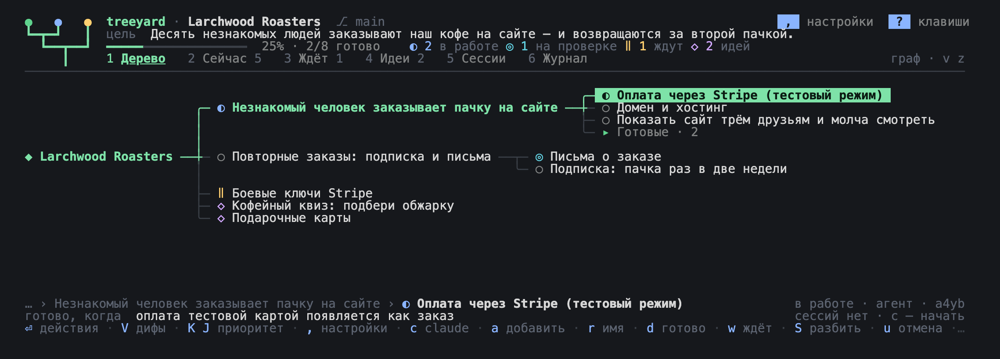
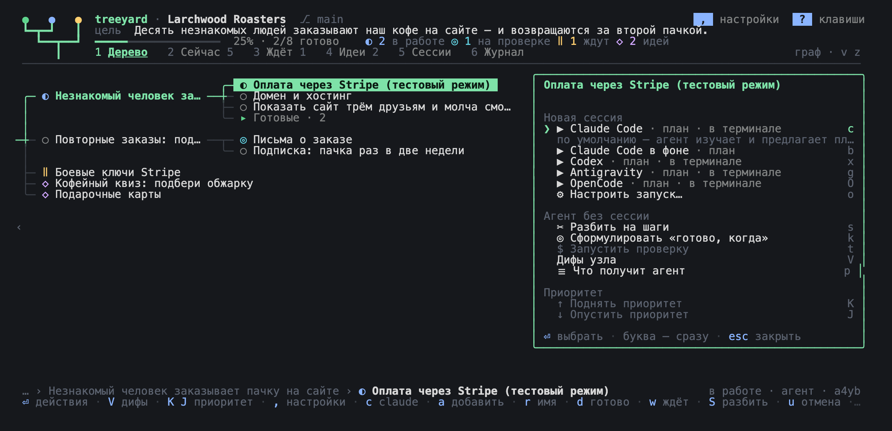

[English](reference.md) · **Русский**

# Справочник Treeyard

Всё, что не вошло в [README](../README.ru.md): как сажается дерево, что показывает
интерфейс, все клавиши, настройки и команды.

- [Посадка дерева с агентом](#посадка-дерева-с-агентом)
- [Как это выглядит](#как-это-выглядит)
- [Клавиши](#клавиши) · [Мышью](#мышью)
- [Подтверждение и настройки](#подтверждение-и-настройки) · [Что разрешено агентам](#что-разрешено-агентам)
- [Сессии рядом с деревом](#сессии-рядом-с-деревом)
- [Агенты и дерево: команды CLI](#агенты-и-дерево)
  - [Сводка по проекту](#сводка-по-проекту) · [Корень и документы проекта](#корень-и-документы-проекта)
  - [Дифы узла](#дифы-узла) · [Замечания](#замечания) · [Картинки узла](#картинки-узла)
  - [Совместные узлы](#совместные-узлы) · [Доска GitHub Project](#доска-github-project)
- [Файлы дерева и шаблоны](#файлы-дерева-и-шаблоны)
- [Удаление treeyard](#удаление-treeyard)
- [Разработка](#разработка)

## Посадка дерева с агентом

Если в папке ещё нет дерева, `treeyard` откроет мастер на весь экран. Дерево можно сажать
**с агентом** (Claude Code, Codex, Antigravity или OpenCode) или **самому, по шаблону**.

Агент получает скилл [`treeyard-init`](../skills/treeyard-init/SKILL.md) и действует по
шагам:

1. **Разбирается, с чем имеет дело.** В пустой папке он попросит рассказать о проекте всё,
   что ты о нём думаешь, сплошным текстом. В существующем проекте изучит код, документы и
   историю коммитов и коротко расскажет, что на самом деле работает, что было обещано, но
   не сделано, и где остались хвосты.
2. **Задаёт вопросы.** По одному–три за раз, и к каждому сразу предлагает свой вариант
   ответа, так что часто достаточно сказать «да». Всего вопросов не больше двенадцати, и
   только о том, что влияет на форму дерева. О том, что видно из репозитория, он не
   спрашивает. Мелочи вроде языка README сразу становятся узлами в наброске.
3. **Договаривается о цели и первой вехе — именно в таком порядке.**
   - В корень дерева идёт большая цель: ради чего проект вообще существует («десять
     незнакомых людей заказали наш кофе на сайте и вернулись за второй пачкой»), а не
     «сделать MVP».
   - Первая ветка — это первая веха, то есть ближайшая проверка в реальной жизни
     («незнакомый человек заказывает пачку на сайте»).
   - Ещё агент спросит, сколько времени ты готов вложить до этой вехи.
4. **Спрашивает о шагах в реальном мире, а не в коде.** Сервер, домен, оплата, договор,
   живой пользователь — всё это сразу попадает в дерево узлами «делает: ты», а не копится
   под конец, где проекты обычно и вставали.
5. **Показывает набросок дерева текстом.** Сначала идёт самый короткий путь от начала до
   работающего результата, у каждого узла есть критерий «готово, когда», всё
   заблокированное помечено «ждёт», а идеи вынесены в отдельную ветку. Сажает дерево агент
   одной командой (`treeyard import --from-json -`), но только после твоего «да».
6. **Пишет несколько коротких документов вместо прежнего десятка.** Это `docs/vision.md`,
   `AGENTS.md` как единственный источник правил и `CLAUDE.md` из одной строки
   `@AGENTS.md`. План и задачи с этого момента живут в дереве.

Если установлен tmux, разговор с агентом открывается справа, а слева по мере посадки
появляется и растёт дерево. Всё, что ты печатаешь, сразу уходит агенту. `⌃Q` возвращает
управление дереву, `f` — снова разговору, а `F` разворачивает разговор на весь экран.
Когда посадка закончится, ничего дополнительно запускать не нужно.

Без tmux (или с настройкой `open=terminal`) агент работает на весь экран прямо в этом
терминале. Когда ты выйдешь из сессии, откроется дерево.

Скиллы treeyard — `treeyard-init` (посадка), `treeyard` (работа с деревом) и
`treeyard-coordinate` (раздать несколько узлов сессиям, принять и влить их работу) — ставятся
сами: `treeyard init`, `treeyard` и любая команда в папке с деревом кладут их во все CLI на
машине — `~/.claude/skills`, `~/.codex/skills`, `~/.gemini/config/skills` — и обновляют, когда
новая версия treeyard приносит другие. Поэтому их знает и обычный `claude`, `codex` или `agy`,
запущенный в проекте, а не только сессия из узла. Если что-то записано, команда скажет об этом
строкой (дерево — всплывающей подсказкой).

Ставятся они в папки самих CLI, а не в проект: в репозитории не появляется копий, которые надо
коммитить и держать в ногу с версией, а `treeyard-init` работает и там, где дерева ещё нет.
Папку скилла, которая сделана ссылкой (например, на checkout), treeyard не трогает; копии,
которые проект держит у себя (`.claude/skills`, `.agents/skills`), обновляет, но не заводит. Где
они стоят, показывают `treeyard status` и `treeyard skills`.

```sh
treeyard skills            # где стоят скиллы в каждом CLI: стоит, устарел, не стоит
treeyard skills install    # поставить или обновить сейчас, и ссылки тоже
treeyard config skills off # не ставить их самому; TREEYARD_SKILLS=off — на один запуск
treeyard uninstall         # убрать их отовсюду вместе с хуком — см. «Удаление treeyard»
```

Скилл ставится папкой целиком (SKILL.md и `references/`); уже свежая копия остаётся как есть.

## Как это выглядит



- **Граф** — вид по умолчанию. Цель находится слева, ветки растут вправо, а каждый
  родитель стоит посередине между своими детьми. Узел занимает одну строку, поэтому всё
  рабочее дерево помещается на экране. Дети начинаются сразу за названием родителя, а
  листья занимают оставшееся место справа: короткая группа «Готовые · N» не отодвигает
  соседей, и длинные названия обрезаются реже.

  Выбранный узел подсвечен зелёной «таблеткой», путь к нему от корня тоже выделен. Если
  название не помещается целиком, оно медленно прокручивается до конца и обратно,
  ненадолго замирая на краях. Клавиша `z` показывает те же узлы карточками, а `v` —
  деревом с отступами, как список.

  Когда открыта сессия, ширина карточек подстраивается под оставшееся слева место, а граф
  и карточки сдвигаются к ветке, в которой идёт работа. Корень при этом уходит левее;
  вернуться к нему можно через `⌥←` или перейдя на верхнюю ветку. В узком списке длинные
  отступы сокращаются до `…`, но статус и название узла видны всегда.

  Подписи агентов становятся компактными: `⠋ claude` — агент работает, `? claude` — ждёт
  твоего ответа, `▣ codex` — у агента открыта панель. Их видно и на выбранном узле, чуть в
  стороне от подсвеченного названия.
- **Полоса внизу** показывает, где ты находишься, что значит «готово» для выбранного узла
  (или чего он ждёт) и что с его сессиями: агент работает, ждёт тебя или сессий нет. В
  первую очередь место отдаётся названию и статусу выбранного узла, а если весь путь не
  помещается, промежуточные шаги сокращаются до `…`.
- **Вкладки:** `1` «Дерево»; `2` «Сейчас» — всё, за что можно взяться прямо сейчас, по
  всем веткам; `3` «Ждёт» — заблокированные ветки с причиной и условием возврата; `4`
  «Идеи»; `5` «Сессии» — сессии этой папки, сгруппированные по Claude Code, Codex,
  Antigravity и OpenCode (группы переключаются стрелками `← →`); `6` «Журнал» — всё, что
  происходило в дереве.



На корне дерева клавиша `c` запускает ревью всего дерева агентом проекта, а `⏎` открывает
меню, где кроме ревью есть разговор о проекте. В пункте «⚙ Другой агент, место, модель…»
(`o`) можно выбрать Claude Code, Codex, Antigravity или OpenCode, а также где открыть
сессию — в панели или в терминале; Claude может работать ещё и в фоне. Агент получает
цель, обзор узлов, содержимое вкладок «Сейчас» и «Ждёт», последние записи журналов,
правила и решения проекта, а ещё то, что treeyard нашёл сам: родителей и вехи, у которых
все дети готовы, а сами они открыты; открытые узлы под закрытыми ветками; узлы «на проверке»,
когда в папке есть незакоммиченный код (файлы `.tree/` не в счёт); названия длиннее 60 символов;
узлы с прошедшим сроком (дата после «до», «к», «срок», «by», «until» в названии или критерии;
дата без слова — например, «28.08 Разбор» — сроком не считается; веха — узел, чьё название
начинается с «Веха» или «Milestone»); узлы «ждёт», у которых прошла дата в «вернуться, когда»
(здесь дата считается и без слова перед ней; дата без года — после дня, когда узел встал в «ждёт»).
Во время ревью он сначала показывает находки и команды
`treeyard`, а меняет что-то только после твоего согласия. В разговоре первым пишешь ты:
можно спросить о состоянии проекта, завести новые узлы или закрыть старые. Сессии проекта
хранятся в `.tree/tree.md`: они видны в меню корня и во вкладке «Сессии» с пометкой `◆`.
Клавиша `f` продолжает такую сессию в панели, а `x` её усыпляет.

## Клавиши

Буквенные команды работают и в русской раскладке — на тех же физических клавишах: `р о л
д` срабатывают как `h j k l`, `ф` — как `a`, `Ф` — как `A`. Это действует в дереве,
списках, меню и диалогах, а Shift сохраняет своё значение. В поиске, формах и панелях
агентов русский текст набирается как обычно.

| | |
| --- | --- |
| `↑ ↓` `← →` | вверх и вниз по колонке графа · к родителю и к детям (`j k` — по всем узлам подряд); с верхнего уровня `←` ведёт к корню `◆` |
| `space` `+` `−` | свернуть или раскрыть ветку · раскрыть всё · свернуть всё |
| `:` или `⌃K` | палитра: найти любой узел или действие по словам |
| `/` | отфильтровать дерево по названию |
| `⏎` | всё про узел: продолжить сессию, начать новую, дать задачу агенту без сессии, запустить проверку |
| `c` `b` | сессия Claude Code по узлу (в панели, если есть tmux) · то же в фоне |
| `f` `F` `x` `p` | сессия справа: печатать в неё · развернуть на весь экран · усыпить · скрыть (подробнее ниже) |
| `a` `A` | новый узел внутри выбранного · рядом с ним; название вводится в строке внизу, длинный текст переносится и виден целиком (`tab` — сразу с критерием) |
| `r` `e` `E` | переименовать · изменить поля и описание · открыть узел во внешнем редакторе |
| `d` `w` `s` | отметить готовым (на готовом узле — вернуть «к работе») · поставить «ждёт» с причиной · выбрать любой статус |
| `D` `y` | удалить узел · скопировать его id |
| `G` | GitHub: мастер, пока ничего не подключено; сверка с доской; если подключены только issues — выбор: свериться с ними или подключить доску |
| `I` | картинки узла: скриншот из буфера (`v`), подпись (`n`), просмотр на весь экран (`o` — в полном размере в Preview), удаление (`D`); файл картинки можно просто перетащить в окно |
| `V` | дифы узла: привязанные коммиты → файлы → цветной диф; то же есть в меню `⏎` и в палитре `:` |
| `P` | документы проекта: все `.md` с разметкой, их можно читать и править во встроенном редакторе; на корне `◆` то же открывает `⏎` |
| `S` | агент разбивает узел на 3–7 шагов, а ты отмечаешь, какие из них добавить (каким агентом разбивать, выбирается при подтверждении) |
| `t` | запустить проверку узла — команду из поля «проверка» |
| `u` | отменить последнее изменение |
| `tab` `⇧tab` | вложить узел · поднять его на уровень выше |
| `K` `J` или `⇧↑` `⇧↓` | поднять или опустить приоритет среди соседей с тем же статусом (это есть и в меню `⏎`, и в палитре `:`) |
| `⌥` + стрелки | сдвинуть граф · `f` возвращает к выбранному узлу |
| `v` `z` `i` `.` | граф или список · строки или карточки · панель деталей · показать или скрыть готовое (готовый узел, под которым есть открытые, остаётся строкой над ними) |
| `,` `⌃R` | настройки · перечитать дерево с диска |
| `?` `q` | все клавиши (если не помещаются, листай `↑↓` `PgUp` `PgDn`) · выход |

В окне «Изменить узел» (`e`) есть многострочное поле «Описание». В нём `Enter` начинает
новую строку, `↑↓` перемещают курсор между строками, а `←→` — по тексту. При вставке
переносы строк сохраняются, длинный текст переносится по ширине окна, а видимая часть
следует за курсором. `Tab` и `Shift+Tab` переключают поля, `Ctrl+S` сохраняет всё окно
сразу; в остальных полях сохранить можно и клавишей `Enter`. `Esc` отменяет правки, а `u`
в дереве отменяет уже сохранённое изменение. Журнал сохраняется отдельно от описания. Если
нужно отредактировать весь Markdown-файл узла вместе с журналом, для этого по-прежнему
есть `E`.

Внутри каждого родителя узлы сгруппированы по статусу. По умолчанию порядок такой: **в
работе → на проверке → к работе → ждёт → идея → готово → отказ**. Внутри одного статуса
порядок ты задаёшь сам, сверху вниз. Он хранится в поле `order` у узлов, виден в CLI, а
перестановку можно отменить клавишей `u`. (Собираемый `.tree/README.md` перечисляет
соседей только по `order`, не глядя на статус и на твой порядок статусов: файл
коммитится, и он не должен зависеть от того, чьи настройки писали его последними.) Из CLI место задаётся так:
`treeyard set <id> after=<id соседа>|first|last` (сосед с другим статусом тоже подходит:
узел займёт ближайшее место в своей группе); новый узел — `treeyard add … --after <id соседа>`,
и если статус у соседа другой, `add` напишет, в какой группе узел встал. Когда у узла меняется статус, он сам
переезжает в нужную группу. Порядок статусов настраивается в пункте
«Порядок статусов» в настройках (`,`) или командой `treeyard config status_order`:

| Вариант | Сверху вниз |
| --- | --- |
| `active-first` — в работе сверху (по умолчанию) | в работе → на проверке → к работе → ждёт → идея → готово → отказ |
| `done-first` — готовые сверху | готово → в работе → на проверке → к работе → ждёт → идея → отказ |
| `active-last` — в работе снизу | идея → ждёт → к работе → на проверке → в работе → готово → отказ |
| `custom` — свой порядок | как расставишь сам: `⏎` на строке «Порядок статусов» открывает список статусов, `K` `J` или `⇧↑` `⇧↓` двигают их, `⏎` сохраняет |

Узлы, которые ты подтвердил как готовые, собираются в свёрнутую группу **«Готовые · N»** —
в конце ветки или там, где «готово» стоит в выбранном порядке. Чтобы раскрыть группу,
выбери её и нажми `space` (или `⏎`); повторный `space` свернёт её обратно. Клавиша `+`
тоже раскрывает такие группы. Узлы «на проверке» в группу не попадают и всегда остаются на
виду. Поиск `/` и палитра `:` находят и готовые узлы, а внутри группы у них доступны те же
сессии и действия. Группа влияет только на отображение: родители, история и файлы узлов
остаются прежними.

### Мышью

| | |
| --- | --- |
| клик | выбирает узел в графе или в списке (в том числе корень `◆`), строку во вкладках «Сейчас», «Ждёт», «Идеи», «Журнал» и «Сессии» · переключает вкладки |
| двойной клик | то же, что `⏎`: действия узла, открытие сессии, переход к узлу из журнала; в меню — выбор пункта |
| клик по `▸` `▾` или `›4` | раскрывает или сворачивает ветку в списке · в графе раскрывает свёрнутую ветку и переходит в неё |
| клик по подсказке | нажимает её клавишу: это работает для подсказок внизу экрана, `,` и `?` в шапке, кнопок панели сессии и подвалов диалогов |

Клик по подсказке в точности повторяет нажатие её клавиши, поэтому мышью можно сделать всё
то же, что и с клавиатуры. Пока открыт диалог, дерево слева на клики не реагирует.

## Подтверждение и настройки

Перед каждой сессией и каждой задачей агента treeyard уточняет детали: какой узел, кто
будет работать (Claude Code, Codex, Antigravity или OpenCode), где (в панели, в этом
терминале или в фоне), как начать, на какой модели и с какими правами. Здесь же видно
первое сообщение, которое получит агент. `⏎` запускает, `o` позволяет поменять параметры,
`esc` отменяет запуск, а `!` отключает эти вопросы. Команда `treeyard open` из shell
спрашивает так же, а с флагом `--yes` запускает без вопросов. Что разрешено каждому
агенту — в разделе [«Что разрешено агентам»](#что-разрешено-агентам).

Режим «План» запускает Claude Code в его режиме plan, а OpenCode — с его агентом plan:
пока ты не согласишься с планом, править файлы агент не может. Claude Code с готовым
планом сам спросит, можно ли приступать. OpenCode спросит так же или попросит переключить
агента: `Tab` в его панели включает агента build. Codex и Antigravity получают ту же
просьбу обычными словами.

Перед командами «Разбить на шаги» и «Сформулировать «готово, когда»» подтверждение
выглядит как небольшая форма. Мозг (Claude Code, Codex, Antigravity или OpenCode), модель
и уровень усилия выбираются стрелками `←→`, а между полями можно переходить по `↑↓`.
Изначально там стоят мозг проекта и модель из `assist_model`. Если выбрать что-то другое,
это подействует только на текущую задачу, а настройки проекта не изменятся. Если у модели
нет выбранного уровня усилия (у Haiku его нет вовсе), агенту он не передаётся.

Настройки открываются клавишей `,` (она всегда подписана в правом верхнем углу) или
командой `treeyard config`:

| Для всех проектов (`~/.treeyard/settings.json`) | |
| --- | --- |
| `lang` | `en` (по умолчанию) или `ru` — язык интерфейса, шаблонов и текстов для агентов |
| `confirm` | спрашивать ли подтверждение перед запуском сессий и задач агента |
| `theme` | `dark` или `light` — под цвет твоего терминала |
| `animation` | спиннеры и мигающий лист |
| `marquee` | бегущая строка: длинное название выбранного узла прокручивается, чтобы его можно было прочитать целиком |
| `status_order` | порядок статусов внутри каждого родителя: `active-first` (по умолчанию), `done-first`, `active-last`, `custom` или свой — все семь статусов через запятую |
| `live` | живые статусы сессий Claude Code, Codex, Antigravity и OpenCode: кто сейчас работает, а кто ждёт тебя |
| `open` | где открывать сессии: в панели (`pane`, по умолчанию) или в терминале (`terminal`); без tmux они всегда открываются в терминале |
| `sleep_after` | через сколько минут простоя усыплять сессию: 15, 30 или 60 (по умолчанию 30); `0` — никогда |
| `max_panes` | сколько живых панелей может быть у проекта: 3, 5 или 8 (по умолчанию 5); `0` — без ограничения |
| `stale_after` | через сколько часов узел «в работе» без живой сессии и без записей помечается «без сессии N ч» (по умолчанию 2); `0` — не помечать |
| `notes` | папка с деревом, куда `treeyard note` складывает замечания из любого проекта; `off` — не собирать. В настройках (`,`) это пункт «Куда падают замечания»: путь (`~`, `.` — этот проект) или пустое значение, чтобы отключить |
| `antigravity_access` | права Antigravity: `full` (без подтверждений), `normal` (спрашивает перед каждой командой) или `ask` (по умолчанию — спросить перед первым запуском); подробнее — «Что разрешено агентам» |
| `codex_access` | как запускать Codex из дерева: `sandbox` (песочница + treeyard и git: workspace-write, сеть и `.git` проекта открыты), `config` (как сказано в `~/.codex/config.toml`) или `ask` (по умолчанию — спросить перед первым запуском); подробнее — «Что разрешено агентам» |
| `skills` | ставить скиллы treeyard в Claude Code, Codex и Antigravity и держать их в версии treeyard (по умолчанию да); `off` — только вручную, `treeyard skills install` |

Когда `live` включён, у узла с работающим Codex крутится спиннер, а сама сессия
учитывается в счётчике «работает агентов» вверху, даже если она длинная. Если агент в
панели задал вопрос или запросил разрешение, узел покажет «ждёт тебя»; после ответа или
отмены пометка исчезнет при следующем обновлении. Статусы обновляются каждые 3 секунды.
Счётчик вверху учитывает только сессии, привязанные к узлам этого дерева.

У OpenCode пока бывает только статус «работает»: Brainyard не отличает его вопрос или
запрос разрешения от работы, поэтому «ждёт тебя» у него не появляется.

| Этот проект (`.tree/tree.md`) | |
| --- | --- |
| `brain` | мозг по умолчанию: claude, codex, antigravity или opencode |
| `start` | как начинать сессию: plan, do, goal или chat |
| `model`, `effort` | модель и уровень усилия для сессий — выбираются из списка, который отдаёт сам CLI |
| `assist_model` | модель для разбивки на шаги и формулировки критерия; можно взять подешевле |
| `setup` | команда, которая готовит новый [worktree узла](#git-worktree-узлов): `npm install`, сборка…; `treeyard config setup "npm ci"` |
| `mail_limit` | сколько писем подряд могут уйти между двумя узлами, прежде чем [тормоз](#агенты-и-дерево) остановит следующее (по умолчанию 6); `treeyard config mail_limit 10`, `off` — без тормоза, `default` — снова 6 |

Вписывать модели вручную не нужно: treeyard сам спрашивает их у CLI (`codex debug models`,
`agy models`, `opencode models` — последняя показывает модели провайдеров, подключённых к
OpenCode). Для Claude Code используются псевдонимы fable, opus, sonnet и haiku, которые
всегда указывают на последнюю версию. Уровни усилия предлагаются только те, которые
понимает выбранная модель, а звёздочкой `*` отмечен её уровень по умолчанию. Модель и
усилие привязаны к мозгу проекта и сбрасываются, когда мозг меняется. Те же списки есть и
в окне запуска (`o`). Сессии OpenCode усилие при запуске не передаётся: OpenCode меняет
его (это вариант модели) прямо внутри сессии по `ctrl+t`. А вот разбивка на шаги и
формулировка критерия передают усилие и в OpenCode.

```sh
treeyard config                 # показать все настройки
treeyard config lang ru         # русский язык
treeyard config confirm off     # запускать без подтверждения
treeyard config sleep_after 15  # усыплять после 15 минут простоя
treeyard config max_panes 3     # не больше трёх панелей; работающие и видимые не трогаются
treeyard config stale_after 4   # помечать «в работе», которых не трогали 4 часа
treeyard config status_order done-first  # готовые сверху
treeyard config status_order todo,review,active,waiting,idea,done,dropped  # свой порядок
treeyard config notes ~/Projects/my-notes  # куда складывать замечания
treeyard config antigravity_access normal  # Antigravity спрашивает перед каждой командой
treeyard config codex_access sandbox  # Codex проходит песочницу к treeyard send и git commit
treeyard config skills off      # скиллы только вручную: treeyard skills install
TREEYARD_LANG=ru treeyard       # язык только на этот запуск
```

## Что разрешено агентам

| Агент | Права при запуске из дерева |
| --- | --- |
| Claude Code | его собственные настройки (`permissions` в `~/.claude/settings.json`); старт «план» — его режим plan: без правок, пока ты не согласишься |
| Codex | на твой выбор: **песочница + treeyard и git** — `workspace-write`, сеть и `.git` проекта открыты, остальное из `~/.codex/config.toml` — или **как в config.toml**: его песочница и подтверждения, флагов от treeyard нет |
| OpenCode | его собственные настройки (`permission` в `opencode.json`); старт «план» — его агент plan |
| Antigravity | на твой выбор: **полный доступ** — команды, правка и удаление файлов, сеть без подтверждений (`--dangerously-skip-permissions`) — или **обычный режим**: спрашивает перед каждой командой |
| «Разбить на шаги», «Сформулировать «готово, когда»» | только чтение, без сети — какой бы агент ни делал |

У Antigravity в собственных настройках есть только режимы plan и accept-edits, и он
спрашивает разрешения перед каждой командой, а агенту из узла нужно запускать treeyard,
тесты и git. Поэтому перед первым запуском Antigravity — новой сессии, продолжения или
пробуждения панели — treeyard один раз спрашивает: полный доступ или обычный режим. Вопрос
появляется, даже если `confirm` выключен; `esc` ничего не запускает. Выбор хранится в
`~/.treeyard/settings.json` (`antigravity_access`) и меняется в настройках (`,` → «Права
Antigravity») или командой `treeyard config antigravity_access full|normal|ask` (`ask` —
спросить снова при следующем запуске). Пока выбора нет, лишних прав Antigravity не получает.
`treeyard open` и `treeyard init --agent` в терминале задают тот же вопрос, а без терминала
(когда `open` вызывает агент или скрипт) останавливаются с кодом 2 и подсказывают, как
выбрать человеку: `--yes` пропускает подтверждение, но прав не даёт.

Песочница Codex по умолчанию держит закрытыми две вещи: сокет tmux (`treeyard send`,
панели) и `.git` проекта (`git commit`) — сессия Codex из дерева не может ни написать другой
сессии, ни закоммитить. Поэтому первый запуск Codex тоже один раз спрашивает (так же, `esc`
ничего не запускает):

- **песочница + treeyard и git** — treeyard запускает Codex с `--sandbox workspace-write`,
  `-c sandbox_workspace_write.network_access=true` и `-c
  sandbox_workspace_write.writable_roots=[…]` с `.git` проекта (из git worktree — `.git`
  основного репозитория, куда уходят его коммиты). Твои `writable_roots` из config.toml
  остаются; подтверждения, модель и всё остальное берутся из config.toml. Флаги получают
  новая сессия, продолженная и разбуженная панель. `~/.treeyard` для Codex остаётся
  закрытым: он пишет только в проект.
- **как в config.toml** — без флагов; песочница такая, как в `~/.codex/config.toml`.

Выбор хранится в `~/.treeyard/settings.json` (`codex_access`) и меняется в настройках (`,` →
«Права Codex») или командой `treeyard config codex_access sandbox|config|ask`. `treeyard
status` показывает, как запускается Codex, и, если config.toml закрывает сокет tmux или
`.git`, а выбрана не песочница, называет строки, которые стоит добавить, — они работают для
любого запуска Codex, не только из treeyard:

```toml
[sandbox_workspace_write]
network_access = true
writable_roots = ["/путь/к/проекту/.git"]
```

## Сессии рядом с деревом

Сессия, открытая «в панели», живёт в tmux. Её экран виден справа от дерева, печатать в неё
можно, не выходя из treeyard, а если закрыть treeyard, сессия продолжит работать: при
следующем запуске она снова окажется в своём узле. Так работают все четыре CLI.

| | |
| --- | --- |
| `f` или клик по панели | печатать в сессию: в CLI уходит всё, включая стрелки, вставку и `⌃C` |
| `⌃Q` или клик по дереву | вернуться к дереву |
| `F` | развернуть сессию на весь экран; `⌃Q` возвращает к дереву |
| `x` | усыпить сессию: CLI закрывается и освобождает память, а разговор остаётся в его истории |
| `f` на узле со спящей сессией | разбудить её: тот же разговор откроется в новой панели (после подтверждения) |
| `p` | скрыть или показать панель |
| `⇧←` `⇧→` или `<` `>` | сделать панель шире или уже, граница двигается в сторону стрелки; то же делает клик по `⇧← ⇧→` в правом углу панели |
| колесо · `PgUp` `PgDn` · `End` | история панели · листать по страницам · вернуться к живому экрану |
| протянуть мышью по экрану панели | выделить текст и скопировать его в буфер обмена (мышь занята Treeyard, поэтому выделяет он сам) |

В правом верхнем углу видно, сколько сессий сейчас живо и сколько памяти они занимают.
Примерно это так: Claude Code — 200–300 МБ, Codex — около 80, Antigravity — около 350,
OpenCode — 0,5–1 ГБ.

Treeyard читает экран только той сессии, которая у тебя перед глазами, остальные он не
трогает. Пока ничего не происходит, он делает это 8 раз в секунду. После нажатой клавиши или
прокрутки экран читается сразу, а следующие полсекунды — часто, чтобы ответ CLI появился без
задержки. Тихие сессии засыпают сами (`sleep_after`, по умолчанию через 30 минут простоя).
А если живых сессий становится больше, чем `max_panes` (по умолчанию 5), засыпает та, что
простаивает дольше всех. Сессия, которая работает, ждёт тебя или открыта на экране, не
засыпает никогда. OpenCode пока сам не засыпает совсем, потому что Brainyard не может
определить, что он свободен; усыпить его можно клавишей `x`. Сессия, в которой не было ни
одного сообщения, не засыпает, а просто закрывается: CLI не сохраняет пустой разговор, и
будить было бы нечего.

Во вкладке «Сессии» (`5`) можно выбрать любую сессию и нажать `x` — уснёт именно она, даже
если её панель скрыта или она запущена в фоне через `b`. Фоновые сессии Claude Code
останавливаются его собственной командой `stop`, при этом разговор и привязка к узлу
сохраняются. В списке у такой сессии появится `☾ спит`, а `⏎` продолжит тот же разговор.
Если усыпить сессию вручную, она остановится, даже если в этот момент работает. Сессию,
открытую на весь экран или в другом терминале, сначала нужно закрыть там.

Сессии этой папки, которые не привязаны ни к одному узлу, помечены `без узла`: их открыли
в обход дерева. Над списком указано, сколько всего сессий было за последние 14 дней и
сколько из них прошли мимо дерева; та же сводка выводится в конце `treeyard sessions`.
Привязать такую сессию к узлу можно клавишей `l`.

Для панелей нужен tmux. У treeyard свой сервер tmux (`tmux -L brainyard`), поэтому твой
собственный tmux и его настройки он не трогает.

Программа, которая сама показывает терминал сессии (Treeyard Web), узнаёт у treeyard, к какой
панели подключаться. `treeyard open <id> --pane --json` запускает сессию и печатает
`{"node", "brain", "id", "pane", "startedAt", "warnings"}`: `id` — id сессии, `pane` — имя её
сессии tmux на этом сервере (`tmux -L brainyard attach -t <pane>`). Codex, Antigravity и
OpenCode называют сессию только после запуска, поэтому у них `id` сначала `null`.
`treeyard sessions --json` даёт каждой сессии поле `pane` — её живую панель или `null`, если
сессия не в панели, — и сессию свежей панели находит в хранилище самого CLI; обычный
`treeyard sessions` помечает такую сессию `▣ <панель>`. Найденный id ни одна из этих команд в
дерево не пишет: это сделает TUI, когда заглянет в панели. С несколькими узлами —
`treeyard open a b c --pane --json` — печатается массив таких объектов, по одному на узел, в
заданном порядке; панель, которая не встала, — объект с `error` и `null` в `id`, `pane` и `startedAt`.

`treeyard open <id> --bg --json` — то же для фоновой сессии, для координатора, который читает
ответ программой: `{"node", "brain", "id", "startedAt", "warnings"}` — без `pane`; в stdout
только JSON (строки `✓` и предупреждения не печатаются). С несколькими узлами —
`treeyard open a b c --bg --json` — массив, по объекту на узел в заданном порядке; сессия, которая
не встала, — объект с `error` и `null` в `id` и `startedAt`, код выхода 1, как без `--json`.

## Агенты и дерево

Сессия, открытая из узла, получает короткий контекст: путь от корня (то есть зачем этот
узел нужен), критерий готовности, соседние узлы, правила проекта и команды для работы с
деревом. В конце команд — правила, которые агенты нарушали чаще всего, одни и те же в узле
и в корне: человеку узлы называть по названию, id — только в командах; вывод `show` читать
целиком (`--brief`, `--journal N`), а не обрезать; субагенту передавать id узла и
`--project <основная папка>`; «готово» — только когда человек прямо просит об этом в
разговоре (`--as ты`). Агенты пишут в дерево теми же командами, что и человек:

```sh
treeyard show                                   # дерево; вне терминала готовое свёрнуто в «✓ готово: N» (--all — всё, --open — без готового)
                                                # открытое под готовым или отменённым родителем видно: родитель — одной свёрнутой строкой («· свёрнуто, скрыто N»)
treeyard show <id>                              # один узел; несколько сразу: treeyard show a b c (--json — массив)
treeyard show <id> --brief                      # шапка, критерий, проверка/ждёт и 3 последние записи журнала
treeyard show <id> --journal 5                  # только 5 последних записей (--journal all — все)
treeyard show <id> --only журнал,сессии         # только эти части: header (шапка), criterion, commits, children, sessions, note, journal, history
treeyard show --status review,idea --under <id> # узлы этих статусов в ветке, по строке с путём (--json — массив)
treeyard show --under <id>                      # ветка узла деревом (--open, --all, --json — как у всего дерева)
treeyard show --json --all                      # всё о каждом узле для программы: описание, журнал, смены статуса, картинки, даты, место (--under <id> — ветка)
treeyard watch --json                           # следить за деревом: строка JSON на каждое изменение — узел добавлен, удалён, сменил статус, новая запись, правка (без --json — строкой для человека)
treeyard docs --json                            # документы проекта, как в окне «Документы»: путь, заголовок, строки, время (без --json — по строке на документ)
treeyard projects --json                        # папки с деревьями, которые видел treeyard, свежие сверху: путь, название, цель, когда видел (без --json — по строке на проект)
treeyard find "округлен|копейк"                 # поиск по всем узлам, готовым тоже: id, статус словом, путь и кусок совпадения (--status, --under, --json, --limit)
treeyard add "Показать продукт человеку" --who human --parent <id>
treeyard add "Тихий выход при EPIPE" --parent <id> --done-when "…" --note "подробности"   # название — суть в 2–6 словах; длиннее 60 символов add всё равно заведёт узел, но подскажет --note и set <id> title=
treeyard add "Поправить справку" --parent <id> --after <id>   # сразу после соседа, как set after= (без --parent — под его родителем; без --after — последним)
treeyard add "Идея из worktree" --parent <id> --status idea --project ../main   # завести узел в дереве другой папки (без --for — обычный узел, не совместный)
treeyard add --parent <id> --from-json - < nodes.json      # несколько узлов разом (ошибка — не заводится ни один); печатает их id (с --project тоже)
treeyard set <id> after=<id соседа>|first|last  # место среди соседей; вместе с parent=<id> — в новом родителе
treeyard set <a> <b> <c> status=todo            # несколько узлов: то же всем (after=<id> ставит их подряд); ошибка — не меняется ни один
treeyard set <id> status=waiting waiting="нет сервера" until="появится VPS"
treeyard set <id> status=review                 # агент отправляет на проверку; «готово» ставит человек
treeyard set <id> status=done --as ты           # только по слову человека; от агента (или с --as не человека) готово становится «на проверке» — строка вывода говорит об этом
treeyard log <id> "что сделано; что осталось"
treeyard log <id> "итог, доказательства" --status review --commit HEAD   # закрыть узел одной командой: запись, статус и коммиты (--commit a b, --commit a,b)
treeyard log <id> --fix "исправленный текст"    # заменить свою последнюю запись (время остаётся; смены статуса и коммиты не трогает)
treeyard set <id> note="…"                      # описание узла; журнал остаётся как есть
treeyard log <id> "…" --project ../main         # из git worktree: писать в основное дерево (show, find, add, set и diff тоже принимают)
treeyard note "справка не помещается в экран"   # замечание о самом treeyard — в «Замечания»
treeyard rm <id>                                # удалить узел, заведённый по ошибке; узел с журналом, детьми, сессиями или коммитами закрывают: status=dropped
treeyard decide "SQLite, а не Postgres: один пользователь"   # строка с датой в «Решения» .tree/tree.md; без текста — список (--json)
treeyard goal "Десять незнакомых людей заказывают у нас"   # цель дерева в .tree/tree.md, меняется только эта строка; без текста — напечатать (--json)
treeyard rules --from - < rules.md              # правила (tree.md без «Решения»); шапка и «Решения» не меняются; без --from — напечатать (--json)
treeyard image <id> shot.png --note "…"         # приложить к узлу картинку (скриншот, доказательство)
treeyard diff <id> --add HEAD                   # привязать свой коммит к узлу, чтобы его проверили
treeyard commit <id> [<id>…]                    # закоммитить файлы дерева этих узлов, README, tree.md и .gitattributes (chore(tree): …); код, другие узлы и чужой индекс не берёт
treeyard add "Codex: статус хода" --project ../api --for <id>   # нужна правка в другом проекте
treeyard set <id> needs=<другой id>             # ждёт узла этого дерева (needs=../api#<id> — другого проекта)
treeyard open root --start plan --pane          # ревью дерева в панели
treeyard open root --start chat --brain codex   # разговор о проекте
treeyard open <id> --brain codex                # сессия по узлу прямо из shell
treeyard open <id> --brain codex --pane         # открыть панель и вернуться в shell
treeyard open <id> --brain opencode --pane      # то же с OpenCode
treeyard open <id> --pane --json                # для программы: id сессии и имя панели tmux в JSON
treeyard open <id> <id> <id> --brain codex --pane   # три панели, по одной на узел (--json: массив); первый — в папке проекта, остальные — каждый в своём git worktree
treeyard open <id> --brain codex --pane --worktree   # свой git worktree и ветка treeyard/<id> у узла, для любого CLI (--no-worktree — папка проекта)
treeyard open <id> <id> --bg --json             # для программы: JSON-массив, по объекту на каждую запущенную сессию
treeyard open <id> --bg --task "без платных вызовов" --model sonnet --effort high   # координатор отдаёт узел отдельной сессии
treeyard open <id> --bg --task - < task.txt     # длинное задание с кавычками — из stdin
treeyard open <id> <id> <id> --bg --task "…"   # три узла одной командой: сессия в каждом, строка на узел
treeyard wait <id> <id> --timeout 10m          # координатор ждёт: узел ушёл из «в работе», сессия закончила ход или ждёт человека (--all — все; --json)
treeyard send <id> "поправь тест"               # следующая реплика той же сессии узла, а не новая сессия (- — из stdin); не может взять сейчас — в очереди, доставит treeyard
treeyard send <id> "какой порт?" --wait --timeout 10m   # письмо и ответ на него (или конец хода без ответа)
treeyard send <id> "продолжай" --force           # мимо тормоза писем по кругу — только если координатор или человек велел
treeyard send <id> --answer "2"                  # ответ человека на вопрос в диалоге сессии (вариант или текст)
treeyard deliver --once                          # один проход доставки ждущих писем (обычно доставщик запускается сам)
treeyard queue <id> --pane --parallel 2 --task "…"   # очередь: открытые дети узла по порядку, по две сессии, следующая — когда узел ушёл из «в работе»
treeyard worktree                               # worktree узлов: папка, ветка, коммиты, что не закоммичено (add | setup | rm <id>)
treeyard sessions                               # сессии папки во всех CLI; «без узла» — открытые мимо дерева, ▣ — живая панель (--json: pane)
treeyard status                                 # сводка: версии, дерево, узлы, скиллы, путь Codex к treeyard и git, указатель, хук, сессии, GitHub; у проблем — команда (--json)
treeyard context <id>                           # ровно то, что получит агент
treeyard pointer                                # добавить блок о дереве в AGENTS.md / CLAUDE.md (что в нём — ниже)
treeyard help                                   # все команды; treeyard <команда> --help — строки одной
```

Статус в командах — ключом (`review`), словом на любом из двух языков (`на проверке`,
`in review`) или коротким алиасом (`проверка`, `wip`, `check`); подойдёт и значок, скопированный
из вывода. Вне терминала каждая строка дерева несёт статус словом после id — агенту не нужно ни
читать, ни набирать `◐ ◎ ○`.

`treeyard add [--parent <id>] [--project <папка>] --from-json <файл|->` принимает массив узлов:
`[{"title": "…", "parent": "<id>", "done_when": "…", "note": "…", "who": "agent", "status": "todo",
"check": "…", "key": "api", "needs": ["api", "k3f9", "../api#y79a"], "children": […]}]`. Обязателен
только `title`; верхние узлы могут задать свой `parent` (id, префикс или `root`), перекрывая
`--parent`; `key` — имя узла внутри пачки, по нему на него ссылаются `needs` других; `--status` и
`--who` в команде задают то, чего узел не указал сам. Пачка проверяется целиком до записи:
неизвестное поле, родитель, статус или ссылка — и не заводится ни один узел.

`treeyard show --json --all` — всё дерево для программы (Treeyard Web): разбирать markdown из
`.tree/` не нужно. Без `--all` `--json` остаётся коротким: поля узла и его дети. Полная форма:

- в корне — `version` (формат JSON, сейчас `1`; новое поле его не меняет, переименованное или
  убранное — меняет; незнакомые ключи пропускай), `title`, `goal`, `created`, `summary` и `nodes`;
  с `--under <id>` — сам узел ветки с добавленным `version`;
- у каждого узла — поля короткой формы (`id`, `title`, `status`, `who`, `done_when`, `check`,
  `waiting`, `until`, `needs`, `for`, `sessions`, `stale`, `commits`) и ещё:
  - `parent`, `position` — место среди соседей того же статуса (0 — первый; дерево группирует
    соседей по статусу, и `order` в файлах значим только внутри группы);
  - `created` и `closed` (`ГГГГ-ММ-ДД`, `closed` — только у готовых и отказанных), `updated` (время ISO);
  - `note` — описание, `""`, если его нет;
  - `journal` — все записи, старые первыми: `{at, who, text}` (`at` — `2026-11-12 09:42`, местное
    время, как в журнале; у строки без отметки времени — только `text`);
  - `history` — смены статуса: `{at, who, from, to, comment}`, статусы — ключами (`todo`,
    `review`), на каком бы языке ни была строка; `comment` — что после смены, например чего ждёт;
  - `images` — `{file, path, note, added}`: `path` — абсолютный, `added` — время ISO;
  - `children` — по статусам в порядке по умолчанию (сначала «в работе»), какой бы ни была твоя
    настройка; внутри статуса — по `position`.

`treeyard watch --json` — изменения дерева по мере того, как их делают люди, агенты и git: по
строке JSON на событие, пока команду не прервут (Ctrl+C, SIGTERM или закрытая труба — код 0).
Первая строка — `{"type": "ready", "version": 1, "dir", "at"}`: слежение началось, теперь можно
прочитать всё дерево (`show --json --all`) и ничего не пропустить. `version` — формат событий, по
тем же правилам, что у `show --json --all`. Дальше — по строке на узел:

- у каждой — `type`, `id`, `at` (время ISO: новое `updated` узла, когда правку записал treeyard,
  иначе — когда её заметили), `title` и `status` (у удалённого — последний, у корня его нет);
- `type` — главное, что случилось с узлом: `added` (появился; ещё `parent` и `journal` — его
  записи), `removed` (исчез; `parent` — где стоял), `status` (сменил статус: `from`, `to` ключами
  и `who`, если журнал говорит, кто), `journal` (в конце журнала новые записи), `changed` (другая
  правка);
- `fields` — что изменилось, ключами `show --json --all`: `status`, `title`, `done_when`, `note`,
  `journal`, `sessions`, `updated`…; `journal` — новые записи `{at, who, text}`; `history` — смены
  статуса среди них `{at, who, from, to, comment}`: несколько, если узел прошёл не один статус;
- исправленная запись (`log --fix`) — это `changed` с `journal` в `fields`, а не новая запись;
- корень (`tree.md`) — `{"type": "changed", "id": "root", "fields": ["goal", "body", …]}`.

Команда ждёт, пока файлы затихнут (150 мс), и только тогда сравнивает их с прошлым разом: команда,
которая пишет узел трижды, и `git checkout`, переписавший полсотни файлов, дают по одному событию
на узел. Файл, который не читается (правка руками на полпути), остаётся каким был, а не
пропадает из дерева.

`treeyard projects` — папки с деревьями, которые видел treeyard: программа (Treeyard Web) находит
проекты сама, а не по списку. Папка запоминается, когда в ней работает команда, которая читает
или пишет её дерево (`show`, `log`, `--project <папка>`…), или дерево открывается в TUI; список
лежит в `~/.treeyard/projects.json` (`$TREEYARD_HOME`), свежие сверху. Папка, которой больше нет
или в которой нет `.tree/tree.md`, в список не попадает, но остаётся в файле — неподключённый диск
вернётся; связанный git worktree тоже не попадает: его `.tree/` — копия ветки, проект — основная
папка. `treeyard projects --json` — массив `{"path", "title", "goal", "seen"}`: `path` — настоящий
абсолютный путь папки; `title` и `goal` — из `.tree/tree.md` (`goal` — `null`, если цели нет);
`seen` — время по ISO, когда treeyard последний раз видел дерево; обновляется не чаще раза в десять минут.

Флаги `treeyard open`: `--task "…"` дописывает твоё задание в конец первого сообщения, после
стандартного, под подписью «Задание к узлу:» (при старте `chat` задание становится первым
сообщением; `--task -` читает текст из stdin; `treeyard context <id> --task "…"` показывает
результат; при `--start goal` задание входит в условие `/goal`). `--model` и `--effort` задают
модель и усилие только для этого запуска; без них CLI берёт свои значения. `--worktree` запускает
сессию в [git worktree](#git-worktree-узлов) самого узла, в любом CLI; `--no-worktree` — в папке
проекта. `--bg` (Claude Code) запускает сессию в фоне и сразу возвращается; сессия
сохраняется в узле. С `--bg` можно назвать несколько узлов: `treeyard open a b c --bg --task "…"`
проверяет все id заранее (неверный — ни одной сессии), запускает сессии по очереди с одними флагами
и печатает в stdout строку на узел: `✓ <id> <название> · сессия <id сессии>`. Сессия, которая не
встала, — строка `✗` в stderr; остальные запускаются, код выхода — 1. `--pane` берёт несколько
узлов так же — `treeyard open a b c --brain codex --pane` — и нужен координаторам на Codex,
Antigravity и OpenCode, у которых нет `--bg` (он только у Claude Code): по панели на узел, строка
на узел `✓ <id> <название> · панель <имя>`; панель, которая не встала, — строка `✗` в stderr, код
выхода 1. С `--json` — один массив в stdout (см. «Сессии рядом с деревом»). Без `--bg` и `--pane`
несколько узлов — ошибка: в этом терминале сессии идут одна за другой.

Розданные узлы координатор ведёт двумя командами, без опроса `show` и `git log` и без своих
субагентов. `treeyard wait a b` ждёт, пока хотя бы один узел будет в нём нуждаться: ушёл из
«в работе» (на проверку, ждёт, готово), или его самая свежая сессия закончила ход, ждёт человека
(разрешение, вопрос в диалоге) или закончилась (панель уснула, фоновый запуск кончился). Узел,
который уже не в работе, — ответ сразу. Для такого узла печатается статус (`в работе → на
проверке`), последняя запись журнала, написанная человеком или агентом (обычно итог сессии),
состояние сессии и последнее сообщение, которое сессия написала, целиком, любой длины: вопрос, на
котором она закончила ход, или итог. Сообщение берётся из стенограммы самого CLI через Brainyard
(Claude Code, Codex, OpenCode — где Brainyard умеет читать хранилище CLI); нет стенограммы — у
сессии в панели вместо него конец экрана (двенадцать непустых строк), а рядом с целым сообщением
длинная запись журнала сокращается до короткой отсылки. Узлы, которые ещё в работе, — строкой под
«ещё в работе:». Изменение дерева будит команду сразу, сессии
опрашиваются раз в три секунды через Brainyard. Только что запущенной или только что получившей
письмо сессии даётся полминуты, если команда не застала её за работой: CLI на старте говорит
«свободна» раньше, чем начинает ход. `--all` — ждать, пока все узлы; `--timeout 10m` (или `90`,
`90s`, `1h`) — сколько ждать, по истечении — код 124 и те же строки; без него — сколько угодно.
Письмо узлу твоей сессии (координатора: `TREEYARD_NODE` этого дерева), которое ждёт, пока ты
занят ожиданием, тоже возвращает команду: оно печатается целиком под `✉ письмо №N от «…»` с
подсказкой, как ответить, и считается доставленным — второй раз в твой разговор не придёт.
`--json` — `{"version": 1, "timedOut", "letters", "settled", "pending"}`; в `letters` — `{n, from,
title, who, text, at, replyTo}`; в каждом узле `node`, `title`, `status`, `from` (статус в начале
ожидания), `reason` (`status`, `waiting`, `idle`, `gone`, `letter` — его сессия написала тебе, или
`null`), `entry` (`{at, who, text}`), `message` (последнее сообщение сессии,
`{text, source: "transcript"|"screen"}`, или `null`; `screen` — стенограммы не нашлось, тогда текст —
конец экрана панели) и `session` (`{brain, id, mode, state, waitingFor, pane, screen}`; `screen` —
только у сессии без сообщения из стенограммы). Claude Code запускает `wait` в фоне и узнаёт о конце сам; CLI без фоновых команд
зовут его с `--timeout` меньше своего предела на команду.

Узлы, розданные параллельно, должны трогать разные файлы — `wait` и `queue` это проверяют, а не
угадывают. Читается каждый узел проекта с worktree, который в работе или на проверке: файлы,
которые его ветка закоммитила с тех пор, как разошлась с веткой основной папки
(`HEAD...treeyard/<id>`), и файлы, не закоммиченные в его worktree. Где файлы двух узлов
пересеклись, `wait` печатает после узлов `⚠ «A» и «B» правят один файл: путь` (строка на файл, не
больше пяти, остальное счётом); `queue` — ту же строку событием (`--json`: `{"type": "overlap", "a",
"aTitle", "b", "bTitle", "files"}`); у `wait --json` есть `conflicts` — `[{"nodes": [{"node",
"title", "status"}, …], "files": […]}]`, пусто, если пересечений нет. Пара считается, когда хотя бы
один её узел назван в команде. Файл, одинаковый в обоих worktree (файл настроек, скопированный в
каждый, удаление, сделанное обоими), и файлы дерева `.tree/` не в счёт; влитой ветке встречаться не с
чем. Пока команда ждёт, worktree читаются раз в 15 секунд и ещё раз перед ответом. Когда файл у
пары встретился впервые, сессиям обоих узлов уходит письмо — раз на пару и файл, это помнится в
`.tree/.local/conflicts/` — от treeyard, не от человека: кто второй узел, какие файлы и
`treeyard send <он> "…"`, чтобы договориться, кто что меняет. Узлу на проверке не пишут (его сессию не
будят), узлу в работе — пишут. Письма идут через ящик, как любой `send`.

`treeyard send <id> "…"` пишет следующую реплику самой свежей сессии узла — продолжение той же
переписки, а не новую сессию, которая заново прочла бы всё. Письмо не пропадает и не получает отказа
из-за того, что делает адресат: сначала оно целиком ложится в ящик проекта (`.tree/.local/mail/`,
файл на письмо, не в git) и получает номер, потом доставляется — сразу, если сессия может его
взять, а нет — само, как только сможет:

- живой панели, закончившей ход, — вставкой и Enter;
- уснувшей панели — продолжением той же переписки в новой панели (`--resume`) с письмом первым
  сообщением; OpenCode просыпается без письма (его интерфейс теряет текст, данный при запуске), а
  письмо набирается, как только он готов;
- фоновой сессии Claude Code — продолжением в фоне (закончившая ход сначала останавливается);
- занятой сессии, ждущей человека (разрешение, вопрос в диалоге — нажатия попали бы в него), и
  открытой в терминале человека письмо ждёт: занятой — до конца хода, ждущей — пока человек не
  ответит в панели (`tmux -L brainyard attach -t <панель>`) или в `claude attach`, открытой в
  терминале — пока её не закроют, тогда она просыпается в панели. Занятой сессии Claude Code с
  хуком (ниже) конца хода ждать не нужно: письмо доходит до неё между двумя вызовами
  инструментов, где бы она ни была запущена;
- узлу без сессии письмо ждёт его первую сессию: `treeyard open` и запуск из дерева кладут все
  ждущие письма в её первое сообщение.

Ждущие письма доставляет сам treeyard, без отправителя: `send` запускает в фоне доставщика
`treeyard deliver` — один на проект; он смотрит на сессии раз в три секунды (через десять минут —
раз в 15 секунд) и кончается, когда ждать больше нечего. Остановился (перезагрузка, песочница
без tmux) — следующие `send`, `wait` или дерево запускают его снова. `treeyard deliver --once` —
один проход руками со строкой на узел. Несколько писем одной сессии уходят одним сообщением, по
порядку. Только что написанной или запущенной сессии даются секунды: CLI говорит «свободна» раньше,
чем начинает ход.

Вывод `send` — номер и статус: `письмо №12 доставлено: набрано в панели claude-…` или `письмо №12
в очереди: сессия занята — придёт, когда она закончит ход` и следующей строкой, что дальше. Код
выхода 0 в обоих случаях; 1 — нет такого узла или остановил тормоз (ниже). `-` вместо текста — из stdin; `--json` —
`{"node", "sent": true, "letter": 12, "state": "queued"|"delivered", "how": "typed"|"woke"|"resumed"|null,
"held": "busy"|"waiting"|"terminal"|"starting"|"none"|null, "heldFor", "brain", "id", "pane", "warnings"}`.

**Тормоз писем по кругу.** Две сессии, отвечающие друг другу без конца, жгут лимиты подписки и
ничего не двигают. Когда между двумя узлами ушло `mail_limit` писем (по умолчанию 6, `treeyard
config mail_limit N`, `off` — без тормоза) в любую сторону, а с первого из них ни один из узлов не
написал запись в журнал не-письмом, не сменил статус и не закоммитил (коммит ветки worktree узла
считается без хука и `--add`), следующий `treeyard send` между ними ничего не отправляет. Он
печатает, почему и что делать — спросить координатора или человека; записать сделанное в журнал
(`treeyard log`), и счёт начнётся заново; велели продолжать — то же письмо с `--force`, — и выходит с
кодом 1; с `--json`: `{"node", "sent": false, "error", "reason": "ping-pong", "from", "letters",
"limit"}`. Счёт — по паре: письма других пар в него не входят, `--force` пропускает одно письмо, а
письмо из shell вне сессий узлов (человека) не тормозится и не считается. Метки журнала — целые
минуты: письмо в минуту записи против пары не считается.

`--wait` — дождаться ответа: ответ — следующее письмо узла-адресата узлу отправителя (оно
помечено «ответ на №N»), команда печатает его целиком и отдаёт тебе, а не набирает потом в твой
разговор. Если сессия получила письмо и закончила ход без ответа, ждёт человека или закончилась —
печатается «ответа нет:» и её состояние с концом экрана, как у `wait`. `--timeout 10m` — сколько
ждать, по истечении — код 124. С `--json` — ещё `reply` (`{n, from, text, at}` или `null`),
`session` (как узел в `wait --json`) и `timedOut`.

`treeyard send <id> --answer "…"` передаёт ответ человека на вопрос, который сессия узла задала в
диалоге (Claude Code: «input needed», Codex: «input») в панели: номер варианта или его слова — выбор
стрелками и Enter, любой другой текст — в строку своего ответа («Type something», «Other») и Enter.
В журнал узла — `ответ человека в диалог: «…»`. Разрешения, доверие к папке и всё, что не вопрос, —
отказ с кодом 1: это даёт только человек в панели. Сессия не ждёт вопроса, не в панели или на экране
нет вариантов — тоже отказ.

Письмо, которое пишет сессия узла (команда видит её узел по `TREEYARD_NODE` этого дерева), —
переписка двух узлов: у получателя в журнале `письмо №12 от «Координатор»: «…»`, у отправителя —
`письмо №12 узлу «Сайт»: «…»`, по строке на письмо, что бы с ним ни было дальше; в разговор
получателя оно приходит с первой строкой «Письмо от сессии узла «…» (id), не от человека; ответ —
treeyard send <id> "…"»: письмо агента не сойдёт за слово человека. Письмо не из сессии узла
(человек в shell) записывается только у получателя: `письмо №12 сессии claude 1a2b3c4d: «…»`, а
узлу без сессии — `письмо №12: «…»`. `treeyard show <id> --only mail` (или `письма`) — все письма
узла, полученные `←` и отправленные `→`, целиком и со статусом из ящика этой машины («в очереди:
…», «доставлено: …»); письма из журналов без ящика (другая машина, до ящика) — строкой журнала, без
статуса. С `--json` — `mail: [{n, direction: "in"|"out", peer, session, text, at, who, state, held,
heldFor, how}]`. В карточке узла в TUI — раздел «Письма»: последние четыре, у каждого — статус;
ждущее — жёлтым.

Сессия, которую открыла сессия другого узла (`treeyard open` из сессии координатора), получает в
первом сообщении, как ей ответить: вопрос — `treeyard send <узел координатора> "…"`, затем конец
хода; ответ придёт следующим сообщением. Песочница Codex не пускает сессию к сокету tmux, поэтому
сессия Codex пишет вопрос последним сообщением и заканчивает ход — `treeyard wait` покажет это
сообщение (целиком, из журнала самого Codex; где его не прочесть — конец экрана). Конец хода сессии Codex в панели `wait` узнаёт по журналу самого Codex: свободные
сессии Codex в списке живых не значатся.

`treeyard queue <id…> --pane|--bg` держит очередь узлов вместо чата координатора. Один узел с
детьми — его открытые дети (к работе и в работе, кроме шагов человека) в порядке среди братьев;
несколько id — как названы. Сессий сразу — не больше `--parallel` (2), у панелей — ещё и не больше
`max_panes` живых панелей проекта. Следующий узел запускается, когда узел ушёл из «в работе» или его
сессия закончилась; сессия, которая закончила ход или ждёт человека, место держит — очередь об этом
пишет, ответ — `treeyard send`. Узел с `needs` на узлы этого дерева ждёт, пока они не на проверке
или готовы. Перед запуском очередь смотрит окна подписки CLI (`usage()` Brainyard, только то, что
CLI сам сохранил, без запроса к модели) и при заполнении от `--limit` (90%) новых не запускает, пока
окно не сбросится. Строка на событие: `▶` запущен, `✓` ушёл из «в работе», `■` сессия закончилась, а
узел в работе, `?` закончила ход или ждёт человека, `‖` лимит или узел, который не дождался своих
`needs`, `⚠` два узла правят один файл (см. `wait`), `✗` не запустился (повторно не пробует);
`--json` — строка JSON на событие с полем `at`.
Очередь кончается, когда все прошли (код 0) или оставшиеся не дождутся своих `needs` (код 1).
Ctrl+C — больше не запускать; повторный запуск той же команды подхватит узлы, что уже в работе.
Старт по умолчанию — `do`; `--brain`, `--start`, `--model`, `--effort`, `--worktree`,
`--no-worktree`, `--task`, `--yes` — как у `open`. При `--parallel` от 2 один узел работает в папке
проекта, каждый из остальных — в своём worktree (`--worktree` — все, `--no-worktree` — никто); папка
освобождается, когда её узел ушёл из «в работе».

### Git worktree узлов

Сессии одного проекта в одной папке мешают друг другу. `treeyard open <id> --worktree` даёт узлу
свою папку и свою ветку — в **Claude Code, Codex, OpenCode и Antigravity** одинаково: worktree
заводит сам treeyard, а не CLI.

- **Ветка** — `treeyard/<id>`: id узла в названии; от коммита, на котором стоит основная папка.
  Папка — `<проект>.worktrees/<id>`, рядом с проектом, чтобы её не обходили инструменты проекта.
  Узел помнит её в `.tree/.local/worktrees.json` (на машине, не в git); сессия узла записывает папку в
  своё `dir`: CLI находят разговор по папке, в которой он шёл. Открыть узел снова — новая сессия,
  продолжение, пробуждение панели — можно без флага: он пойдёт в тот же worktree; `--no-worktree`
  отправит одну сессию в папку проекта.
- **Несколько узлов разом.** `open a b c --pane|--bg` и `queue` (при `--parallel` от 2) держат одну
  сессию в папке проекта и заводят worktree каждому из остальных. Папка без git или репозиторий без
  коммитов worktree не заводят — узлы остаются вместе, как и было. `--worktree` даёт worktree всем,
  `--no-worktree` — никому. Подтверждение говорит, как именно.
- **Команды изнутри пишут основное дерево.** `treeyard log`, `add`, `set`, `show`… из сессии в
  worktree, который завёл treeyard, — а также в любом git worktree репозитория, когда
  `TREEYARD_PROJECT` указывает на его основное дерево (например, сессия из узла ушла в
  собственный worktree Claude Code), — идут в основное дерево, а не в копию `.tree/` на ветке, и
  `--project` не нужен. (Чужой git worktree без `TREEYARD_PROJECT` остаётся при своей `.tree/`,
  и по-прежнему принимает `--project <основная папка>`.) В первом сообщении сессия узнаёт, где
  она стоит и что ветку вливает координатор или человек.
- **Коммиты — узла сами.** Что ветка сделала с тех пор, как началась, видно в узле
  (`treeyard show <id>`, карточка, `V` в дереве) и в `treeyard diff <id>` — без [хука](#хук-коммитов)
  и без `--add`. Когда ветку влили и worktree убрали, её коммиты навсегда привязываются к узлу.
- **Подготовка.** Файлы основной папки, которые git не отслеживает и которые называет
  `.worktreeinclude` (шаблоны как в `.gitignore`, в корне репозитория), — `.env`, локальные ключи, —
  копируются в новый worktree; отслеживаемый файл и тот, что там уже есть, не трогаются.
  Настройки Claude Code для проекта, `.claude/settings.local.json`, копируются тоже. Команда
  проекта `setup` (`treeyard config setup "npm ci"`, ключ `setup` в `.tree/tree.md`) запускается в новом
  worktree до начала сессии. Если она не прошла — сессия не стартует и говорит почему; worktree
  остаётся, `treeyard worktree setup <id>` или следующий запуск выполнит её снова.
- **Работа не теряется.** `treeyard worktree rm <id>` убирает папку и ветку, только когда ничего не
  осталось незакоммиченным и в ветке основной папки есть все коммиты ветки узла; иначе говорит, что
  осталось, — и пока в папке открыта сессия, тоже не уберёт. Ключа `--force` нет: это дело git
  (`git worktree remove`) и человека.
- **В дереве.** `treeyard show <id>` и `show --json` дают папку, ветку и что в ней
  (`коммитов: 3 · не влито: 3 · не закоммичено: 2`); карточка узла показывает ветку и папку; в окне
  запуска (`o`) строка «Worktree» есть у любого мозга. Панели и сессии в worktree считаются
  проектными: дерево их показывает, `max_panes` их считает, `wait`, `send` и `sessions` их находят.

```sh
treeyard open <id> --brain codex --pane --worktree   # один узел в своём worktree
treeyard open a b c --brain opencode --pane          # a — в папке проекта, b и c — в worktree
treeyard worktree                                    # список с тем, что в каждом (--json)
treeyard worktree add <id>                           # завести без сессии; печатает папку
treeyard worktree setup <id>                         # копия по .worktreeinclude и setup заново
treeyard worktree rm <id>                            # только когда ничего не потеряется
```

Отмена (`u`) возвращает только твои собственные изменения: если агент успел поправить тот
же узел, его правка останется.

### Сводка по проекту

`treeyard status` одной командой показывает, как устроен проект и что в нём не так:

- версии treeyard и Brainyard;
- папку и дерево; в git worktree — основное дерево (его видит человек), а не копию ветки, и
  подсказку, что команды дерева идут с `--project <основная папка>`;
- узлы по статусам и брошенные — «в работе» без живой сессии и панели дольше `stale_after` часов;
  в отличие от `show`, здесь живые сессии и панели учитываются;
- скиллы `treeyard`, `treeyard-init` и `treeyard-coordinate` в Claude Code, Codex и Antigravity:
  стоит, устарел (какой-то файл отличается от того, что пришёл с этой версией), не стоит или нет CLI; копии в папке
  проекта (`.claude/skills`, `.agents/skills`) тоже считаются; и ставит ли их treeyard сам (настройка `skills`);
- Codex, если он установлен или ты выбрал, как его запускать: выбор (`codex_access`) и пускает ли
  его config.toml сессию к treeyard (сокет tmux) и к git (`.git` проекта); если нет — проблема
  с строками для `~/.codex/config.toml` и командой `treeyard config codex_access sandbox`;
- блок о дереве в CLAUDE.md, AGENTS.md и GEMINI.md: есть, устарел, без блока, через импорт
  (`@AGENTS.md`) или нет файла;
- git-хук post-commit;
- хук Claude Code для писем: в настройках проекта или твоих, или не стоит;
- живые сессии папки во всех CLI и панели tmux — с узлами, которым они принадлежат;
- связь с GitHub: доска, issues, `gh` и статусы, ещё не дошедшие до GitHub.

В конце — «Что исправить»: каждая проблема и команда, которая её исправит.

**Блок о дереве.** Сессия, открытая в проекте не из узла, читает только AGENTS.md / CLAUDE.md,
поэтому о дереве она узнаёт из этого блока. Он короткий и говорит: работай по скиллу `treeyard`
(нет его — `treeyard skills install`); найди узел и держись его; итог — в журнал, `review`,
когда критерий выполнен, а «готово» — только по прямой просьбе человека; всплывшая идея — узел с
коротким названием (2–6 слов); человеку узлы называй по названию, не по id; длинное дерево читай
через `show <id> --brief` или `find`. `treeyard pointer` кладёт его между маркерами
`<!-- treeyard -->`, поэтому он заменяется, а не дублируется. Если в проекте блока нет (или он
старый), об этом говорит `treeyard status`, а в TUI рядом с названием проекта стоит «агенты не
знают о дереве»: `!` или клик предлагает его дописать.

| Проблема | Команда |
|---|---|
| нет дерева | `treeyard init` |
| брошенный узел | `treeyard set <id> status=todo` или `treeyard open <id>` |
| скилла нет или он устарел | `treeyard skills install` |
| нет блока о дереве или он устарел | `treeyard pointer` |
| нет ни AGENTS.md, ни CLAUDE.md, ни GEMINI.md | `touch AGENTS.md && treeyard pointer` |
| нет git-хука | `treeyard hook install`; хуки лежат в репозитории — `echo '…' >> <post-commit>` |
| нет `gh`, он не вошёл, нет доступа к доскам | `brew install gh`, `gh auth login`, `gh auth refresh -s project` |
| статусы не дошли до GitHub | `treeyard github sync` |
| битый файл дерева, потерянный родитель | `$EDITOR <файл>`, `treeyard set <id> parent=root` |

Из git worktree команды, которые пишут дерево, получают `--project <основная папка>`.
`--json` — то же объектом (у проблем — `kind`, `what`, `fix`); `--project <папка>` — сводка по
другой папке. Команда только читает: ничего не пишет и не запускает, `gh` спрашивает, только
когда дерево связано с GitHub. Код выхода — 0 и при проблемах: это отчёт, а не проверка.

### Корень и документы проекта

На корень `◆ <проект>` тоже можно встать: клавишей `←` с ветки верхнего уровня, кликом или
клавишей `↑` с первой строки списка. У корня есть своя карточка (`i`) с целью, прогрессом,
документами проекта и описанием того, как ведётся дерево. `⏎` на корне открывает меню
проекта: документы, «Цель, правила и решения» (`.tree/tree.md`), настройки и создание
новой ветки.

Клавиша `P` (в русской раскладке — `З`) из любого места открывает «Документы проекта». Там
собраны все `.md` из Git — и отслеживаемые, и новые, кроме игнорируемых файлов и узлов
дерева; если Git нет, показываются файлы папки. Первым идёт `.tree/tree.md`, за ним
README, AGENTS и CLAUDE. `⏎` открывает документ для чтения: заголовки, списки, цитаты, код
и ссылки выделены цветом, а листать можно `↑↓`, `PgUp/PgDn` и `Home/End`. Клавиша `e`
открывает встроенный редактор на том же месте, где ты читал:

| | |
| --- | --- |
| стрелки · `PgUp` `PgDn` · `Home` `End` | курсор · по страницам · в начало и конец строки (`⌃Home` `⌃End` — всего текста) |
| `⌥← ⌥→` · `⌃A` `⌃E` | по словам · в начало и конец строки |
| `⌃W` · `⌃K` · `⌃U` | удалить слово · до конца строки · до начала строки |
| `⌃S` · `⌃Z` | сохранить · отменить последнюю правку (по словам) |
| `esc` | выйти; если есть несохранённые правки, `s` сохраняет их, `d` выбрасывает, а `esc` оставляет тебя в редакторе |

Если файл изменился на диске, пока был открыт (его поправил агент или другой редактор),
`⌃S` не затрёт чужую правку молча: `o` перезапишет файл, а `r` перечитает его с диска.
Если YAML-шапка у `tree.md` не читается, сохранить его не получится. Правку `tree.md`
можно отменить клавишей `u` в дереве, как и любую другую правку дерева.

`treeyard docs` печатает тот же список в том же порядке, чтобы программа (Treeyard Web) не
выбирала файлы сама; `--project <папка>` — дерево другой папки. `treeyard docs --json` — массив
`{"path", "title", "lines", "modified"}`: `path` — от папки проекта, через `/`; `title` — `title`
из YAML-шапки документа, иначе его первый заголовок верхнего уровня (`# …`, строка над `===` или
`<h1>`; блоки кода не в счёт), иначе имя файла без `.md`; у `.tree/tree.md` — «Цель, правила и
решения» на языке treeyard; `lines` — как их считает окно; `modified` — время ISO последней
правки файла.

Корневой документ `.tree/tree.md` читается и меняется по частям: программе не нужно разбирать
его самой, а правка не переписывает весь файл. `treeyard goal` печатает цель (`goal` в шапке),
`treeyard goal "…"` записывает новую — цель пишется в одну строку, переносы становятся
пробелами. `treeyard rules` печатает правила — текст файла без «Решения»: метод, как держим
дерево, правила для агентов; `treeyard rules --from <файл|->` записывает новые; решения
дописывает `treeyard decide`. Каждая команда меняет только свою часть: остальные ключи шапки с
их кавычками, комментариями и сессиями и раздел «Решения» остаются байт в байт (раздел, который
стоял после «Решения», — часть правил, и тогда «Решения» уходят в конец файла). Правила со своим
заголовком «Решения», пустые правила и пустая цель не записываются. `treeyard decide` печатает
«Решения» построчно, `treeyard decide "…"` дописывает решение с сегодняшней датой в конец
«Решения» (строка, где дата уже есть, остаётся как есть) — в файле прибавляется только эта строка. `--json` выдаёт `{"goal": "…"}` (`null`, если цели нет),
`{"rules": "…"}` и `{"decisions": [{"text": "…", "date": "2026-10-07"}]}`, и после записи тоже:
`text` — строка как записана, без `- `, `date` — последняя дата `ГГГГ-ММ-ДД` в ней (`null`, если
даты нет); `--project <папка>` — дерево другой папки.

### Дифы узла

Коммиты, привязанные к выбранному узлу, открываются клавишей `V` (в русской раскладке —
`М`), через `⏎` → «Дифы узла» или из палитры `:`. Клавиша `a` позволяет выбрать коммит из
истории Git, а `n` в списке коммитов подгружает ещё 100. Агент после коммита сам
привязывает его командой `treeyard diff <id> --add HEAD` — она есть в контексте узла, — либо
это делает [хук коммитов](#хук-коммитов); коммиты ветки собственного [worktree](#git-worktree-узлов) узла
в списке и без того, и без другого. Привязки хранятся в поле `commits` файла узла и коммитятся вместе с деревом.
Привязывать стоит только коммиты с работой по этому узлу: при просмотре показывается весь
коммит целиком.

`↑↓` выбирают коммит или файл, `Enter` или `→` открывают его. Рядом с кодом в дифе видны
номера строк до и после изменения. Добавленное выделено зелёным, удалённое — красным, а
изменённые слова подсвечены ярче. Длинные строки переносятся с отметкой `↪` и сохраняют
отступ. Служебные заголовки Git скрыты, а блоки изменений разделены диапазонами строк.
Статистика `+`/`−` в списке файлов тоже цветная. Текст прокручивается `↑↓`, `PgUp/PgDn` и
`Home/End`. `Esc` или `←` возвращают к списку файлов, затем к коммитам и в дерево, а `r`
заново читает Git. Строку можно выбрать мышью и открыть двойным кликом. `D` в списке
привязанных коммитов снимает привязку, а `u` после возврата в дерево отменяет и привязку,
и её снятие. Сам коммит в Git при этом никуда не девается.

Отдельный пункт — «Текущие изменения проекта»: файлы в индексе, правки в рабочей папке и
новые файлы, которые не игнорируются. Они общие для всех узлов репозитория. Каждый
привязанный коммит показывается отдельно, относительно своего родителя (у merge-коммита —
первого), поэтому промежуточные коммиты других узлов в его диф не попадают. Для бинарных
файлов вместо содержимого показывается пометка Git. Просмотр ничего не меняет: ни файлы,
ни индекс, ни историю Git.

```sh
treeyard diff <id>                              # дифы всех коммитов узла
treeyard diff <id> --add HEAD                   # любая ссылка: HEAD, HEAD~1, ветка, тег, короткий SHA; в узел пишется полный SHA
treeyard diff <id> --add <ref1> <ref2>          # сразу несколько коммитов (можно --add a,b и повтор --add)
treeyard diff <id> --rm <sha>                   # снять привязку, даже если коммита уже нет
treeyard diff <id> --commit <ref> --file src/app.ts
treeyard diff <id> --stat                       # только файлы и +/−, без текста дифа
treeyard diff <id> --working                    # текущие изменения проекта, общие для всех узлов
treeyard diff <id> --json                       # коммиты, файлы и дифы для скрипта
treeyard diff <id> --project ../X --add HEAD    # привязать к дереву другой папки или основного worktree
```

Ссылку (`HEAD`, ветку) `diff --add` и `log --commit` разбирают в репозитории папки, где их
запустили, если это git worktree того же репозитория: из worktree сессии `HEAD` — коммит её ветки,
и с `--project <основная папка>` тоже. Из чужого репозитория — в репозитории дерева.

#### Письма посреди хода: хук Claude Code

Занятая сессия читает письмо, только когда её ход закончился, а ход может идти полчаса. Claude Code
умеет лучше: его хуки срабатывают вокруг каждого вызова инструмента, и то, что хук `PostToolUse`
напечатал как `additionalContext`, модель читает на следующем запросе — в том же ходу. Хук, который
treeyard ставит в настройки Claude Code, берёт из ящика письма узла, отдаёт их модели под обычной
первой строкой («Письмо от сессии узла … , не от человека …») и помечает «доставлено: посреди
хода»; второй раз они не приходят.

```sh
treeyard hook claude install     # поставить в .claude/settings.local.json проекта (git его не видит)
treeyard hook claude install --user    # или в настройки самого Claude Code — для всех проектов
treeyard hook claude status      # где он стоит: в проекте и в твоих настройках
treeyard hook claude remove      # убрать только нашу запись; остальное в файле остаётся (пустой файл уйдёт)
```

В `treeyard status` — строка «хук писем»; `treeyard uninstall` убирает хук вместе с остальным.

- **Только сессии, запущенные из узла.** Строка хука начинается с `[ -n "$TREEYARD_NODE" ]`, потом
  проверяет флаг ящика узла (`.tree/.local/mail/inbox/<узел>` — он есть, пока для узла есть
  письма): без письма это три проверки shell, около 0,3 мс сверх пустого `sh -c` (3,0 против 2,7
  мс), и `treeyard` не запускается. Любая другая сессия Claude Code — твоя, в том же проекте — не
  затронута.
- **Идущая сессия нового хука не видит**: Claude Code читает хуки при старте. Сессии, начатые или
  возобновлённые после `install`, его получают.
- **Сессия в git worktree**: [worktree узла](#git-worktree-узлов), который заводит treeyard,
  получает копию `.claude/settings.local.json` проекта вместе с хуком (заведённый до установки
  хука — `treeyard hook claude install` в нём или `--user`). В любом другом git worktree такого файла
  нет: его нет в git. Для таких сессий — `--user` (хук всё равно работает только в сессиях с
  `TREEYARD_NODE`).
- **Субагент** сессии (инструмент Agent) ничего не получает: письмо — самой сессии.
- **Длинные письма** остаются в ящике: Claude Code берёт у хука 10 000 символов контекста, а
  treeyard письмо не режет; что не поместилось, доходит обычным путём (в панель после хода или в
  первое сообщение новой сессии).
- Хук никогда не ломает вызов инструмента: нет `treeyard` в `PATH`, ящик занят, ошибка — он ничего
  не печатает, и письмо приходит после хода, как без хука. Замок ящика он ждёт не дольше двух секунд.
- **Другие CLI** — по их документации. У Codex есть хуки той же формы (`PostToolUse` с `additionalContext`), но каждый
  не управляемый политикой хук должен просмотреть человек (`/hooks`), прежде чем он заработает, —
  молча поставить его treeyard не может. У Antigravity есть `hooks.json` и системное сообщение
  перед запросом к модели (`PreInvocation`), но не после вызова инструмента. У OpenCode хуков-команд
  нет, только плагины в коде. Для них письма по-прежнему приходят после хода.

#### Хук коммитов

`treeyard hook install` ставит в репозиторий текущей папки хук `post-commit`: коммит,
сделанный в сессии, запущенной из узла, привязывается к этому узлу сам (в журнале появляется
«привязан коммит …», сообщение коммита не меняется). Коммит одних файлов дерева
(`treeyard commit`) — не работа по узлу, он не привязывается. Команды:

```sh
treeyard hook install    # поставить хук; к существующему shell-хуку допишет блок между "# >>> treeyard" / "# <<< treeyard"
treeyard hook status     # стоит ли хук и где
treeyard hook remove     # убрать только этот блок (и файл, если в нём больше ничего нет)
```

Хук — одна тихая строка: если `treeyard` нет в `PATH`, он ничего не делает и коммит не ломает.
Каждая сессия из узла получает `TREEYARD_NODE` (узел), `TREEYARD_PROJECT` (папку его дерева)
и `TREEYARD_SESSION` (этот запуск сессии); хук привязывает коммит к этому узлу этого дерева.
Ещё `TREEYARD_AS` — её CLI: под этим именем она пишет в журнал, и человеком её команды не
считаются, даже если она запускает их в терминале (так делает Antigravity) — «готово» ей не
поставить. Сессии OpenCode из дерева запускаются без автообновления (`OPENCODE_DISABLE_AUTOUPDATE`):
окно «перезапусти после обновления» посреди работы съедало ввод и письма.

Если агент сессии перешёл на другой узел того же дерева и поставил его «в работе»
(`treeyard set <id> status=active` или `treeyard log <id> "…" --status active`), коммиты
сессии дальше идут в этот узел; «в работе» у узла открытия возвращает их обратно. Несколько
узлов «в работе» одной командой сессию никуда не переводят. Узел, у которого есть своя сессия,
открытая за последние 12 часов (его отдали другой сессии), коммиты не забирает: координатор,
вернувший дочерний узел «в работе», работу этого узла не делает. Куда теперь идут коммиты, `set` и
`log` пишут строкой в stderr. Переходы хранятся на этой машине,
в `.tree/.local/sessions.json`; сессия, возобновлённая позже, снова начинает с узла, из
которого открыта, — как и сессии, начатые до появления `TREEYARD_SESSION`.

Хук не срабатывает, если:

- коммит сделан не в сессии из узла (нет `TREEYARD_NODE`);
- коммит сделан в другом репозитории, чем дерево (агент зашёл в соседний); коммиты из
  worktree проекта срабатывают;
- сессия началась до появления `TREEYARD_PROJECT`: дерево ищется в текущей папке, значит,
  коммит должен быть внутри проекта;
- `core.hooksPath` указывает внутрь репозитория (husky и подобное): эти файлы под
  версионным контролем, поэтому `install` ничего не пишет, а печатает строку, которую нужно
  добавить в `post-commit` самому;
- существующий `post-commit` не shell-скрипт: `install` откажется; добавь туда вызов
  `treeyard hook post-commit`.

Когда хук стоит, контекст агента больше не просит ручной `--add`.

### Замечания

Если treeyard в чём-то мешает или чего-то не хватает, это можно записать одной строкой, не
отрываясь от работы и из любой папки: `treeyard note "…"`. Замечание станет идеей в ветке
«Замечания» того дерева, которое указано в настройке `notes`; если такой ветки ещё нет,
она появится сама. Указать дерево можно в настройках (`,` → «Куда падают замечания») или
командой `treeyard config notes <папка>`. В описании замечания записано, откуда оно
пришло, например: `Откуда: my-app › «Закрыть один узел» (k3f9)`. Узел известен, если
команда запущена из сессии, открытой из узла: treeyard передаёт такой сессии
`TREEYARD_NODE=<id>`, а более старые сессии Claude Code узнаёт по их id. Из обычного shell
записывается только проект, но узел можно указать вручную: `--node <id>`. Когда `notes`
задан, агент в сессии из узла тоже знает про `treeyard note`: эта команда есть в его
списке команд дерева.

### Картинки узла

Скриншот бага или макет удобнее приложить к узлу, чем описывать словами. Скопируй скриншот
(`⌘⇧⌃4` на Mac), нажми `I` на узле, а затем `v` — картинка из буфера прикрепится. Само по
себе открытие окна ничего не прикрепляет. Файл картинки (PNG, а на Mac ещё JPG, HEIC,
TIFF, GIF, BMP и WebP) можно просто перетащить в окно терминала: терминал вставит путь к
файлу, и картинка прикрепится к выбранному узлу.

В деталях узла (`i`) видны миниатюры с подписями. В окне `I` есть список, превью и подпись
(`n`); `←→` листают картинки, а `o` открывает картинку в полном размере в системном
просмотрщике (на Mac — в Preview). Картинки рисуются цветными символами `▀`, поэтому нужен
терминал с поддержкой truecolor. Apple Terminal так рисовать не умеет, и превью в нём
выглядит мозаикой, поэтому там `⏎` сразу открывает картинку в Preview.

Картинки хранятся в `.tree/.local/images/<id>/` — рядом с деревом, но не в git. Когда узел
становится «готово» или «отказ», его картинки хранятся ещё неделю (если отменить изменение
клавишей `u`, узел вернётся вместе с ними), а потом удаляются. Картинки удалённого узла
тоже удаляются через неделю.

Сессия из узла получает в контексте пути к картинкам и их подписи, и агент открывает их
сам. Агент может и сам приложить скриншот — например, как доказательство для проверки:

```sh
treeyard image <id> shot.png --note "кнопка на месте"   # приложить; --paste — из буфера
treeyard image <id> wide.png narrow.png --note "1440" --note "390"   # несколько файлов, подпись к каждому по порядку (один --note — всем)
treeyard image <id>                                      # пути и подписи
treeyard image <id> 001.png --note "…" · --rm 001.png    # подписать · удалить
```

### Совместные узлы

Если узлу нужна правка в другом проекте, агент не лезет туда молча, а заводит узел в
дереве того проекта: `treeyard add "…" --project ../api --for <id>`. Узел попадёт в ветку
«Совместные узлы» того дерева (если её нет, она появится; другую ветку можно указать через
`--parent`), а в его описании будет сказано, откуда он пришёл. Оба узла связаны между
собой: у твоего появится `needs: [../api#hv95]`, у того — `for: [../my-app#g9ph]`; пути
указываются от папки проекта. В журналы обоих узлов записывается строка о связи.

Выглядит это так: в карточке и под графом видно «ждёт: ○ api › … · к работе» и «нужен для:
my-app › …», а в строке дерева — `→ api ○`. Если папку или узел найти не удалось, вместо
этого будет серое «не найдено». Узел в статусе «ждёт», у которого всё необходимое уже
готово, возвращается во вкладку «Сейчас» с пометкой «можно продолжать».

Закрывать совместный узел вручную не нужно. Агент, который сделал там работу, сам ставит
`treeyard set <id> status=done --project ../api` (для таких узлов агенту это разрешено). А
когда человек отмечает готовым свой узел, совместный закрывается автоматически, если он
больше никому не нужен. Связь можно задать и вручную: `treeyard set <id>
needs=../api#y79a` (пустое `needs=` её снимает). Для узла этого же дерева достаточно id:
`needs=y79a` (то же самое `#y79a` и `.#y79a`); если такого узла нет, будет ошибка. Такая
связь выглядит так же, но ничего не закрывает: когда ждущий узел становится готовым, тот,
которого он ждал, остаётся как был.

### Доска GitHub Project

Задачи с доски GitHub превращаются в узлы дерева, а статус синхронизируется в обе стороны.
Передвинул карточку на GitHub — у узла поменялся статус; перевёл узел «в работу» или в
«готово» — карточка переехала в нужную колонку.

Пока ничего не подключено, в корне дерева стоит узел **GitHub**. Это не файл, а предложение
подключить доску. `⏎` на нём (или `G` из любого места) открывает мастер из трёх шагов:

1. **gh.** Если его нет, мастер предложит `brew install gh`. Если вход не выполнен или нет
   доступа к доскам, команды `gh auth login` и `gh auth refresh -s project` запустятся
   прямо в этом терминале.
2. **Репозиторий** берётся из `git remote`. Он нужен, чтобы понять, чей это аккаунт: доска
   GitHub Project принадлежит не репозиторию, а аккаунту — твоему или организации. Если
   репозитория нет, можно выбрать один из своих (тогда добавится remote) или создать
   новый. Создать его можно самому — с именем папки, приватным или публичным
   (переключается `tab`), без push — или поручить агенту: появятся узел и сессия, и агент
   спросит имя и видимость.
3. **Доска.** Можно подключить одну из досок владельца репозитория или создать новую —
   самому (с колонками по умолчанию) или с помощью агента (он сделает колонки под статусы
   дерева и сам подключит доску). А можно нажать `i` и обойтись без доски, только с issues
   репозитория.

Как только подключено хоть что-то — доска или одни issues, — предложение уступает место
настоящему узлу «GitHub» (`github: hub`), и карточки с issues складываются внутрь него. С
доской `G` синхронизирует дерево с доской и issues. Если подключены только issues,
предложение подключить доску не пропадает, а переезжает на этот узел: в его строке и в
деталях написано «доски нет», а `⏎` на нём (или `G`) спрашивает, что делать: свериться с
issues или подключить доску. Второе открывает тот же мастер сразу на последнем шаге —
доске (репозиторий уже известен, issues остаются подключены), а карточки появятся рядом с
узлами issues. Действия самого узла в этом же окне. Если предложение не нужно, пока ничего
не подключено, его можно скрыть в настройках: `,` → «Узел GitHub» → скрыть (в `tree.md`
это `github: off`).

То же самое можно сделать из shell:

```sh
treeyard github link owner/1 [--parent <id>]    # или ссылка на доску; без --parent — в узел «GitHub»
treeyard github link owner/app                  # issues репозитория (или ссылка на него), можно вместе с доской
treeyard github sync                            # синхронизация в обе стороны: и доска, и issues
treeyard github                                 # к чему привязано дерево и какие колонки
```

Команда `link` находит на доске поле Status и угадывает, какая колонка соответствует
какому статусу (Todo → «к работе», In Progress → «в работе», Review → «на проверке», Done
→ «готово» и так далее). Результат записывается в `.tree/tree.md` в `github.columns`, и
там его можно поправить. Если у статуса нет своей колонки, карточка с таким статусом
остаётся на месте.

`sync` заводит узлы для карточек, которых ещё нет в дереве (готовые карточки остаются на
доске), и не создаёт дублей: в поле `github.item` у узла записана его карточка. Если с
прошлого раза карточку передвинули на доске, узел получает её статус, а в журнале
появляется запись «github · … карточка в „Done“». Если же поменялся статус узла, карточка
переезжает в нужную колонку. Статус, изменённый в дереве (через `treeyard set`, клавишами
`d` и `w` или при старте сессии), двигает карточку сразу. Если сдвинуть её не получилось,
это записывается в журнал узла, и следующий `sync` доделает работу. Всё идёт через `gh` с
его авторизацией; нужен scope `project` (`gh auth refresh -s project`).

**Issues без доски.** После `link owner/репозиторий` (в `tree.md` это поле `github.repo`)
`sync` заводит узел-идею для каждой открытой issue (pull request'ы не учитываются) и тоже
без дублей: номер issue хранится в `github.issue`. Если issue закрыли на GitHub, узел
становится «готово» (или «отказ», если её закрыли как not planned); если открыли снова, он
возвращается «к работе». Это работает и в обратную сторону: «готово» в дереве сразу
закрывает issue, «отказ» закрывает её как not planned, а возврат в работу открывает
заново. Статус «на проверке» issue не закрывает, потому что «готово» ставит человек. Если
issue заодно лежит на доске карточкой, это всё равно один узел. Если issue удалили или
перенесли, в журнале узла появится запись, а сам узел останется.

## Файлы дерева и шаблоны

Само дерево — это обычные md-файлы в `.tree/` (`tree.md` и `nodes/*.md`). Их можно править
чем угодно и коммитить вместе с кодом. Вид, выбранный узел и раскрытые ветки запоминаются
в `.tree/.local/`, и эта папка в git не попадает. Файл `ui.json` сохраняется, только когда
меняется вид или выбранный узел; кадры анимации записи не вызывают.

Узлы лежат по файлу, поэтому две ветки, тронувшие разные узлы, сливаются в git без
конфликтов. Обзор `.tree/README.md` собирается из всех узлов и тоже коммитится. Чтобы он не
конфликтовал при каждом слиянии, при первой записи дерева в репозитории treeyard кладёт
`.tree/.gitattributes` (он коммитится вместе с деревом) и прописывает в `.git/config`
драйвер слияния `merge.treeyard`. При `merge`, `rebase` и `cherry-pick` драйвер читает три
версии обзора, сливает их по узлам и рисует обзор заново, так что счётчики и прогресс
верны для слитого дерева. Обзор, который не читается обратно (правка руками, другой
формат), и клон без treeyard сливаются построчно, как обычно. Если один узел менялся в
обеих ветках, конфликт остаётся в файле узла, а обзор поправит следующая запись дерева.
Слияние на GitHub драйвер не видит: там ветку подтягивают локально.

Дерево читается при запуске и перечитывается при изменении файлов. Кадры анимации
используют уже прочитанное дерево; порядок узлов для списков работы и идей строится один раз на список.

Когда терминал сообщает о потере фокуса, Treeyard приостанавливает анимации и чтение
экрана видимой сессии, сохраняя последний кадр дерева. Агенты, опрос статусов и
автоматическое усыпление продолжают работать. При возврате в окно дерево, статусы и
экран сессии сразу обновляются; ввод или клик тоже возобновляют интерфейс, если событие
фокуса потерялось. Бегущий заголовок вызывает новый кадр только при сдвиге текста.

Фокус определяется по [событиям самого терминала](https://www.invisible-island.net/xterm/ctlseqs/ctlseqs.html#h3-FocusIn_FocusOut),
без опроса операционной системы. Если терминал их не присылает, обычный режим работы
сохраняется. При запуске внутри tmux для передачи фокуса нужен `focus-events on` на
внешнем сервере tmux; Treeyard эту настройку сервера не меняет. Перед передачей
терминала другому CLI и при выходе отправка событий фокуса отключается.

Как вести проект с помощью дерева, подробно описано в
[practice.ru.md](practice.ru.md). Шаблоны дерева: «Этапы», «Направления», «Микадо»,
«Поиск улучшений» и «Заказ» (список выводит `treeyard templates`).

## Если treeyard упал

Неожиданная ошибка, `SIGTERM` или `SIGHUP` (и `SIGINT`, присланный через `kill`) сначала
возвращают терминал: отчёты мыши и фокуса выключены, перенос строк включён, обычный экран,
курсор и обычный построчный ввод. Сигнал затем завершает treeyard с привычным кодом (143, 129);
ошибка пишется с версией treeyard, Node, командой и стеком в `~/.treeyard/crashes/`
(`$TREEYARD_HOME`; хранятся последние 20), а в терминале видно, что сломалось, путь к файлу и куда
сообщить — [github.com/antondanv/treeyard/issues](https://github.com/antondanv/treeyard/issues).
Закрытый pipe (`treeyard show | head`) — не падение: treeyard выходит тихо.

## Удаление treeyard

`treeyard uninstall` убирает всё, что treeyard поставил вне `.tree/`:

- скиллы `treeyard`, `treeyard-init` и `treeyard-coordinate` из папок всех CLI —
  `~/.claude/skills`, `~/.codex/skills`, `~/.gemini/config/skills`; папка, сделанная ссылкой,
  уходит как ссылка, то, на что она указывает, остаётся; чужие скиллы рядом не трогаются;
- копии этих скиллов в папке текущего проекта (`.claude/skills`, `.agents/skills`) — это
  файлы проекта в git, так что в других проектах их убирать не будет;
- блок treeyard в хуке `post-commit` — в репозитории текущей папки и во всех проектах, где
  treeyard бывал (`treeyard projects`); строки самого хука остаются, файл, в котором кроме
  блока ничего не было, удаляется. Хуки внутри репозитория (husky и подобное) команда не
  правит, а говорит, откуда убрать строку;
- нашу запись хука Claude Code для писем (`treeyard hook claude`) — в тех же проектах и в
  настройках самого Claude Code; остальное в этих файлах остаётся;
- драйвер слияния обзора `merge.treeyard` из `.git/config` там же; `.tree/.gitattributes`
  остаётся с деревом;
- с `--settings` — ещё настройки, список проектов и журналы падений в `~/.treeyard` (или
  `$TREEYARD_HOME`), и саму папку, если в ней больше ничего нет.

Дерево `.tree/` и блок о нём в `AGENTS.md` / `CLAUDE.md` остаются: это часть проекта.

```sh
treeyard uninstall --dry-run    # только показать, что будет убрано
treeyard uninstall              # убрать скиллы и хук
treeyard uninstall --settings   # и настройки treeyard
npm uninstall -g @antondanv/treeyard
```

Пока treeyard установлен, первая же команда в папке с деревом снова поставит скиллы (см.
[настройку `skills`](#подтверждение-и-настройки)), поэтому сам пакет удаляется следом, или
перед этим — `treeyard config skills off`.

## Разработка

Команды сборки и тестов — в [README](../README.ru.md#разработка).

`scripts/screenshot.ts` рисует кадр интерфейса и снимает его через headless Chrome. С
`FORCE_COLOR=2` картинка выглядит так же, как в Apple Terminal (256 цветов). Как всё
устроено внутри, описано в [architecture.md](architecture.md).

По умолчанию Treeyard запускает React/Ink в режиме `production`, чтобы анимации не копили
в памяти отладочные замеры. Если `NODE_ENV` задан явно, он сохраняется; для отладки React
можно запустить `NODE_ENV=development npm run dev`.

## Брошенное «в работе»

Узел в статусе `active`, у которого нет живой сессии и не было движения дольше `stale_after`
часов (по умолчанию 2), показывается как «в работе · без сессии N ч»: в строках дерева и
списков, в карточке узла (с последней записью журнала — с чего продолжить), в `treeyard show`
(строка статуса; в `--json` поле `stale: { hours }`) и в контексте ревью корня, где предлагается
вернуть такие узлы к работе или продолжить. Движение — самое позднее из: узел обновлён, запись
журнала, сессия начата или открыта, поэтому свежий узел, отданный координатором субагенту,
не помечается. Не помечается и узел с незакрытыми детьми: его работа идёт в детях,
а брошенный ребёнок получит пометку сам. TUI знает живые сессии и панели; CLI и контекст ревью судят только по времени.
Настройка — и в окне настроек («,»).
